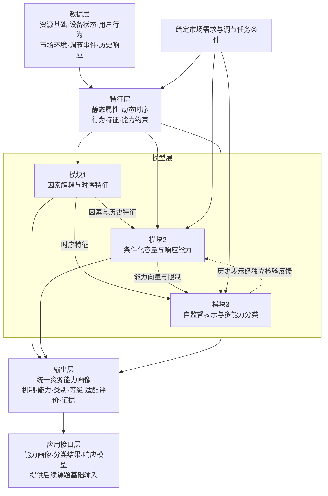

# 课题一技术路线与模型设计方案

**版本：v1｜日期：2026年10月11日**

项目：国网山东电力“基于新型电力负荷管理系统的虚拟电厂市场化运营服务支撑技术及应用”。

研究范围：课题一“虚拟电厂多元异质资源调节行为分析与智能分类方法”。

编制依据：[103任务书下达稿](D:/myDocu/project_postg/VPP_program/01_项目依据/103_山东公司_基于新型电力负荷管理系统的虚拟电厂市场化运营服务支撑技术及应用_任务书（下达稿）.pdf)及用户确认的[课题一需求分析与研究框架（现用局部修订版）](D:/myDocu/project_postg/VPP_program/01_项目依据/课题一需求分析与研究框架_整合修订版_v1_20261011.md)。

本方案将现用需求框架转化为对象定义、数据组织、模型计算、模块接口和实验设计。文中模型形式、方法分支和实验场景属于拟研究方案；参数与方法效果须通过数据和实验确定，不作为已获得结论。本文不承担课题二套餐与运营优化、课题三阻塞优化或课题四平台开发。

任务书三项研究方向保持不变：

1. 差异化市场环境下虚拟电厂多元资源行为影响因素分析与关键调节时序特征提取。
2. 融合行为经济学、绿色价值与多智能体协同的资源可调容量与响应能力分析。
3. 面向多元市场调节需求的多能力维度自监督智能分级分类。

## 第一部分 总体技术架构设计

### 1.1 架构目标与基本计算单位

建立“数据层→特征层→模型层→输出层→应用接口层”五层技术架构。三个模型模块共享对象、时间和证据口径，分别形成行为机制、条件化能力和多能力分类结果，再整合为统一资源能力画像。

基本计算单位定义为：**资源实体或控制主体×调用前信息时点×调节任务窗口×市场及运行条件**。分路、设备、住户和聚合单元分别登记层级及关联关系。模型训练样本以完整事件或完整连续窗口组织，采样行用于描述事件内部过程。

以调用前时点为信息截点，区分历史观测、当前已知条件、对未来的预测及本次执行后的结果。一次计算必须明确任务方向、基线、持续窗口、业务约束、授权条件和数据来源。

### 1.2 数据层：六类数据与关联方式

| 数据类型 | 主要内容 | 关联与处理要求 | 模型用途 |
| --- | --- | --- | --- |
| 资源基础数据 | 实体类别、容量、设备参数、控制方式、业务用途及主体关系 | 建立实体主键；参数保留单位、来源与版本；分路到设备映射不明确时不强行拆分 | 静态画像、机制选择和基础分类 |
| 设备状态数据 | 功率、电量、SOC、温度、液位、库存、工序、连接和队列等适用状态 | 带量测时间和实际可获得时间；区别观测、估计与假设 | 动态状态、容量边界和连续演化 |
| 用户行为数据 | 用能需求、邀约、参加、拒绝、授权、退出、偏好及必要问卷 | 关联用户与事件；事前激励与事后结算分开；未记录的信息保留缺失 | 参与选择、开放潜力和行为经济分析 |
| 市场环境数据 | 价格或激励、需求类型、调用条件及适用规则 | 明确公布时点、适用地区和情景；预测价格不当作事前已知实价 | 差异化市场条件和能力适配评价 |
| 调节事件数据 | 方向、目标轨迹、起止时间、指令发出及接收、允许误差和状态要求 | 建立事件主键，关联资源、用户及任务；登记未执行或退出原因 | 结果定义、响应过程和事件划分 |
| 历史响应数据 | 执行曲线、基线、实际交付、恢复及后续状态 | 保留完整前—中—后窗口；基线方法单独登记；历史与本次未来结果分开 | 时序表示、误差建模和独立验证 |

拟形成实体表、状态时序表、用户决策表、市场信号表、任务事件表和响应记录表。通过实体、用户、事件和时间主键关联，建立参数来源及质量登记。该组织方式是研究数据结构设计，不要求立即具备所有字段。

数据处理包括时间同步、量纲统一、异常量测识别、原生缺失标记、基线估计和事件切片。原始缺失、不适用、拒绝参与与真实零响应分别保留；填补仅用于有依据的处理，并保存填补标记及不确定性。

### 1.3 特征层：四类特征与可用时点

| 特征组 | 候选内容 | 提取方式 | 使用边界 |
| --- | --- | --- | --- |
| 静态属性特征 | 资源类型、额定参数、控制方式、业务机制、主体层级 | 档案核对及资源类别—机制映射 | 静态属性不能直接替代当前能力 |
| 动态时序特征 | 基线形态、变化幅度、延迟、爬坡、波动、持续、退出、恢复与反弹 | 事件阶段识别、曲线计算及候选表示学习 | 本次事后特征用于标签或分析；事前预测使用历史可得部分 |
| 行为特征 | 参与与授权历史、需求紧迫性、价格条件、风险和绿色偏好 | 决策记录、可核验问卷及条件行为分析 | 功率曲线不能自动识别未记录的拒绝、授权或偏好 |
| 能力约束特征 | SOC余量、温度缓冲、离站余量、工序许可、共享容量及恢复状态 | 物理与业务模型计算、状态估计 | 使用资源适用约束，不以统一状态指数替代所有机制 |

每个特征登记名称、含义、单位、计算窗口、输入字段、提取方法、适用资源、可获得时点及证据状态。绝对容量尺度与相对曲线形态分别保留，用于检验分类是否被规模或数据来源主导。

### 1.4 模型层：三个模块及数据流

| 模块 | 主要输入 | 核心计算 | 输出及接收模块 |
| --- | --- | --- | --- |
| 模块1：行为影响因素解耦模型 | 市场、环境、状态、用户、控制及历史时序 | 因果假设与识别、条件关联、非线性、阈值和时序提取 | 因素作用及全周期特征，提供给模块2和模块3 |
| 模块2：容量与响应能力评估模型 | 当前状态、任务、物理业务约束、行为信息和历史响应 | 条件化可行轨迹、用户开放潜力、响应不确定性及组合能力 | 能力向量、约束余量和可兑现结果，提供给模块3及画像 |
| 模块3：自监督表示学习与多能力维度分类模型 | 历史曲线、状态、基础属性及能力向量 | 候选自监督任务、表示聚类、维度等级和需求适配评价 | 能力表示、类别、等级及市场需求适配评价结果 |

模块1的物理知识和变量角色支持模块2，模块2的约束也用于检验模块1结论是否合理。模块3学习到的历史表示可作为模块2的候选输入，但须以训练内或留出方式生成，避免循环使用本次结果。

市场需求贯穿特征定义、能力计算和分类用途检验。三模块可以并行建立基线，最终路线图表示数据依赖，不要求全部严格串行完成。

### 1.5 输出层：统一资源能力画像

资源能力画像是三个模型的统一成果对象。画像以实体和计算条件为索引，保存可读结论及其证据，不压缩成未经论证的单一总分。

| 画像字段组 | 建议内容 | 表达要求 |
| --- | --- | --- |
| 对象与计算条件 | 实体、主体、聚合关系、信息截点、任务窗口、方向与市场条件 | 能追溯本次结果针对什么对象和任务 |
| 基础属性与当前状态 | 机制类型、关键设备参数、业务需求及状态 | 观测、估计、假设分别标记 |
| 行为机制与历史特征 | 关键因素、作用对象、方向、强度、阈值及历史模式 | 附适用条件和关联或因果证据标记 |
| 条件化能力 | 功率范围、电量、速度、持续、恢复和可靠性 | 标明物理、授权、预计兑现或可承诺层次；保持条件相容 |
| 轨迹与限制 | 对应候选轨迹、约束余量、限制来源和任务后状态 | 能解释能力为何受限，支持全过程复算 |
| 表示、类别与等级 | 表示模型版本、能力类型、各维度等级及类别解释 | 类别与等级分开，不将类型天然排序 |
| 市场需求适配评价 | 给定需求下的满足情况、缺口、适用类型及限制 | 不包含套餐、报价、交易策略或阻塞优化 |
| 证据与不确定性 | 来源、缺失、适用性、参数及模型版本、验证范围 | 未估计或不可计算明确表达，不自动填零 |

任务、授权或关键状态变化时重新计算相应能力；历史稳定属性可以复用。模型结果的有效期由状态变化、任务窗口和数据时效决定，后续设计时具体化。

### 1.6 应用接口层与整体流程图

研究接口包括条件化能力查询、能力画像与分类结果输出、响应模型参数及结果复算信息。课题二据此开展聚合和运营优化，课题三使用资源能力信息，课题四集成研究成果。本方案仅定义研究输出，不开发应用平台。



### 1.7 数据条件与实施准入

当前依据[公开数据目录](D:/myDocu/project_postg/VPP_program/data/public_datasets/README.md)和现用框架组织组件验证，不预设已存在同实体全链条资料。

| 候选资料 | 可以首先检验的内容 | 开始建模前必须检查 |
| --- | --- | --- |
| iFlex及瑞士住宅用能资料 | 价格条件、用户异质性和历史时序表示 | 独立事件、对照、事前信号、参与选择及设备可分辨性 |
| EPFL及德国充电实验 | 设定与功率跟随、状态条件和历史响应 | 时间同步、会话关联、状态及需求记录；缺失字段不以未来真值补足 |
| 储能、光伏及设备实测资料 | 能量状态、出力形态、预测误差及机制组件 | 是否有指令、基线、能力边界与完整恢复，参数能否迁移 |
| 山东分路档案 | 基础画像、对象关联与样本抽取 | 分路是否对应实体，容量含义及动态记录关联 |
| 评分1.4与解耦2.4模拟数据 | 已知机制、连续约束及异常压力检验 | 核对内部版本、预设规律、主实验及独立连续场景划分 |

每套来源先形成“可支持输出—必要字段—已具备证据—缺口”的准入结果。真实最大容量或用户决策证据不足时，先完成可验证组件，暂不估计缺证据结果。不同真实来源分别验证，不横向拼成同一事件。

资源类别覆盖通过机制映射逐步扩展。项目不少于16类资源的示范覆盖由课题一提供能力模型支撑，不要求16个独立算法，也不以接口数证明研究完成。

## 第二部分 模块1：行为影响因素分析与时序特征提取

### 2.1 输入变量体系

| 变量组 | 候选解释变量 | 使用时点与来源 | 主要研究对象 |
| --- | --- | --- | --- |
| 市场因素 | 价格、补偿、信号发布时间、任务方向、目标幅度、持续要求及不确定性 | 事前市场与任务记录；区分实际公布和预测 | 参与、开放潜力及实际调节 |
| 环境因素 | 气温、天气、季节、生产或使用日历 | 观测与预测分开；采用资源相关环境 | 可用状态、需求及恢复 |
| 资源状态因素 | SOC、温度、工序、库存、连接、当前功率及历史调用 | 信息截点前状态或历史 | 调节幅度、速度、持续和恢复 |
| 用户因素 | 用能需求、离站要求、授权、参加历史、风险及绿色偏好 | 事前记录或可核验调查；拒绝与退出作为实际选择记录 | 参与选择与可开放潜力 |
| 控制因素 | 控制模式、指令轨迹、发送及接收时间、通信条件、动作许可 | 明确形成时点；执行后测量不进入本次事前模型 | 跟随误差、响应速度及执行失败 |

同一变量在不同问题中可以承担不同角色。例如研究价格对最终交付的总作用时，参与和授权可能属于中间决策；研究授权后技术执行时，则是已知条件。每个子模型先确定问题，再确定是否纳入该变量。

### 2.2 被解释变量与研究问题

分别建立参与、开放、执行和恢复四类结果，避免所有机制都归结为一个完成比例。

| 结果变量 | 观测或计算定义 | 对应问题 |
| --- | --- | --- |
| 参与选择及参与概率 | 邀约后的参加、拒绝或退出；概率是模型估计 | 哪些因素改变参加决策，适用于哪个用户总体？ |
| 授权释放潜力 | 明确开放的功率、电量、时间或动作范围 | 用户在什么条件下接受并授权释放多少潜力？ |
| 响应幅度与电量 | 相对明确基线的功率变化及窗口交付 | 状态、用户与控制如何影响实际执行？ |
| 响应速度 | 指令到动作及进入目标带的时间、必要爬坡特征 | 延迟来自设备、通信还是控制？ |
| 持续时间及退出 | 满足任务条件的连续区间、退出及原因记录 | 什么条件限制持续调节？ |
| 恢复行为 | 回到约定可再调用状态的过程、回补与反弹 | 调节如何影响后续可用能力？ |

只有接受者数据时，可以研究接受者的条件响应，不能直接推断全部用户的参与概率。实际执行低于目标时，也需区分拒绝、容量受限、控制故障与外部扰动。

### 2.3 全周期时序特征提取

按资源适用过程识别调节前、响应开始、执行、退出或结束、恢复阶段。利用指令变化、状态和功率曲线联合定位阶段，单纯曲线突变不能自动等同有效调用。

计算候选特征包括基线形态、延迟、幅度、爬坡、跟踪偏差、持续区间、交付电量、状态消耗、恢复时间和回补或反弹。响应判定须给出目标带及时间分辨率；采样不足时报告区间或分辨率限制，不输出无依据秒级精度。

时序提取形成两种用途：历史特征用于调用前预测与表示学习，本次完整过程特征用于结果分析与验证。未来结果仅作为训练目标或事后分析，不进入本次事前输入。

### 2.4 方法路线与选择条件

**数据预处理→因果关系假设→结构因果模型／因果图学习→非线性关系识别→阈值与敏感性分析。**

| 环节 | 拟实施操作 | 方法选择与准入条件 |
| --- | --- | --- |
| 数据预处理 | 关联事件、同步时间、确定基线和信息截点、提取全过程特征 | 先检查对象和结果是否可观测，不以填补制造选择记录 |
| 因果关系假设 | 建立因素、共同原因、中间过程和结果的初始关系图 | 结合物理业务过程与资料，区分已知约束和待识别关系 |
| 结构因果模型及图学习 | 明确结构方程、时间顺序、可比较变化和识别对象；有条件时学习图或效应 | 干预、对照、重复观察及主要共同原因可观测性决定具体方法 |
| 非线性关系识别 | 用透明关系模型建基线，再比较候选非线性模型及资源差异 | 按独立事件数量和变量变化选择复杂度，避免仅凭采样行数增加模型容量 |
| 阈值及敏感性 | 分析有效取值范围内的响应变化、转折区间及状态交互 | 报告区间与留出稳定性，区分物理边界、业务门槛和估计转折 |

结构模型采用一般形式：

$$
X_j=f_j(\mathrm{Pa}_j,\varepsilon_j),
$$

其中，父变量集合由假设图、时间顺序和识别条件约束；未观测扰动及可能共同原因单独讨论。该表达是模型组织方式，不指定图搜索或估计算法，也不表示父节点已经得到真实因果证明。

对价格、状态等因素，明确研究其对参与、开放或最终交付的何种作用。若估计总作用，不随意控制作用路径上的参与或授权；仅在参加者中估计时标明选择范围。图学习与预测拟合不能自动完成因果识别。

识别条件不足时，输出条件关联和预测敏感性，保留标为待验证的机制假设。已知机制模拟可检验方法能否恢复假设，但真实机制结论仍取决于独立证据。

### 2.5 非线性、阈值与异质性计算

对选定因素，在有效样本范围内绘制条件响应曲线，并按主体、机制、任务和状态比较。通过重复划分或适当不确定性估计形成方向、强度和阈值区间。

敏感性对应明确结果和变化条件；多因素一起变化时，不归因于某个单独因素。价格为零或负值的情形不直接套用要求正值的比例或对数定义，具体价格响应表达在模型设计中依据变量域选择。

参数探索与阈值选取限定在训练或验证数据内，独立测试用于检验稳定性。没有足够跨状态变化时，不推断未观察区间的机制。

### 2.6 输出及模块接口

输出统一为：**因素—作用对象—作用方向—影响强度—适用条件**，并附证据类型、有效样本范围、不确定性和版本。

输出对象包括因素作用记录、关系图及识别说明、非线性曲线、阈值与敏感性记录、全周期特征表。模块2使用经核验因素及特征选择结果，模块3使用历史行为与全过程表示；未经识别的因果假设不转成固定权重。

## 第三部分 模块2：条件化容量与响应能力分析

### 3.1 条件化能力定义与统一方向

资源能力依赖状态、任务、用户授权、控制策略和外部条件。模块2以条件化可行轨迹为计算对象，再形成能力摘要。

以电网侧净注入功率统一符号：

$$
p_{i,k}=p^{\mathrm{gen}}_{i,k}-p^{\mathrm{load}}_{i,k},\qquad
u_{i,k}=p_{i,k}-p^0_{i,k}.
$$

其中，$p^0$为同时间窗及外部条件下的未调用参照。$u>0$表示增发或减载，$u<0$表示减发或增载；储能放电为正注入，充电为负注入。基线不是观测真值时，明确估计方法及误差。

对任务方向$s\in\{+1,-1\}$，以$q_{i,k}=s u_{i,k}$表示沿需求方向的交付，反向响应保留为负交付。任务窗口内电量为：

$$
E_i=\sum_{k\in\mathcal W}q_{i,k}\Delta t.
$$

功率单位为kW时，时间间隔采用小时，电量单位为kWh。任务电量与恢复回补分账；若评价含恢复的净效果，另行声明完整核算窗口，不能自动将任务电量称为净收益。

固定方向$s$的电量表达适用于单方向任务。交替上下调任务应按逐时目标与对应方向评价跟踪，并分别核算方向电量，不能用一个固定方向的净电量概括任务完成情况。

### 3.2 六维资源能力向量

$$
C_i(\mathcal I_t,\tau,a,\pi)=
\{P_{\mathrm{range}},E,S_{\mathrm{response}},T_{\mathrm{sustain}},H_{\mathrm{recovery}},R_{\mathrm{delivery}}\}.
$$

$\mathcal I_t$为调用前可得信息，$\tau$为方向、目标和窗口等任务条件，$a$为授权条件，$\pi$为控制或执行策略。该记号明确条件，不预设具体预测模型。

| 维度 | 技术含义 | 输出形式与相容性要求 |
| --- | --- | --- |
| 可调功率 | 相对基线的上下调边界 | 区分瞬时边界与给定持续窗口的可持续范围 |
| 可调电量 | 给定窗口及方向下的交付 | 对应同一候选轨迹，保留反向响应和恢复分账 |
| 响应速度 | 指令、接收、动作和达到目标带的时间及必要爬坡 | 时间与爬坡分别给单位，注明采样和目标口径 |
| 持续时间 | 给定幅度、允许偏差和状态约束下的持续能力 | 与功率、电量及任务窗口共同计算 |
| 恢复能力 | 回到约定可再调用区域所需过程 | 恢复时间、回补或反弹、下一任务状态等结构化描述 |
| 可靠性 | 给定条件与策略下，交付及必要业务约束共同满足的条件可靠性 | 有足够记录时估计与校准；不足时标记未估计 |

六个维度不能分别求最大值后拼成一次服务承诺。应保存对应轨迹、状态演化和约束条件，使各维度描述同一可实现任务。

### 3.3 轨迹可行域与能力计算流程

对资源$i$，建立：

$$
\mathcal F_i(\mathcal I_t,\tau,\omega)
=\{(u_{i,0:H},x_{i,0:H}):\text{状态、设备、业务、终端及任务约束满足}\},
$$

其中，$x$为状态，$\omega$为天气、到站或需求等情景。计算窗口覆盖任务及必要恢复或业务截止时间，不能只检查任务内某个瞬时状态。

情景中的物理可行性与实际信息下的策略能力分别计算。执行动作只能依赖该时点已获得的信息；情景树在相同已知历史下采用相同动作，或使用滚动预测与反馈策略。事前能力计算不能按每个情景的未来真值分别选择动作。完美预知求解仅作理想可行上界参照，预计兑现和可承诺输出以实际信息条件下的策略为对象。

建议采用以下计算过程：

1. 冻结事前状态、需求、授权和任务，确定基线及可用信息。
2. 按机制选择状态方程与约束，登记参数证据。
3. 构造与实际响应过渡相容的服务轨迹模板。
4. 调整幅度、持续或动作组合，检验全过程可行性。
5. 从相容轨迹提取六维能力、约束余量及恢复结果。
6. 利用独立历史执行估计误差和兑现不确定性；有证据时形成可承诺结果。

例如对给定方向和模板$\phi_k$，研究$u_k=s b\phi_k$可实现的幅度$b$，并随持续时间与状态形成能力曲线。响应过渡和允许误差须显式处理，不要求所有资源瞬时实现矩形轨迹。

可行性求解方式依连续或离散机制、模型精度和样本条件选择。搜索到可行方案只证明相应能力可实现；若没有最优性或边界依据，不把搜索结果称为最大能力。

### 3.4 储能资源

**关键状态：**电量或SOC、充放电状态及必要温度、健康和后续需求。**物理约束：**功率、能量、效率、互斥、爬坡、终端状态与恢复。

最小能量收支模型为：

$$
e_{k+1}=e_k+\eta_c P^c_k\Delta t-\frac{P^d_k}{\eta_d}\Delta t,\qquad
p_k=P^d_k-P^c_k,
$$

$$
e_{\min}\le e_k\le e_{\max},\quad
0\le P^c_k\le z_k\overline P^c_k,\quad
0\le P^d_k\le(1-z_k)\overline P^d_k,\quad z_k\in\{0,1\}.
$$

$e$为电量，SOC按额定能量换算；效率与功率限值可随适用状态变化，未识别时注明参数假设。还需检查终端状态及后续调用，恢复充电与当期放电不重复承诺。

在零基线、恒功率且无其他约束的简化情形，可用能量给出持续时间$T$下的参考边界：

$$
P_{\mathrm{dis}}(T)\le\min\{\overline P^d,\eta_d(e_t-e_{\min})/T\},
$$

$$
P_{\mathrm{ch}}(T)\le\min\{\overline P^c,(e_{\max}-e_t)/(\eta_c T)\}.
$$

一般条件下直接对基线和实际轨迹计算。停止原计划充电也可能提供向上调节，不能只把放电功率当作上调能力。

### 3.5 可控负荷

按热惯性、泵与流程、生产批次或服务机制建立状态模型，不以一个连续缩放系数覆盖全部负荷。

| 机制 | 关键状态 | 主要约束 | 能力计算方式 |
| --- | --- | --- | --- |
| 热惯性负荷 | 温度、热缓冲、环境与用能需求 | 舒适或工艺边界、功率、启停及恢复 | 状态递推下搜索可调轨迹，检查任务与恢复阶段温度及反弹 |
| 泵与流程负荷 | 液位、流量需求、设备及运行许可 | 收支、液位、连续或离散控制、最短启停 | 通过功率到流量的有依据映射及液位递推计算持续范围 |
| 批次生产负荷 | 库存、工序、质量与批次状态 | 生产需求、工序先后、许可动作、整数启停和切换 | 枚举或求解允许动作，递推库存与生产状态，检验质量及截止要求 |
| 服务负荷 | 队列、任务量及服务期限 | 服务截止、迁移或延迟许可、功率条件 | 计算可延迟任务和状态变化，在期限约束下评价移时能力 |

状态演化采用$x_{k+1}=f(x_k,P_k,v_k)$等机制表达，$v$为环境或业务输入。热、流量、产量或队列映射须由资料、识别或明确假设支持。制热和制冷的功率作用方向分别定义。

负荷能力相对未调用需求计算。任务后回补、温度恢复或积压任务可能占用后续容量，应共同检验；未观测恢复时不直接宣称全过程可持续。

### 3.6 充电资源

**关键状态：**逐车连接、SOC或电量、接受功率、事前离站与需求、用户授权及站级共享容量。**约束：**连接窗口、车桩兼容、功率及必要启停、离站需求、共享容量和V2G许可。

对车辆$j$，在允许单向充电时递推电量，并满足：

$$
0\le P^c_{j,k}\le a_{j,k}\overline P^c_{j,k},\qquad
e_{j,d_j}\ge e^{\mathrm{req}}_j,\qquad
\sum_jP^c_{j,k}\le\overline P^{\mathrm{station}}_k.
$$

$a_{j,k}$为连接条件，$d_j$为离站时刻；模型延伸至相关需求截止，即使调节任务提前结束。最低功率或最短启停仅在确有设备、业务依据时使用。V2G只有具备设备能力及授权时加入放电动作。

计算同一需求条件下基线与候选轨迹之差，形成可减载、增载、移时和恢复范围。车辆需求与离站信息必须使用当时可得记录；未知未来信息用明确情景或受限估计处理，不读取事后真值。缺少需求时，可以检验技术响应，但不能完整证明移时容量。

### 3.7 新能源资源

**关键状态：**可用出力、当前出力、预测及不确定性、限发和控制状态。**约束：**实际可用出力、设备功率与控制边界、必要爬坡及任务窗口。

以光伏为例：

$$
0\le P^{\mathrm{PV}}_k\le\min\{P^{\mathrm{avail}}_k(\omega),P^{\mathrm{inv}}_{\max}\}.
$$

基线为$P^0_k$时，上调受可用出力相对基线的实际预留限制，下调受当前可减出力及控制能力限制。额定功率减当前出力不等于可上调功率；跟踪最大可用出力且无预留时，通常没有自身上调余量。

通过预测情景和控制边界生成可行出力轨迹，再计算方向、电量、持续及可靠性。风电等资源按对应出力与控制机制适配。配套储能作为独立状态及设备能力进入组合，不能计成光伏自身上调潜力。

绿色供给能力和用户绿色偏好分别表达。绿色消费适配还需要时间匹配及可核验属性；不从设备名称直接推导绿色价值，不扩展碳管理服务。

### 3.8 行为经济学、绿色价值与能力融合

用户行为模型研究可行方案中的参加、拒绝、开放范围和退出。保留前景理论与离散选择方向：以收益参考点、收益或损失、风险、用能不便和绿色取向构造候选决策表达，根据真实选择与数据条件确定具体形式。

建议把满足基本需求的候选调节方案及不参加选项组织为选择集合。参数估计需要事前方案、激励、选择和必要偏好记录；数据不足时仅开展明确参数范围的假设敏感性分析，不声称识别了真实风险或绿色偏好。

可先以普通效用与离散选择建立行为基线，再检验参考点、损失敏感性、风险权重和绿色项的增量。一个可比较的前景价值候选形式为：

$$
v(\Delta B)=
\begin{cases}
(\Delta B)^{\alpha},&\Delta B\ge0,\\
-\lambda(-\Delta B)^{\beta},&\Delta B<0,
\end{cases}
$$

$$
V_a=\sum_m w_{a,m}\,v(B_{a,m}-B_{\mathrm{ref}})-D_a+\gamma G_a,
\qquad
\Pr(A=a\mid X)=\frac{\exp(V_a)}{\sum_{b\in\mathcal A(X)}\exp(V_b)}.
$$

$B_{a,m}$为方案$a$在风险结果$m$下的净收益，$B_{\mathrm{ref}}$为参考点，$D_a$为尚未计入净收益的用能不便等代价，$G_a$为有证据的绿色属性，$\gamma$表示用户绿色偏好的候选参数。各项须使用一致的效用尺度；已在收益中扣除的费用或损失不再通过$D_a$重复计入。

该候选形式约束$\alpha>0$、$\beta>0$、$\lambda>0$，具体数值及是否采用更严格形状约束依识别条件和模型比较确定，不直接赋予用户统一偏好参数。

$w_{a,m}$由明确的风险概率与前景加权规则形成，不能作为任意人工权重；概率、参考点和偏好参数分别说明观测、估计或假设来源。上述价值函数、概率连接形式及参数均为候选，不限定最终算法；是否能够识别及是否优于普通效用基线由数据与实验决定。

绿色项分别记录用户取向和方案实际绿色属性。时段移时是否具有绿色效果需核验相关条件，不能默认移时就降低碳排放。

模块2形成三层结果：

1. **物理及业务可行能力：**设备和必要用能需求下的可行轨迹。
2. **授权可接受能力：**在上述轨迹中加入明确授权范围及用户接受条件。
3. **预计兑现与可承诺能力：**结合选择、执行、控制和外部不确定性，估计交付及必要约束的联合满足情况。

已知硬授权作为约束，未来是否参加作为选择结果，两者分别处理。参与概率乘物理容量可以作简化期望量基线，但不能直接解释成可承诺功率或概率保证。

可靠性估计对应给定任务与策略，需用独立执行记录检验与校准；场景要求的风险条件另行定义，不用90%模型精度替代交付可靠性要求。模块1的因素和模块3的历史表示作为候选输入，通过比较检验是否改善能力估计。

### 3.9 源荷储组合资源

组合能力以各单体授权可行轨迹、共享设施和跨时段状态共同形成。单体与组合采用一致电网侧计量边界，组合基线与单体基线汇总保持一致；共用设备只计一次，必要共用负荷或损耗单独纳入。令组合交付为$u_G=\sum_i u_i$，则：

$$
\mathcal F_G=\{u_G:\ \exists (u_i,x_i)\in\mathcal F_i^{\mathrm{auth}}\ \text{对各资源}i,
\ u_G=\sum_i u_i,\ \text{共享容量、业务及跨时段约束满足}\}.
$$

源、荷、储之间的互补可能延长可调窗口或改善恢复；共享充电容量、同一能量和同时恢复也可能限制组合。需用同一任务模板和信息条件检验，不直接加总单体最大值。

计算组合轨迹、功率—持续时间边界、约束余量和任务后状态。具体主体交互与协调过程见第四部分；计算用于分析组合调节潜力，不生成套餐、报价或交易策略。

## 第四部分 多智能体协同模型设计

### 4.1 协同模型的研究对象

基于多智能体协同框架描述资源、用户和聚合主体的状态交互、约束关系和能力协同机制。研究重点是互补、竞争、共享容量和连续调用状态变化。

主体类型依据实际控制和决策关系配置。设备可以由自动策略控制，用户也可以只提供固定授权；不要求每个场景都有可学习的独立用户决策过程。

### 4.2 三类Agent定义

| 主体 | 状态与可用信息 | 动作 | 约束及研究目标 |
| --- | --- | --- | --- |
| 资源Agent | 设备运行、容量、状态余量、当前业务和历史执行 | 提供条件化可行信息；执行功率调整并更新状态 | 设备安全、业务边界、启停和恢复要求；如实表达可提供能力 |
| 用户Agent | 需求、偏好、收益参考点、风险、绿色取向及授权 | 参与、拒绝、调整授权、选择可接受方案及允许退出 | 基本用能需求与授权不被突破；描述可接受释放潜力 |
| 聚合Agent | 各资源能力、整体状态、市场任务和共享容量 | 形成资源组合、请求方案、协调功率并依据反馈调整 | 保持联合约束可行，分析任务交付及组合潜力，不开展运营交易优化 |

Agent状态区分真实可见、估计与未知；动作必须映射到可执行控制或授权变化。模型目标通过硬约束和清楚的能力评价表达，不预先设置无依据加权总分。

### 4.3 状态交互及协同过程

建议先构建可解释协同原型：

1. **本地能力计算：**资源Agent根据本地状态及需求给出可行轨迹或能力边界。
2. **授权与选择：**用户Agent明确接受范围；缺少动态选择资料时使用已记录授权或明确假设情景。
3. **组合协调：**聚合Agent结合任务和共享约束，寻找联合可行组合。
4. **执行与反馈：**资源返回实际动作、偏差及新状态，用户条件变化同步更新。
5. **连续校核：**更新下一调用和恢复阶段能力，检查重复承诺及剩余业务需求。

候选实现包括有限可行方案协商、集中式可行计算及分解协调等，依据问题结构和信息条件比较。不预先承诺强化学习或其他单一算法；主体名称本身不证明协同机制有效。

### 4.4 四类协同机制

| 机制 | 代表场景 | 技术分析方式 | 应输出的认识 |
| --- | --- | --- | --- |
| 互补关系 | 波动出力与储能、快响应与长持续资源衔接 | 同一任务下对照单体、组合及不同交互条件 | 哪些状态和窗口产生互补，增益来自什么约束变化 |
| 竞争关系 | 同时用能、恢复或争用同一缓冲 | 固定组合规模，比较任务、需求及恢复冲突 | 哪些资源或阶段互相限制，损失发生在哪里 |
| 共享容量 | 站级功率、共用设备或业务额度 | 显式加入共享容量及占用记录 | 联合可行边界、剩余容量和重复承诺情况 |
| 连续调用 | 首次调节后SOC、温度、库存或队列变化 | 递推完整状态，纳入恢复和后续任务 | 下一调用能力、累计状态消耗及可恢复条件 |

本地设施的已知共享功率约束用于组合能力研究，不扩展为配网拓扑或阻塞优化。源荷储组合的共同天气、需求或通信扰动需要联合情景，不能无依据假定各资源失效完全独立。

### 4.5 组合潜力计算与输出

固定任务轨迹形状、窗口和业务条件，搜索联合可行幅度或可承接范围；对不同状态形成能力边界。先满足设备、用户和共享硬约束，再比较交付、恢复及业务影响。

输出包括组合可行轨迹、六维能力摘要、功率—持续时间曲线、互补与竞争来源、共享约束余量、任务后状态和恢复需求。采用近似协调时报告可行性和边界证据，不声称必然得到全局最大潜力。

协同方法与相同约束、信息及组合规模下的集中式基线比较。若二者数学等价，不宣称协同必然更优；协调价值可以来自信息表达、约束分解或状态反馈，但同样需要实验支持。

## 第五部分 模块3：自监督表示学习驱动的多能力维度分类

### 5.1 自监督研究目的

面向能力标签不足、异质状态难以统一表达及行为模式尚不清楚的条件，研究从历史时序自身结构学习能力表示。目标是形成可解释、可迁移的能力组合，而非仅降低重建或预测损失。

保留基础特征与聚类作为透明对照。若学习表示只反映设备规模、采样频率或数据来源，则尚未证明其具有能力分类价值。

### 5.2 输入组织及表示空间

输入包括历史功率或调节曲线、状态变量、基础属性和条件化能力向量，同时保留采样间隔、任务条件、基线、数据质量和缺失掩码。以完整实体事件划分后再切片，避免重叠片段跨训练和测试。

不同资源采用适用状态通道及机制标记，统一能力维度的含义和单位。不适用状态不填成观测零。对尺度处理比较绝对能力与相对形态两种信息，避免一律归一化消除真实规模差异。

候选表示为：

$$
z_i=f_{\theta}(X_i^{\mathrm{history}},S_i,M_i,C_i,\tau_i),
$$

其中，$X$为历史曲线，$S$为状态，$M$为适用与缺失信息，$C$为能力特征，$\tau$为计算条件。编码方式、表示维度和训练目标按数据比较确定。

对调用前分类，只输入当时已有历史和能力估计；若研究事后完整行为分类，单独标明用途。由模块2生成的能力输入须由未使用该测试结果的模型产生，不以本次真实标签提前构建表示。

### 5.3 候选自监督任务

| 候选任务 | 输入与学习目标 | 能力含义 | 必须控制的问题 |
| --- | --- | --- | --- |
| 时序预测 | 历史前缀预测后续可观测状态或响应 | 检验状态变化和动态模式能否表达 | 未来仅作目标；预测条件只能使用当时可得信息 |
| 片段重构 | 对实际观测片段人工遮蔽后重建 | 检验局部模式与全过程联系 | 原生缺失与训练遮蔽分开；不以无真值填补作正确目标 |
| 表征一致性学习 | 同一事件的有依据观察视图形成一致表示 | 检验表示对允许量测扰动的稳健性 | 视图保留方向、速度、持续及能量含义，不能任意改变物理过程 |

候选任务可以单独或组合比较；组合权重在训练与验证内确定，不预设全部任务必然有效。有限量测噪声或遮蔽可按观测条件论证，任意时间伸缩、倒序、功率符号翻转或跨事件拼接可能改变能力，不能直接作为安全增广。

同一设备标签不自动意味着相同能力；跨来源样本也不能仅凭类型相同组成一致性正样本。所选自监督目标与能力研究之间须有解释和独立检验。

### 5.4 基础聚类与表示聚类

建立两条可公平比较的分类路径：

1. 基础属性、可解释时序和能力特征→尺度与适用性处理→基础聚类。
2. 同等可用输入→自监督训练→表示向量→表示聚类。

聚类方法和类数由样本结构、稳定性及解释力选择，不提前固定。条件差异较大时，检验按机制、任务或工况组织的必要性，避免把不相容任务下的能力直接聚成高低类别。

利用留出样本描述类别的速度、持续、移时、恢复和可靠性组合，允许类型重叠。快速、长持续或恢复受限等类型不天然构成顺序等级。

### 5.5 能力等级划分

等级围绕明确能力维度或用途定义，依据能力测定、需求条件及训练内分析形成候选界限。功率规模、速度、持续和可靠性可以分别表达；不未经论证合成统一总等级。

等级界限、类别命名和中心在训练或验证阶段确定，独立样本用于校核。缺少外部标签不阻止自监督训练，但最终能力等级仍须有可解释参照。

### 5.6 面向市场需求的资源能力适配评价

将资源能力向量、类别与等级和给定市场任务对照，评价可满足部分、缺口、限制、恢复条件和证据状态。评价以任务轨迹或明确要求为输入，类别可以帮助筛选和解释，不能替代全过程能力校核。

现货、调频、备用、爬坡、绿电供给及消费等作为既定用途参考。PPT结构用于组织价格行为、移时、速度和成本等研究；实际参数及资格条件另行核验，不复刻人工1—5级或综合分。

不以同一评分生成分类标签后再验证该分类。价格、成本或绿色行为证据缺失时，输出已支持的能力适配及缺口，不推断真实收益。课题一提供能力基础，课题二负责套餐、申报和交易运营优化。

### 5.7 输出及与模块2的反馈

形成能力表示、资源能力类别、维度等级、适配市场需求类型与市场需求适配评价结果，附类别解释、条件、缺口及验证范围。

分类结果进入统一画像。若历史表示用于模块2能力预测，采用训练内生成或交叉留出设计，冻结后在独立数据评价；不将测试时序用于无标签预训练后继续声称完全未见验证。

## 第六部分 实验验证方案设计

### 6.1 实验体系与共同规则

建立因素分析、单体容量响应、自监督分类、组合协同四类实验，分别检验三个正式研究任务及协同能力环节。

真实或公开数据检验可观测组件，模拟数据检验已知机制与压力条件，二者分别报告。现用模拟入口为[评分内部1.4](D:/myDocu/project_postg/VPP_program/data/资源市场适配评分模拟数据集_v1/README.md)及[解耦内部2.4](D:/myDocu/project_postg/VPP_program/data/驱动因素解耦模拟数据集_v2/README.md)，使用前再次核验版本；主实验与独立四天连续场景分别评价。

统一执行以下规则：

- 先按完整实体、事件和时间区分训练、验证及独立测试，再切片；重叠片段留在同一分区。
- 缺失处理、基线、尺度变换、表示预训练、聚类中心、等级和阈值选择不使用独立测试结果调整。
- 不同方法使用相同信息截点、任务、样本及比较条件；已有被反复用于诊断的数据不称为全新盲测。
- 报告覆盖率、不可计算、不适用、受限、失败和反向响应；真实负响应不因不符合预期而删除。
- 因果、预测、物理约束、分类及市场适配分别评价，不平均成全课题精度。

**保留正式要求“模型精度不低于90%”。具体精度评价指标、评价对象和计算方式将在后续模型设计和验证方案阶段进一步明确。** 下述为研究评价维度，不预先绑定90%为预测误差、分类准确率、交付概率或任何单一指标。各实验后续根据模型类型、参照及数据条件确定具体评价指标。

### 6.2 实验1：行为因素分析验证

**实验目标：**检验因素作用对象、方向、非线性和阈值能否稳定识别，区分关联、因果及预测证据。

**输入数据：**具有事前信号、状态和结果关联的真实或公开事件；已知作用和零作用机制的解耦模拟。参与选择无完整记录时，仅评价相应可观测响应，不补造拒绝或绿色偏好。

**Baseline：**简单关系模型；加入状态和资源差异的透明模型。候选解耦模型与它们使用相同变量、事件和划分比较。

**实验操作：**按结果分别建模；核对因果准入；检验主要因素变化和状态交互；加入零作用、观察混杂、量测误差和缺失压力情景；比较跨实体及时间的稳定性。

设置时序特征提取子实验，参照同步指令、执行曲线及必要人工确认，核验阶段边界、延迟、持续和恢复特征；改变采样分辨率检查提取敏感性，区分量测限制与方法偏差。

**评价维度：**作用方向与强度恢复、零作用误报、非线性和阈值稳定性、条件响应解释及留出表现。模拟已知效应与真实识别证据分别评价；预测表现不代替因果质量。

**预期形成的结果：**因素作用表、有效范围、阈值区间、识别条件和失败案例，判断哪些因素适合进入能力模型。预期产物是可检验结果，不预设候选方法必然优于基线。

### 6.3 实验2：容量与响应预测验证

**实验目标：**检验条件化模型相较固定容量是否更准确表达状态、任务和授权变化，评价单体可兑现能力及响应过程。

**输入数据：**有状态、指令和执行记录的设备资料；有条件时增加独立能力测试和真实用户选择。不同来源物理、行为组件各自检验，不合成为同一真实事件。模拟用于已知约束和连续状态压力测试。

**Baseline：**档案或额定容量；状态物理模型；加入历史时序的模型；具备真实选择数据后再比较行为融合模型。各基线输出限于其能够合法计算的对象。

**实验操作：**固定任务模板，改变SOC、温度、需求期限、生产状态、幅度、持续及恢复条件；比较物理、授权和兑现层次；检验未来输入泄漏与六维相容性；必要时进行因素和表示消融。

分别记录理想可行上界和实际信息下的策略可兑现能力；未知未来条件采用预测、情景及反馈处理，可靠性检验针对实际可用信息和策略。行为子实验具备选择记录时，比较普通效用基线与加入前景、风险及绿色项的候选模型。

**评价维度：**容量估计偏差与高估、响应轨迹和速度、持续及恢复表现、约束违反、区间与可靠性校准、不同状态下泛化。具体量化指标依据最终输出类型及参照确定。

**参照要求：**最大容量用独立边界测试、受控调用或可信测定；未触边界的执行量只证明本次交付，不能直接当容量上限。缺容量参照时先验证响应组件。

**预期形成的结果：**各机制能力曲线、状态边界、响应误差、参数适用范围及可承诺条件；据比较决定行为因素或历史表示是否有增量价值，不提前承诺达到90%。

### 6.4 实验3：自监督分类验证

**实验目标：**检验学习表示能否比基础特征揭示更有解释力、可迁移的能力组合，分别验证类别、等级和适配用途。

**输入数据：**完整历史曲线、状态、适用掩码、基础特征和能力向量；留出实体的独立能力测定或实际响应用于外部校核。

**Baseline：**基础属性分类；可解释时序与能力特征加基础聚类；自监督表示加可比聚类。控制样本、可用信息和调参条件，不以PPT人工分值作真值。

**实验操作：**比较三种候选自监督任务及必要组合；检验绝对尺度和相对形态；按实体、时间、机制或来源留出；消融状态、能力和历史通道；用独立任务校核能力等级和适配结果。

**评价维度：**表示对相关动态信息的保持、类别稳定及外部能力差异、等级解释、跨条件迁移和适配用途。内部聚类区分度和重建表现仅作辅助，不独立证明分类业务有效。

**预期形成的结果：**类别能力特征、等级依据、迁移边界，以及学习表示相较基础特征的贡献或无效情形。若类别主要由来源或容量规模驱动，明确记录并调整，不预设必然形成固定类数。

### 6.5 实验4：组合协同能力验证

**实验目标：**检验共享约束、用户授权、互补和连续状态如何改变组合调节潜力，以及协同原型能否表达这些机制。

**输入数据：**优先选择两至三种代表机制和明确任务。真实同站组合需有共同时间轴及共享约束记录；不具备时采用独立标记的假设组合和现用连续模拟，不称真实源荷储实验。

**Baseline：**单体最大值直接相加作为失配诊断基线；同等信息与约束下的集中式可行计算作为公平基线；拟多主体协同原型。前者的不可行结果不当作合理服务承诺。

**实验操作：**固定资源组合与任务，逐步加入共享容量、授权、恢复竞争、连续任务和共同扰动；通过移除相应机制的消融识别变化来源；检验同一能量或缓冲是否被重复使用。

集中式与协同基线采用相同信息条件和反馈机会；完美预知组合结果单列为上界参照，不与实际策略结果混作方法增益。共同计量边界及组合基线一致性另行核验。

**评价维度：**组合交付、任务跟踪、联合约束违反、重复承诺、业务缺口、恢复反弹及连续可承接量；计算与通信代价仅作辅助。互补比较保持规模、信息、窗口和需求相同。

**预期形成的结果：**联合可行轨迹、组合能力边界、互补与竞争解释、共享约束瓶颈及下一调用状态。协同效果、最优性及迁移性能均以实验结果为准。

### 6.6 实验结果及方法选择

每项实验保存数据版本、划分、模型与参数版本、对照条件、评价对象、结果和失败解释。主实验、连续实验、公开组件和真实项目结果分别组织。

方法进入下一阶段的依据是与正式问题对应、输入合法、约束合理、结果可复算及相对基线的价值。复杂方法若未带来稳定增益或新的解释，可以替换；不同机制允许使用不同实现，共享统一输出和证据口径。

## 第七部分 最终技术路线及实施衔接

### 7.1 三项任务的接口关系

| 数据流 | 传递内容 | 防止误用的约束 |
| --- | --- | --- |
| 数据与特征层→模块1 | 事前因素、结果记录及完整历史事件 | 因素时点、对象和识别条件清楚 |
| 模块1→模块2 | 经核验因素、历史时序、阈值及适用范围 | 不将待识别关系变成人工权重或硬阈值 |
| 模块1→模块3 | 历史模式、时序特征及资源机制条件 | 与事前或事后分类用途一致 |
| 模块2→模块3 | 条件化能力、轨迹特征、限制及可靠性证据 | 能力向量来自合法信息，条件相容 |
| 模块3→模块2 | 经检验的历史表示 | 训练内或留出生成，避免循环标签泄漏 |
| 三模块→画像及接口 | 因素机制、能力、类别、等级和适配评价 | 保留条件、单位、来源和模型版本 |

### 7.2 可实施的工作衔接

首先冻结共同对象、字段、单位、信息截点、任务模板及验证分区；检查现有公开与模拟资料可支持的具体输出。随后建立一个行为时序样板和一个设备能力样板，形成特征计算及透明基线，再并行深化三个模块。

| 工作单元 | 具体实施内容 | 完成产物 |
| --- | --- | --- |
| 共同数据与任务规范 | 主键、时间、方向、基线、字段可用性、任务及划分 | 可检查的数据入口、特征定义与样本清单 |
| 模块1原型 | 时序提取、初始关系图、简单关系及条件阈值 | 因素作用表、特征结果、识别或关联边界 |
| 模块2原型 | 代表机制状态与约束、任务模板、轨迹及能力提取 | 条件能力曲线、六维摘要、限制与恢复记录 |
| 多智能体原型 | 本地能力、授权、共享条件及反馈更新 | 组合轨迹、潜力边界与交互解释 |
| 模块3原型 | 基础聚类与候选表示任务、等级及独立适配校核 | 表示、能力类型、维度等级和用途评价 |
| 独立实验与综合输出 | 四类实验、机制覆盖、失败及复现检查 | 比较结果、统一画像和可调用研究模型 |

数据准入决定具体方法和研究范围。取得新来源或参数后先核对适用条件，再扩展机制；不因接口已存在而跳过特性和能力验证。此顺序描述工作依赖，不规定时间表，也不要求所有模型都先完成才能开展下一模块。

### 7.3 预期研究贡献及其检验路径

| 待检验研究贡献 | 来自的问题定义或模型融合 | 必须提供的证据 |
| --- | --- | --- |
| 区分参与、开放、执行与恢复的行为机制 | 避免用单一完成比例混合用户与设备过程 | 分结果的因素识别及独立对照，说明是否减少机制误判 |
| 条件化轨迹与六维相容能力表示 | 将状态、业务、授权及响应不确定性共同纳入能力 | 与固定容量和简单比例比较，检验高估、约束与恢复 |
| 行为经济与绿色因素的有条件融合 | 将选择和授权与物理能力分开再衔接 | 数据准入、参数识别或假设边界，以及真实选择或独立组件检验 |
| 自监督表示与可解释能力分类融合 | 使不足标签下的表示服务能力组合和市场需求用途 | 基础特征对照、外部能力验证、迁移及来源混杂消融 |
| 多主体共享与连续状态下的组合潜力 | 用交互和约束解释组合为何有增益或受限 | 同规模同信息比较、机制消融与连续状态验证 |

这些是拟验证的研究贡献，不是已确认新颖性或性能优势。创新需由问题、模型关系和证据共同支持，不能由算法名称数量或技术组合形式推导。

### 7.4 最终文字版技术路线图

```text
输入数据
资源基础＋设备状态＋用户行为＋市场环境＋调节事件＋历史响应
        ↓
共同数据与特征基础
实体关联／时间同步／基线／信息截点／机制及特征定义
        ↓
资源行为理解【任务一】
影响因素解耦＋全周期时序特征＋非线性／阈值／敏感性
        ├──────────────────────┐
        ↓                      │ 历史时序与机制条件
能力建模【任务二】             │
物理与业务可行轨迹             │
＋用户可接受并授权释放的潜力   │
＋响应不确定性                 │
＋多智能体交互和组合潜力       │
        ↓                      │
条件化能力向量与约束说明       │
        └──────────┬───────────┘
                   ↓
表示学习【任务三】
历史曲线＋状态＋能力向量
→候选自监督任务→多能力表示
                   ↓
自监督表示学习驱动的多能力维度分类【任务三】
基础聚类对照→能力类别→维度等级
                   ↓
面向市场需求的资源能力适配评价【任务三】
给定市场任务→能力校核→适配类型／缺口／限制
                   ↓
统一资源能力画像与研究接口
机制＋能力＋类别＋等级＋适配评价＋证据
→为后续课题提供基础输入

贯穿条件：市场需求、运行约束、信息可用时点和证据范围。
共同验证：因素分析／容量响应／自监督分类／组合协同四类实验。
反馈关系：能力约束校核因素；历史表示经独立检验反馈能力模型；
          适配与实验结果反馈特征和分类设计。
边界：不开展套餐优化、市场申报、交易策略、阻塞优化或平台开发。
```
