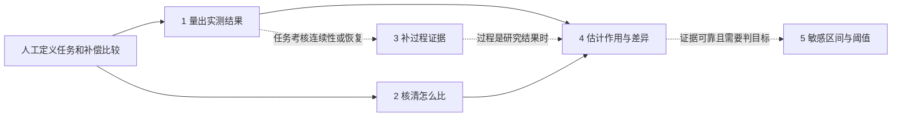

# 课题一研究点一：最终研究框架

2026-11-04｜当前研究组织与验收依据

**总目标：从真实响应记录中量清调节全过程，分清市场、需求、设备和环境因素怎样影响响应，找出响应随时间和条件变化的规律，以及敏感区间和关键阈值。**

本框架替代此前四点、六点及2026-10-30规划中的后续组织顺序，统一使用下文五点。历史实验的编号、模型、分数和采用决定保持原记录；重新编排不代表新增研究已完成。先把充电资源研究做实，再用不同机制资源和市场条件检验适用性，算法研究和程序接口优先。

## 1. 对任务书的逐项对应

依据为[103任务书下达稿](../01_项目依据/103_山东公司_基于新型电力负荷管理系统的虚拟电厂市场化运营服务支撑技术及应用_任务书（下达稿）.pdf)，下表均用PDF文件页码。

| 正式要求与出处 | 本框架承担位置 | 验收时必须看见的内容 |
| --- | --- | --- |
| 第5页1.1（1）：行为影响因素分析、关键调节时序特征提取 | 第1—4点 | 既能描述实际响应，也能解释影响来源与时间规律 |
| 第12页：涵盖市场信号、环境参数与物理属性的多维行为特征库 | 各点共同输入，第2点界定角色 | 字段含义、可用时点、与研究结果的关系；字段数量不作研究成绩 |
| 第12页：结构因果模型与因果图学习的驱动因素解耦 | 第2点，第4点定量检验 | 关系假设、数据检验、作用对象和证据；包括有依据的未定关系 |
| 第12页：关键调节时序演化、全周期特征演化规律 | 第1、3点 | 从起变、执行、退出到恢复的适用阶段，以及它们的时间结构 |
| 第6页：基于时序表征学习的资源行为建模 | 第3点明确承担B1用途 | 学到的时间特征对过程描述或因素分析有什么用，与简单特征比较 |
| 第12页：非线性、关键响应阈值区间、敏感性 | 第4、5点 | 曲线、条件差异、敏感区间、不同含义的阈值及可靠程度 |
| 第5页：多元资源、差异化市场环境 | 五点共同验收 | 不同调节机制与市场任务条件下的代表性证据和适用范围 |

第6页时序表征学习是课题一整体目标，本框架明确承担与研究点一相关的部分；任务书没有指定必须新增某种深度网络，也没有直接列出本框架的五个标题。

补偿曲线、上层可调功率资源模型和成熟方法对照来自[10月29日会议纪要](../task/2026-10-29-课题一算法研究交流会议纪要.md)。用户随后明确要求连续金额直接估计；这是需遵守的研究要求。30分钟任务、累计响应秒数、具体算法和单轮改善门槛是研究设定，不能写成任务书原文。

课题一“模型精度不小于90%”针对指定的可调容量与响应能力特征模型，不要求本框架五点统一用准确率评分。其评价对象、误差容限和分母仍须落实，当前未证明通过。第8页16类资源、4类市场场景、50次测试属于课题四示范指标，B1应支撑项目覆盖，不机械变成16套B1模型。

## 2. 五个分点的交付物、使用时机和实测证据

人先定任务时段、目标、补偿规则和优先检查的条件。车辆的需求、离站余量和事前功率取自可核实的记录。首个充电桩演示由第1点量出实际结果，第2点核清怎么比，第4点算出补偿提高后多调多少。任务考核连续性或恢复时才接第3点，给定达标目标且比较结果可靠时再用第5点。

| 分点 | 交付什么 | 什么时候用 | 已有实测证据和缺口 |
| --- | --- | --- | --- |
| **1. 全过程响应特征提取** | 每笔任务的实测响应表，包括时刻、功率、时长及可计算的电量，标出缺测和缺参照的字段 | 有指令和功率记录，需要量清一次任务的实际结果时 | 真实充电记录已核过可见变化和恢复。要量出相对原本充电的有效减载时长和净减载电量，仍需可靠参照。[第一部分验收](../work/b1_first_block_close_20261103/README.md) |
| **2. 驱动因素与作用关系** | 书面比较依据，包括补偿怎么分、哪些事前条件要对齐、哪些对象可比、哪些影响尚不能分清 | 研究某个条件是否影响响应时。可信随机分配可按原分组比，按条件发放则先核条件与可比范围 | 已观察到后台限额与桩端记录存在错开，桩端限额和实测电流的关系随事前状态而异。充电补偿对参与和响应的作用仍缺配套记录。[实测证据](../work/b1_factor_round3_observed_20261104/ROOT_REVIEW.md) |
| **3. 时序特征学习与演化规律** | 可回查的连续性、中断和回升过程描述。有足够可比样本时，再交跨任务的规律及其验证 | 任务考核连续运行、中断或解除后的恢复时。首个演示只比较总调节量和累计时长时，不需要接过程形态分析 | 三例充电曲线已验收，实测见到回限后分步上升、限额未变时功率归零及短窗不可判。热泵也有回升形态不同的实测例子。跨任务规律和学习方法的增益待验证。[充电案例](../work/b1_temporal_ev_demo_20261104/ROOT_REVIEW.md) · [热泵案例](../work/b1_temporal_t1_comparability_20261104/ROOT_REVIEW.md) |
| **4. 非线性作用与条件差异** | 补偿提高后平均多调多少、多维持多久，并交代误差范围、适用报价和人群。条件足够时再给不同人群的差异 | 有第1点的实测结果和第2点的比较依据，需要量出差多少时 | 已有充电连续补偿模拟曲线，分组结果仍不稳。公开 ACN 缺配对的事前补偿。居民 iFlex 用电预测是辅助证据，充电补偿的真实增量仍待验证。[既有对照](../work/b1_curve_stability_20261103/README.md) · [数据缺口](../work/b1_rp1_stage3_close_stage4_plan_20261104/README.md) |
| **5. 敏感区间与关键响应阈值** | 哪段补偿加一点最有效、哪里趋缓，以及达到事先设定的目标需要什么条件，附不确定范围 | 已有可信的作用结果，需要找敏感区间或判断一个明确目标能否达到时 | 已有计算原型和小规模模拟检查。模拟中仍有把未达标判成达标的情况，真实充电阈值待验证。[模拟复核](../work/b1_research_point1_20261103/research_completion_reassessment.json) |

第1点负责量准单次记录，连续时长或恢复时刻等单次指标可以直接交付。第3点进一步判断多次记录里哪些过程反复出现、在哪些条件下出现，或哪些形态会让同样的累计时长产生不同结果。若研究补偿是否改变恢复过程，恢复曲线是第4点要解释的结果。作为事前比较条件的历史必须在本次报价前已可取得。

第2点按业务和物理依据先定候选因素，再核对它们与报价分配、参与、执行和恢复分别有什么关系。若高补偿主要给了快离站的车，先检查两个报价组在相近离站余量下能否比较。图学习作为结构证据的一部分，交付时注明哪些关系有记录支撑、哪些仍是假设。

**第4点保留补偿重点，并覆盖选定的重要条件。** 连续报价数据用连续估计，不先切档再拼曲线；离散设计先按实际报价比较，未观测的中间金额依赖额外假设，不能称为实测验证。先研究补偿、任务/需求约束、设备/环境状态中有机制依据且数据支持的主要关系，不穷举所有变量。不同群体的曲线须有可比条件和足够共同报价范围。预测、调整后关联和有识别依据的因果作用分别命名。

**第5点区分四种结果。** 业务规定的达标线、设备物理边界、数据中出现的变化/趋缓区间、为达到指定效果反求的补偿交点，含义不同。任务书要求的关键阈值不能只剩“平均增加120秒”的一个交点。多次穿越、未达目标、数据不足都应保留。

## 3. 前后关系和旧编号映射

第1点和第2点可以并行。实验分组、业务规则和物理依据都可提供比较依据。五点分别按任务书验收，首个演示按实际考核调用相应分点。

| 原六点 | 最近四点 | 本框架五点 |
| --- | --- | --- |
| 1 全过程特征 | 1 全过程特征 | 1 全过程响应特征提取 |
| 2 因素关系 | 2 驱动因素与关系 | 2 驱动因素与作用关系 |
| 历史表示曾单独研究，后来未单列 | 未单列 | 3 时序特征学习与演化规律 |
| 3 连续曲线＋4 人群差异 | 3 连续补偿与人群差异 | 4 非线性作用与条件差异 |
| 5 敏感性＋6 阈值 | 4 敏感区间与阈值 | 5 敏感区间与关键响应阈值 |

此前“第三点先别动”指补偿曲线，对应本框架第4点。本次只修订研究安排，未据新编号启动重训。后续交办同时写编号和名称，避免歧义。

## 4. 现有成果的审查与处理

| 已有成果 | 核实后的定位 | 后续处理 |
| --- | --- | --- |
| EV过程提取与学习校正 | 主线正确；同批112模拟变体，累计/最长时长综合误差CPOP18.125→12.232秒，降低32.51%；主要收益来自10秒采样。真实留出48窗核的是可见变化与恢复，尚非完整物理有效时长真值 | 保留effective_response_refined和真实state_v2。第1点记“限定范围阶段成果”；真实参照、独立标注、恢复/回补与新条件仍待补证。[记录](../work/b1_first_block_close_20261103/README.md) |
| 因素结构与筛查 | 有方法基础，早期结构召回41.18%；11月4候选未通过采用门，纯交互情形仍有零检出 | 保留基线；分别评价响应驱动、共同原因、交互和方向，不只追共同变量数量。[记录](../work/b1_response_factors_20261104/README.md) |
| ACN限额—执行关系 | 144/144与30/210为稳定孤立降限窗口的同步下降率；只覆盖1950候选中的354窗。两组前态不同，同会话差距收窄 | 作为第2点一段实测关联证据；不宣布整个关系图或补偿作用已证。需要新日志或新条件时再扩研究。[记录](../work/b1_acn_execution_relation_20261104/README.md) |
| 自动候选因素、EV/热泵共用接口 | 有用的输入准备，尚有余量漏项 | 降为配套；只补后续实际研究需要的字段，不以候选数量计完成度。[记录](../work/b1_auto_resource_factors_20261104/README.md) |
| 合法历史统计/PCA/小型AE | 10月30日已有直接针对B1连续作用曲线的用途比较；共同可用3测试块误差72.018/177.886/287.839/207.716秒，未支持新表示 | 保留负结果和简单方案；新第3点补真实演化、信息保留与跨条件证据，不能重复旧试验追分，也不能说从未研究。[记录](../work/b1_finish_ev_20261030/history/README.md) |
| iFlex实测电量预测 | 事实预测误差下降10.08%，主要来自同峰历史；未证明报价因果作用或EV响应时长 | 保留作辅助模型与历史信息线索。后续必须服务明确的因素或时序问题，暂停单独追用电预测分数。[记录](../work/b1_iflex_real_training_20261103/README.md) |
| 连续作用与分组 | 正式DR基线保留；样条有限批次有益，新机制未稳定优于原法；ACN背景半模拟也有收益，但报价与响应机制仍模拟。整链分组曾仅10/16完整 | 纳入第4点继续研究；组别精度、覆盖和真实作用各自验收。[半模拟](../work/b1_acn_semisynthetic_20261103/README.md)、[后续稳定性](../work/b1_curve_stability_20261103/README.md) |
| 敏感性与阈值 | 新直接导数未胜；整链小样本未达4组中误报1组，完整重拟合区间6/16 | 第5点仍初步，优先可靠区间和关键局部误差，不能借曲线分数宣布完成。[复核](../work/b1_research_point1_20261103/research_completion_reassessment.json) |

需要纠正的主次关系已经明确：因素作用、时序演化和多资源/市场证据是主要求；字段生成、辅助预测、保存查询是支持工作。最优定价、单体未来容量预测、组合调度、市场分类和平台包装不进入本轮B1主线。

## 5. 质量与完成标准

每个分点均经过“问题明确→有合适方法与数据→同条件比较→独立检验→形成结论”。状态分为：待研究、原型、限定范围阶段成果、达到本点验收。**当前五点均未达到研究点一整体收口标准。**

| 分点 | 主要评价什么 | 达到本点验收需要什么 |
| --- | --- | --- |
| 1 | 时点/时长/幅度/电量误差、误检漏检、适用记录比例 | 与原CPOP/LABS等共享输入和定义；覆盖主要阶段和失败场景；真实参照与标注质量足以支撑对应结论 |
| 2 | 已知机制下连接找对/漏掉多少、方向与交互识别；真实资料下逐条关系证据 | 对预先选定的主要驱动有解释和检验；真实部分不以假真值报因果准确率；错误图不会自动造成错误调整 |
| 3 | 过程形态/演化信息是否保留，对预定B1用途的误差与稳定性增益 | 与同信息人工统计及已有PCA/AE公平比较；检验新用户/新时间或新条件；重建好看、聚类分开不单独算完成 |
| 4 | 作用增量曲线误差、分组差异误差、输出范围、零作用误报 | 同任务同人群同信息比较；明确识别依据；模拟能核真值，真实设计能核实际价格/干预下作用证据；失败和弱支持完整报告 |
| 5 | 敏感性误差、变化区间位置、目标误报漏报、交点误差、区间宽度与覆盖 | 在新的确认数据中分别验证；不能通过无限放宽区间或拒绝更多样本获得表面高覆盖 |

具体可接受误差须按任务时长、采样分辨率及使用目的，在看新确认结果前固定。当前尚未统一落实的绝对误差容限应列为待完成事项，不从已见结果倒推一个“达标线”。不把输出率当准确率，不强行将五点凑成一个百分比。

候选无稳定改善时保留成熟方案，失败比较也是有效研究结论。但核心内容仍无可用结果或独立证据时，该分点继续标未完成。只有在适用范围、误差和关键失败已经可接受的情况下，才能以成熟方案结束这一点；“新方法失败”本身不等于结项。

**共同收口条件：** 先固定“资源机制×市场任务条件×可回答问题×证据”覆盖表，完成代表性比较；至少能说明为何所选机制与条件足以支撑声明范围，未覆盖部分明确留待研究。充电桩换额定功率、热泵生成字段、居民用电预测均不能代替跨机制验证。不同市场条件应落实到通知提前量、调用方式、持续要求、计价或履约规则等实质差异。具体采用多少类是研究设计，不冒称任务书给B1规定了一个类别数。

按研究问题检查实际使用的链条，核对前一步的测量误差和比较限制如何影响后一步。首个演示核第1、2、4点的连接，连续性、恢复和阈值按各自任务另验。按用户、日期、任务及实际分配单元处理相关性；优先真实数据，模拟用于已知机制和极端情形检验。新采用决定用预先隔离的确认数据。

## 6. 首个充电桩演示

**在同类充电任务和可比车辆条件下，提高事前补偿能多带来多少实际调节？** 先以半小时任务为例。主要结果是累计有效减载时长，有可靠参照时同时报告净减载电量。任务窗口、有效减载的判定标准和补偿计价单位在看结果前固定。固定奖励和按电量计价分别解释。

1. **核同一批任务能否比较。** 对齐事前报价、分配方式、全体分配对象、任务时段、事前需求和离站条件、实际功率及适用的减载参照。第2点交付分组和可比范围，第1点交付结果与缺失账。已确认的零响应留在分母里，缺测单列。若只问实际用电差，可信分配及完整的分组实测用电可以支持该问题。逐次参与率另需邀请与接受记录。
2. **先做一次能复算的对照。** 第4点先比较数据实际覆盖的报价，交出两组报价、可用任务数、每户或每次任务的平均调节差和不确定范围。只有分配依据和连续金额覆盖足够时，才估计连续补偿曲线。单一奖励对照只能回答该方案相对对照的效果。若真实事前报价与实际响应接不上，本轮交可复查的缺口说明，已有模拟用于演示方法和计算流程。
3. **按考核加结果。** 任务要求少充不能频繁中断，或解除后不能迅速回升时，才接第3点并明确连续性或恢复的评价口径。要求回答达到某个调节目标需要什么补偿时，在第4点证据足够的范围内接第5点。跨资源研究按各自机制和任务重新核条件。

首轮交付是充电任务的数据可比性表和放行判断。公开 ACN 已可核实技术执行和过程形态，尚不能连接同一任务的事前补偿。iFlex 居民用电只作为辅助研究材料。[第4点首轮安排](../work/b1_rp1_stage3_close_stage4_plan_20261104/README.md)

充电桩单资源模拟演示已接通。补偿案例从原始功率开始，完成事前条件绑定、总体曲线和目标查询，连续性与恢复另附实测案例。误差按环节报告，原始功率队列的分组支持不足也单列。现场补偿增量仍需同一任务的事前报价和响应记录。[充电桩演示](../work/b1_ev_single_demo_20261104/index.html) · [复算与数据缺口](../work/b1_ev_single_demo_20261104/README.md)

## 7. 论文与开源怎样进入研究

每个新工作包先查近期主源和GitHub，再决定是否值得比较。记录方法解决的问题、所需假设、许可、可见维护和改造成本；每轮只针对明确缺点提出有限候选，与成熟基线同条件比较。

截至2026-11-04的定向核查，优先级如下：

- **第2点：复用已有causal-learn与业务时间顺序。** [JMLR 2024软件论文](https://jmlr.org/papers/v25/23-0970.html)、[MIT作者库](https://github.com/py-why/causal-learn)。重点修问题定义和交互漏检，图学习提供证据而不替代物理/业务依据。
- **第3点：强手工历史与一个轻量表示候选比较。** [TS2Vec作者库](https://github.com/zhihanyue/ts2vec)为MIT，依赖较旧，需适配。[2026年10月TS2Vec-FM预印本](https://arxiv.org/abs/2610.28602)提供同时保留幅度和形状的启发，主要验证分类，本轮未核到对应实现与权重许可，暂不直接采用。先证明它能补什么信息，避免重复旧负结果。
- **第5点：优先研究整条曲线和阈值的可信范围。** [Takatsu–Westling论文](https://academic.oup.com/jrsssb/article/87/1/33/7685277)正式刊于2025年、2024年在线发表，提出偏差修正和整体置信带。作者代码许可未明确，后续依据论文独立实现；其理论不自动覆盖本项目重复用户、第一点测量误差和首次交点，需专门验证。

时滞图学习、多次报价反馈和隐藏因素代理方法仅在对应问题与数据存在时启用。新发表不代表对本项目更优。完整六方向来源、许可与采用条件见[本轮文献核查](../.review/2026-11-04-rp1-literature-agent.md)。

## 8. 统筹执行约定

2026-11-05。第3点原会话提交阶段收口材料并经总管复核。第4点单独开会话，首轮核充电任务的事前补偿、分配对象和实际响应能否对齐。总管审查数据与对照协议后决定是否进入效果估计。[第3点阶段收口](../work/b1_temporal_ev_demo_20261104/STAGE_CLOSE.md)

用户确认“新9.1”的长线目标是让同一套方法能在多类资源上使用。当前先完成并验证首个演示，之后选不同机制的资源实际试验，再根据证据区分可共用的步骤与各类资源所需的参数、输入和判定调整。本阶段先记录目标及各项结果的适用条件，算法与接口按首个演示的研究需要推进。

2026-11-04最新执行状态。第2点阶段收口，保留充电技术执行实测证据。伦敦报价因可比日期与实际分配证据不足止于准入。第3点阶段收口，保留充电三例实测演示和采暖热泵有限的回升形态证据，待可比样本与参照达标后再比较方法。第4点先围绕充电桩的补偿与实际调节结果，优先核同一任务能否接起事前补偿、需求和离站等事前条件、受邀范围及实测响应。iFlex 四档居民报价比较作为辅助备选。[第2点收口决定](../work/b1_factor_r3c_price_comparison_20261104/ROOT_REVIEW.md) · [第3点收口与第4点安排](../work/b1_rp1_stage3_close_stage4_plan_20261104/README.md)

历史研究方案保留备查，包括[第2点首轮审查](../work/b1_factor_round1_design_20261104/ROOT_REVIEW.md)和[第3点时序研究方案](../work/b1_temporal_plan_20261104/README.md)。首个充电桩演示按第6节的任务范围推进。

后续每次交办都写清：**属于哪一点、回答什么问题、使用什么记录、与谁比较、怎样算取得进展、什么结果决定保留或修改。** 任务按研究问题拆分，不按“再加一个模型/再做一个接口”拆分。

执行返回后，主审先核任务书覆盖与结果定义，再核方法、同条件效果和证据分母，决定采用、保留研究对照或补缺。对用户只需简洁报告“采用什么方法—改了什么—效果如何—下一步补什么”。实现核验和研究质量分别记录；不会因代码跑通而把研究标完成。

本轮已读三条相关对话的关键历史，直接提取任务书原PDF并核对版面，交叉审查已有成果与近期文献；只读重放了ACN最新关系核验。未启动新训练、改模型或重开测试。审查依据与纠偏记录见[综合审查](../.review/2026-11-04-research-point-one-framework.md)。

2026-11-05第4点最新裁定：真实充电补偿资料尚未准入。共享辅助候选和新的固定正则连续R候选分别完成全新模拟开发，均未过预定门，保留原DR。后者四法共同完整输出18/24队列，六组报价端点支持不足；共同子集R组差误差146.19秒，简单OR74.97秒，不作为完整设计主风险。两轮确认均未开启，不追已消费开发数据。暂停当前模拟族的模型替换，优先落实同场补偿—分配—计量连接、按用途固定的绝对误差要求及金额/人群覆盖。第4点继续标研究未完成，不据此宣称现场作用或第5点可靠阈值。[总管最终裁定](../work/b1_point4_next_review_20261105/ROOT_RESULT.md) · [当前功能与缺口](../work/b1_point4_next_review_20261105/CAPABILITY_AND_GAPS.md) · [下一批最少记录](../work/b1_point4_next_review_20261105/NEXT_DATA_REQUIREMENTS.md)
