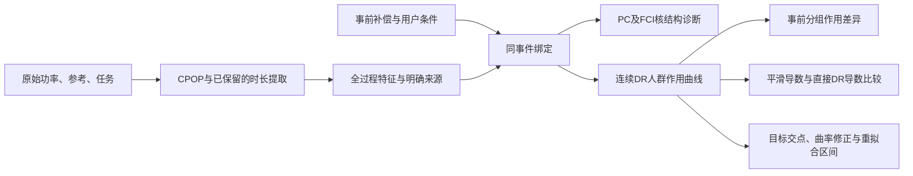

# 研究点一：资源响应全过程特征与连续驱动因素分析算法 v1

本入口把已经发生的任务串成一套分析：输入事前任务/补偿/条件和参考—实际功率，输出全过程特征、因素结构、补偿作用曲线、人群差异、敏感性和目标补偿交点。当前完成充电资源、已知参照条件下的模拟整链验证；通用因素层可接其他资源的同口径结果，其他资源提取适配与真实机理验证仍需各自数据。

## 直接使用

双击本目录的 **运行研究点一.cmd**。它读取本轮已拟合模拟模型，生成新的结果JSON、摘要和曲线图，控制台显示保存位置；普通查询不重新训练。

指定目标增量，例如希望平均累计响应比参考补偿多120秒：

```powershell
powershell.exe -NoProfile -ExecutionPolicy Bypass -File "B1算法/run_research_point_one.ps1" -Target 120
```

任意连续金额直接查询：

```powershell
& "work/ride_b1_v02_reproduction_20261029/.venv/Scripts/python.exe" -B "B1算法/research_cli.py" --amounts 0.73 0.85 1.17
```

完整原始输入重新运行（这是运行接口示例，不算新增独立验证样本）：

```powershell
powershell.exe -NoProfile -ExecutionPolicy Bypass -File "B1算法/run_research_point_one.ps1" -InputFile "B1算法/research_request_example.json"
```

已有Python环境及R/CPOP沿用原项目。新增causal-learn及三个缺失依赖隔离在`work/b1_research_point1_20261103/runtime/site-packages`，启动器会使用它；完整依赖列在本目录requirements.txt。

## 算法怎样连起来



设A为补偿、X为补偿形成前的条件、Y为全体受邀事件的累计响应时长。主曲线为同一固定人群下的μ(a)，作用为μ(a)−μ(a₀)，敏感性为dμ(a)/da。分组曲线研究不同事前条件下补偿作用的差别；改变期限或需求本身的因果作用需要另定干预。

| 环节 | 实际方法与输出 |
|---|---|
| 全过程特征 | 保留effective_response_refined，输出起变/达标、累计与最长时长、净电量/η、恢复与补回；整链表另列原结构曲线的区间尺度功率变化率、峰值与请求比例。时长和结构功率分别标来源 |
| 同事件绑定 | `outcome_source="duration_estimates"`读取已校正时长并核发布字段；旧selected_curve仍按其原曲线积分合同处理；事前因素和任务身份/时点沿用原合同 |
| 因素结构 | 真正调用causal-learn PC-stable/KCI和FCI/KCI，每用户预定首事件；保留CPDAG/PAG端点和未定关系，学习图不自动删除声明调整变量 |
| 连续作用 | 现Kennedy连续DR、用户分折、样条Ridge结果模型及GPS；任意金额直接估计，不分档插值、不强制单调，含零响应 |
| 人群差异 | 预定事前组别各自固定人群的作用曲线；支持不足保留输出状态，不能从其他组借一个分数填补 |
| 边际作用 | 默认保留原平滑曲线导数；Zhang–Chen Eq8直接DR导数已正确实现并持久化，作为研究对照。本轮开发与终验未支持替代默认 |
| 阈值与区间 | 原连续首达/多上穿查询，新增有限设计局部三次曲率偏差修正；可选整用户抽样并实际重拟合辅助模型/GPS的有限网格经验区间。后两项并非完整Takatsu–Westling论文复现或已认证真实覆盖 |

主要成熟方法出处：[CPOP](https://cran.r-project.org/package=cpop)、[Kennedy等2017](https://pmc.ncbi.nlm.nih.gov/articles/PMC5627792/)、[causal-learn](https://github.com/py-why/causal-learn)、[Zhang–Chen Eq8](https://arxiv.org/html/2501.06969v2)、[Takatsu–Westling论文](https://doi.org/10.1093/jrsssb/qkae041)。这是有来源的方法组合和任务接入，不把这些基础方法重命名为原创估计器。

## 程序入口

```python
from b1_api import (
    EVFactorStudy, run_research_point_one, query_research_point_one,
    save_research_point_one, load_research_point_one,
)

study = EVFactorStudy(
    "my-study", "元/千瓦时",
    covariates=("deadline_slack", "demand_urgency"),
    outcome_source="duration_estimates",
)
result = run_research_point_one(
    records, factor_records, study,
    dose_domain=[0, 2.4], reference_dose=0.4,
    assumptions=identification_assumptions,
)
query = query_research_point_one(result["model"], [0.73, 0.85, 1.17])
```

范围、金额单位和目标应来自具体研究。输入记录结构参照research_request_example.json指向的本轮模拟文件。其他资源已提取的可比Y可用`fit_response_research`接通通用因素层。

保存与加载使用JSON；查询和插点不会重训。显式要求重拟合区间时调用`refit_curve_uncertainty(model, amounts, draws=99)`，或CLI加`--refit-draws 99`；每次重抽的支持状态保留在结果内。

## 本轮做到了哪里

新终验16队列、5760个事实变体，来自4个独立随机块；主连续作用曲线RMSE均值64.44秒，原平滑导数203.42、直接DR导数606.41秒/金额单位，因此原平滑导数继续默认。两组全网格作用差异在10/16队列可输出，剩余支持状态保留。

另240个新原始物理模拟任务、120用户，全部经公共原生提取与高层因素合同接通；时长MAE8.21秒。已有全过程输出、结构学习、曲线、导数、阈值、保存加载及双击入口均已实际执行。

结构诊断终验邻接精确率80%、召回41.18%，方向仍常未定；它没有找全机制。目标真实可达的12队列无漏报，4个零作用队列中有1次错误报达；不能将交点工具当确定规律。1584次整用户辅助重拟合中，6队列全部抽样成功，10队列存在支持失败，其经验区间标为不完整。本轮是可运行的模拟研究第一版，真实、多资源与正式90%验收尚未完成。

完整比较、未通过项及独立核验：[本轮研究记录](../work/b1_research_point1_20261103/README.md)。第一部分代码、权重及原曲线方法保留，没有根据终验继续调参。
