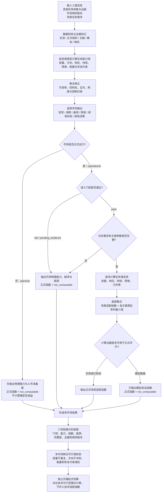

# 资源—市场适配算法简化流程图

> 文档状态：2026-09-10 第一版  
> 用途：用一张图说明当前算法主链，供专利方法讨论、程序实现和后续评审使用。  
> 口径：五类市场、六项输出；绿电交易拆为供给侧和消费侧；备用市场当前按山东“尚未正式开市”处理。

## 一句话理解

算法先回答“资源实际上能做什么”，再回答“按当前规则能不能进入该市场”，最后在任务明确时回答“能完成到什么程度”。任何规则未开放、准入证据不足或关键数据缺失的情况，都保留原因并输出 `not_computable`，不使用 `0 分`冒充计算结果。

## 与专利步骤的对应关系

| 专利步骤 | 流程图环节 | 核心产物 |
|---|---|---|
| S1 | A—B | 带来源、时间和状态的输入参数 |
| S2 | C | 单个资源实体能力域 |
| S3 | D | 聚合后的可用能力域 |
| S4 | E—H | 市场运行状态与准入门控 |
| S5 | J—L | 面向明确任务的满足率和瓶颈指数 |
| S6 | M—O | 正式结果与模拟验证结果分离 |
| S7 | P—Q | 六项单市场输出及限制因素 |
| S8 | R | 多市场容量、方向、能量和恢复约束校验 |
| S9 | S | 与技术适配指数分离的经济测算 |

## 六项输出

1. `spot_fit`：现货市场适配结果；
2. `frequency_fit`：调频市场适配结果；
3. `reserve_readiness`：备用能力准备度；山东正式开市后再按有效细则切换为正式市场适配计算；
4. `ramping_fit`：爬坡市场适配结果；
5. `green_supply_fit`：绿电交易供给侧适配结果；
6. `green_consumption_fit`：绿电交易消费侧适配结果，内部区分交易履约适配与绿电消纳协同。

## 图中刻意没有放入的内容

- 不设置 16 类资源的先验分值；
- 不设置人工 H/M/L 重要度；
- 不强行生成固定“资源总分”；
- 不把价格、收益或主观权重混入技术适配指数；
- 不把模拟数据写成真实验证结论。

