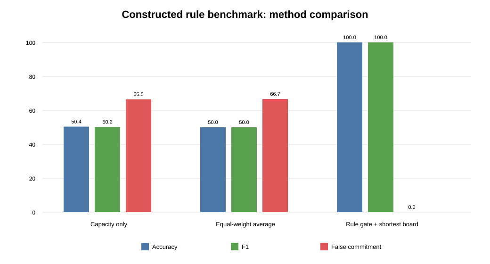

# 算法评测方案与第一轮规则基准结果

> 评测日期：2026-09-15  
> 评测对象：规则门控—约束能力域—场景最短板候选算法  
> 程序：`code/run_algorithm_evaluation.py`  
> 结果：`results/algorithm_evaluation_v1/`

## 1. 本轮回答了什么

第一轮评测建立了可以重复运行的量化基准，不再只展示几个模拟分数。评测覆盖16类资源以及现货、调频、备用准备度、爬坡、绿电供给和绿电消费六项输出。

本轮只回答两个问题：

1. 程序能否准确执行已经明确的山东规则边界；
2. 与“只看容量”和“指标等权平均”相比，当前方法能否避免将存在硬约束短板的资源误判为可履约。

本轮不能回答算法在山东真实调度任务上的预测精度。原因是还没有同一聚合单元的事前任务指令、实际响应和最终履约标签。因此，本轮100%结果是规则逻辑正确率，不是可研要求的真实模型精度不低于90%。

## 2. 评测集设计

共构造336条规则验证案例，全部标记为 `constructed_rule_benchmark`：

| 输出 | 案例数 | 主要反例 |
|---|---:|---|
| 现货 | 80 | 功率不足、持续/电量不足、资源专属约束失败、缺少证据 |
| 调频 | 80 | 双向容量不足、响应/爬坡/跟踪不足、专属约束失败、缺少证据 |
| 备用准备度 | 16 | 山东市场未开放时必须输出 `not_open` |
| 爬坡 | 80 | 容量不足、响应或爬坡不足、专属约束失败、缺少证据 |
| 绿电供给 | 5 | 合格绿电不足、项目资格失败、缺少证据 |
| 绿电消费 | 75 | 可移功率/电量不足、用户或工艺约束失败、缺少证据 |
| 合计 | 336 | 覆盖16类资源 |

每类资源使用自己的专属硬约束，例如储能的SOC与能量、充电站的连接授权与目标SOC、冷水机组的温度与反弹、算力的SLA与任务期限、工业负荷的批次/工艺/库存/联锁条件。专属约束失败时，容量再大也不能判定可履约。

另设置24条山东规则临界值测试，逐项覆盖“阈值略低、刚好等于、略高”三种情况，包括：

- 储能类聚合容量1 MW；
- 储能现货持续时间2 h；
- 储能辅助服务持续时间15 min；
- 调节量负荷类容量1 MW、持续时间1 h；
- 火电AGC响应时间小于60 s；
- 水电AGC响应时间小于20 s；
- AGC允许偏差不超过额定有功功率的1%。

## 3. 第一轮量化结果

### 3.1 山东规则临界值

24条临界值测试全部正确，规则边界正确率为100%。程序正确区分了 `<` 与 `<=`，例如火电AGC响应时间要求为小于60秒，因此60.0秒不通过；AGC允许偏差要求不超过1%，因此1.0%通过。

### 3.2 三种方法对比

剔除80条本来就不可计算的备用未开市和缺证据案例后，256条案例具有明确“可履约/不可履约”标准答案。

| 方法 | 准确率 | F1 | 误承诺率 | 错误判为可履约 | 结果解释 |
|---|---:|---:|---:|---:|---|
| 只看容量 | 50.39% | 50.20% | 66.49% | 127条 | 忽略持续、动态能力和资源专属约束 |
| 指标等权平均 | 50.00% | 50.00% | 66.67% | 128条 | 强项平均后掩盖单项硬短板 |
| 规则门控＋最短板 | 100.00% | 100.00% | 0.00% | 0条 | 在本轮规则构造基准中完整识别硬约束和最短板 |

当前方法在规则基准中的混淆矩阵为：真可履约64条全部识别，真不可履约192条全部拦截，没有误承诺和漏选。资源专属短板识别正确率为100%，市场/证据状态判断正确率为100%。

这些结果说明当前方法的结构适合本项目：市场门控和资源专属硬约束不会被其他高分抵消。它只能证明方法逻辑符合预先定义的规则，不能证明真实环境中能力预测没有误差。

## 4. “精度不低于90%”的建议口径

可研中的90%应落在“可调容量与响应能力特征模型”，不能用本轮规则测试100%代替。建议将正式验收拆成主指标和安全指标：

| 指标 | 建议计算 | 建议目标 | 需要的数据 |
|---|---|---:|---|
| 可调容量预测精度 | `1 − WMAPE(预测可调容量, 实际可持续调节容量)` | ≥90% | 同一主体逐次预测和实际可持续容量 |
| 履约可行性F1 | 对事前“可/不可履约”与实际结果计算F1 | ≥90% | 任务要求、事前预测、实际响应、履约标签 |
| 误承诺率 | 预测可履约但实际失败 ÷ 全部预测可履约 | 越低越好，单列披露 | 同上 |
| 响应时间误差 | 预测与实际达到目标时间的MAE/分位数 | 按市场要求解释 | 指令时间、实际功率秒级记录 |
| 短板识别准确率 | 预测失败原因与实际考核/复盘原因一致比例 | 单列披露 | 失败原因、考核记录和专家复核 |

其中，`1 − WMAPE`可直接解释为总体能力预测精度，也能避免小容量记录使普通百分比误差失真。该口径属于当前建议，需在正式技术报告或验收方案中确认后才生效。

## 5. 当前算法成熟度

| 能力 | 当前状态 |
|---|---|
| 规则边界执行 | 已完成第一轮量化验证 |
| 硬约束与最短板识别 | 已完成构造基准对比验证 |
| 缺证据与未开市处理 | 已验证不会生成正式分数 |
| 16类资源专属约束接口 | 已进入评测基准，仍需逐类接入主计算程序 |
| 真实功率/SOC/负荷数据读取 | 已有三套公开数据试测 |
| 可调容量预测误差 | 尚不可计算 |
| 真实任务履约预测 | 尚不可计算 |
| 山东项目外部验证 | 尚未开始 |
| 90%精度目标 | 尚未验证，不得声称达到 |

因此，当前算法应定位为“规则逻辑通过量化验证的第一版候选原型”，尚不是已经完成真实精度验证的正式模型。

## 6. 下一步执行顺序

1. 将这套评测接口接入主算法，逐类实现16种资源的能力计算函数，而不只停留在光伏、储能和充电站样例。
2. 建立统一的“预测—任务—实际响应—履约标签”表。公开数据能支持部分技术环节，山东项目数据到位后按相同字段直接替换。
3. 先对EPFL充电站设定—实际功率记录开展组件级跟踪评测，给出真实跟踪误差和时间留出结果。
4. 使用项目真实调节事件开展可调容量精度、履约F1、误承诺率和短板准确率评测。
5. 达到并稳定超过确认后的90%口径后，再把结果写入技术报告、专利实施例和论文实验部分。

## 7. 结果文件

- `benchmark_cases.csv`：336条规则验证案例及标准答案；
- `case_results.csv`：三种方法对每条案例的判断、分数、状态和短板；
- `method_comparison.csv`：准确率、F1、误承诺率等汇总；
- `rule_boundary_results.csv`：24条山东规则临界值测试；
- `method_comparison.svg`：方法对比图；
- `evaluation_summary.json`：自动校验摘要。
