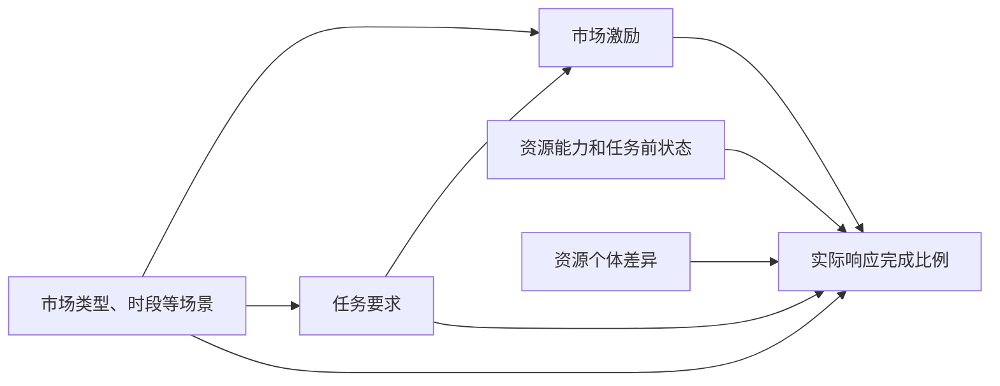

# 初始因果图与变量角色

## 1. 本图回答的问题

本图只服务于第一版问题：

> 在相近任务和资源条件下，市场激励与实际响应完成比例之间有什么定量关系？

它不是最终项目全景图，也不要求把数据需求表中所有字段都放进来。

## 2. 第一版变量角色

| 角色 | 第一版内容 | 作用 |
| --- | --- | --- |
| 结果变量 Y | 实际响应完成比例 | 要解释的结果 |
| 重点因素 T | 市场激励（补偿/价格/奖励强度） | 希望重点量化的因素 |
| 任务条件 Z1 | 要求调节量、持续时间、调节方向 | 任务难度，也可能影响激励设置 |
| 场景条件 Z2 | 市场类型、时段、日期/季节 | 可能同时影响激励、任务要求和完成比例 |
| 资源条件 X | 额定能力、任务前关键状态 | 保证不同资源之间可以公平比较；也可用于观察差异化影响 |
| 个体标识 G | 资源编号、资源组或运营单位 | 用于混合效应模型识别资源长期固有差异 |

## 3. 初始关系图

读图方式：

- 重点研究的是 `市场激励 → 实际响应完成比例`；
- 任务要求、市场场景可能既影响激励，也影响完成比例，因此应在比较时纳入；
- 资源能力、初始状态和资源个体差异主要用于解释不同资源本身的差异；
- 图中箭头是待数据和业务专家共同校核的研究假设，不是已经验证的结论。

## 4. 暂时不放入第一版的因素

| 因素 | 暂不纳入的原因 | 何时再加入 |
| --- | --- | --- |
| 用户是否接受邀约 | 可能是激励影响执行的中间环节；过早控制会改变要回答的问题 | 单独研究“激励如何影响参与意愿”时 |
| 天气 | 对光伏等资源很重要，但对部分资源未必必要 | 选定光伏或发现天气明显影响结果时 |
| 绿色偏好、碳价值 | 当前第一版不是绿色价值研究 | 研究用户意愿或绿电场景时 |
| 失败原因 | 它是任务结果之后才产生的信息 | 仅用于结果解释和数据质量分析，不能作为事前输入 |
| 响应时延、恢复时间 | 是另一类行为结果 | 在完成比例模型稳定后作为第二个结果变量 |

## 5. 变量选择的三个原则

1. **先问是否会改变问题答案**：若一个条件同时影响激励和完成比例，应优先纳入。
2. **先问发生时间**：任务结束后才得到的信息，不能作为任务前预测或解释的输入。
3. **先问是否必要**：没有明确业务理由的变量，第一版不加入；变量多不等于结论可信。

## 6. 数据到位后的校核方式

1. 与调度、交易或运营人员核对：激励是如何设定的，任务要求如何下发；
2. 检查资源标识、任务标识和时间是否能够对应；
3. 检查同一资源是否有足够次数的任务记录；
4. 若市场激励记录缺失，不强行填补，改为研究任务要求或资源状态对完成比例的关系；
5. 根据实际资源类型，决定是否补充天气或用户授权等专属因素。
