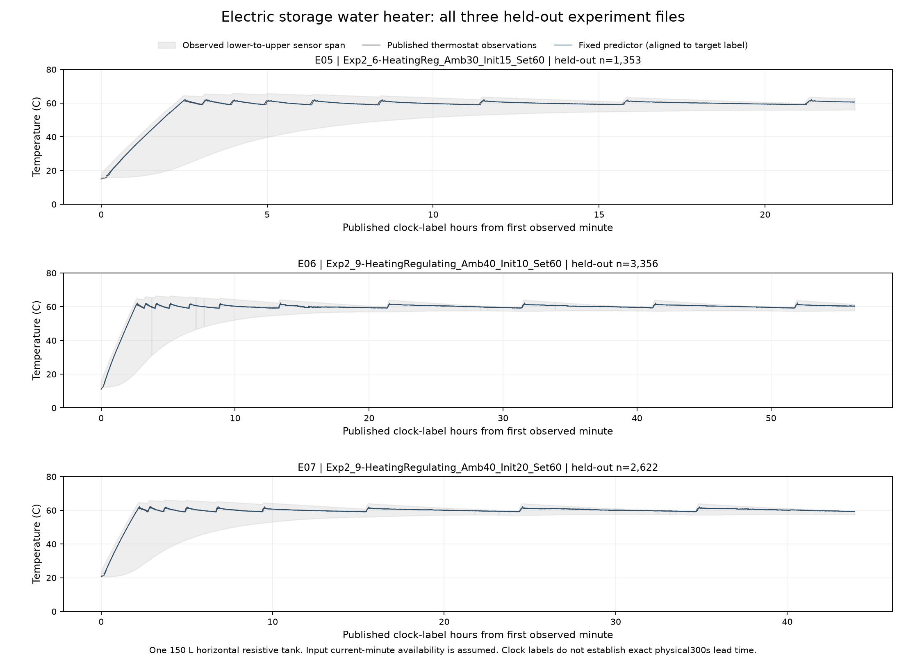

# 储热式电热水器基础成果 v1.0

2026-10-16，D067。首轮基础包在**原150升卧式电阻水箱的运行温度特征与有条件的后续温度标签估计**范围内按六项标准有限收口。代码、参数、构造例、全部留出实验曲线和聚合结果保存在本目录。

当前对象是储热式电热水器。电锅炉配水箱可参考电热转换、散热和水温分层的研究思路，但本轮没有取得其匹配实测数据，也没有验证大型锅炉、循环泵、换热器或水箱组合的参数和能力。

## 使用

本机可双击`运行示例.cmd`查看两个构造例。程序仅需Python 3标准库；启动器优先使用本机已有Codex Python，否则尝试`py -3`。Python入口已在成果目录之外真实执行，cmd未进行界面双击测试。

```text
python run_example.py
python run_example.py --input your_input.json
```

输入JSON对象包含：

```json
{
  "temperature_C": 30.0,
  "previous_temperature_C": 29.8,
  "heating_flag": 1,
  "chamber_temperature_1_C": 20.0,
  "chamber_temperature_2_C": 20.5,
  "upper_sensor_C": 32.0,
  "lower_sensor_C": 28.0
}
```

这些是构造输入。`temperature_C`为当前局部恒温器测温，`previous_temperature_C`为此前五个发布时钟分钟标签的同一测温；其他量来自当前同一记录。上、下传感器对应原B0-T0/B0-T8，不能随意更换测点。输出为后续五分钟标签的局部温度估计和`outside_training_feature_range`提示。该标志表示某项模型特征超出训练范围，不是置信区间；完整输入仍须满足原设备、测点及时间条件。

程序不会读取未来加热标记、电能、用水或温度。它要求当前分钟记录已完整可得，属于离线条件估计；发布时钟的五分钟标签间隔**尚未建立精确300秒物理提前量或真实在线送达保证**。日期、时钟和测点对齐由调用者按本说明保证。负温、超过100℃、无穷值、NaN及不完整输入会拒绝；0—100℃是本研究的宽质量检查范围，不是舒适或运行设定要求。

代码入口`code/water_temperature.py`的`predict`函数；参数为`parameters/horizontal_150L_temperature_v1.json`。路径按脚本位置定位，不依赖当前工作目录。

## 来源、机理与方法

[原发布Mendeley v1](https://data.mendeley.com/datasets/ddmv4w434g/1)，DOI10.17632/ddmv4w434g.1，van Schalkwyk、Engelbrecht、Booysen，CC-BY-4.0。对象为南非Stellenbosch实验室一台Kwikot Superline，150 L、名义3 kW卧式电阻加热水箱。水箱内温度有分层，恒温器传感器、上层温度和下层温度分别描述不同位置，不能将任一点直接视为整箱平均温度或可用储热量。

已读配套[Data in Brief论文](https://doi.org/10.1016/j.dib.2024.110082)的公开全文XML及原字段说明、传感器图。它们支持实验对象与观测含义。简化热平衡、层间温差和OLS方法类别另参考[Buechler等论文](https://arxiv.org/html/2312.04102v1)，该论文研究另一台立式双加热元件设备；其容量、系数、MPC控制和节费成绩均未移植。本程序不是论文完整控制算法或原状态空间模型的复现。

模型直接估计后续温度变化：

```text
d = 当前恒温器温度 − 前五分钟标签的恒温器温度
a = (当前环境温度1 + 当前环境温度2)/2 − 当前恒温器温度
u = 当前上层测温 − 当前恒温器温度
l = 当前下层测温 − 当前恒温器温度
后续温度 = 当前温度 + β0 + β1*d + β2*当前加热标记 + β3*a + β4*u + β5*l
```

仅六个全局统计系数，训练时各完整实验文件总权重相同。系数不是热容、散热系数、效率或真实可调容量。未增加物理剪裁、正则化、状态路由、参数搜索或结果平滑。当前加热标记是发布观测，不证明物理功率或控制送达，也没有假设未来一直加热。

## 原件问题与样本边界

- 已下载七个原始加热保温JSON，共130438行，逐文件大小及发布者SHA256一致；另外核了字段说明、测点图和少量对照原件。不同格式存在`Trace`/`TraceCollection`、`TimeStamp`/`Timestamp`、单位说明行和−127缺测值；未改原件。
- 部分时钟只有分钟，部分只有时分秒，且有跨午夜；三份完整日期记录互相重叠。按原序取每个文件/时钟连续块/发布分钟的最后一行，不择最后有效行、不补秒或日期、不平均；缺日期的跨午夜和其他倒退均重开块。三份日期重叠的文件全部放在留出侧，未拆至训练两侧。
- `PowerConsumed`的原单位为每采样期间Wh。三个留出文件该列全为零而存在加热标记，另有元数据SamplePeriod与实见时钟不一致。因此本模型不使用电能列或把名义3 kW乘标记当实测功率，不计算真实电热效率/热容/容量。
- 16751个分钟末行候选，要求同一文件和块中前后五分钟及中间全部11个分钟标签完整；相关传感器满足质量条件。100个边界/时钟窗口不完整、15个传感器条件不符，共16636合格。温度失格含相关测点−127，未按预测误差、温差大小、启停或用水删点。
- 四个整文件训练9305点、三个整文件评价7331点。部分训练日期晚于评价，两个训练文件没有日期，故这是同一设备的文件/工况留出比较，**不是时间向前的独立部署测试、三个独立物理事件或跨设备验证**。跨训练/评价没有发现完全相同的连续三原始全信号行，但该检查不证明物理事件独立。

## 固定比较与保留的失败边界

拟合前冻结样本、六项输入公式和评价标准，协议SHA256`5f75213a7d757989ee3f73e47194a4098827bc80bb5bf6aa5d240776e131bfa0`。各文件的处理和完整留出范围未按成绩修改。

| 方法 | MAE（℃） | RMSE（℃） |
|---|---:|---:|
| 保持当前温度 B_P | 0.219087 | 0.472491 |
| 延续此前温度趋势 B_TREND | 0.191718 | 0.365369 |
| 六系数温度模型 M_LAYER6 | 0.120595 | 0.197518 |

总体、三个留出文件分别、当前加热标记为1的593点，模型两项误差均优于两种基线，满足事前相对标准。结果针对发布局部温度观测，不代表相对于独立校准真实水温的绝对精度，也不换算为103的90%验收成绩。

**当前加热标记为0的6738点，两项误差均比保持不变法稍差**：MAE0.105494→0.109108℃、RMSE0.171468→0.175434℃，原结果保留，不事后按状态切模型。316点超训练特征范围，全部保留；最差绝对误差2.295133℃，E06源行3161、当前标签2022-08-18 18:11:52，当前59.187℃、目标61.424℃、模型59.128867℃，没有凭误差诊断故障或删掉该点。

独立核验以向量时钟/分钟末行重建对照逐行准备，用显式SVD对照OLS求解器，重核全部16636样本、7331预测、96指标和完整门槛；五科研产物复跑逐字节一致。源JSON解码器共享，不称第二种物理测量。最终标准库计算的全点回放及输入边界核验见发布收据。

## 完整曲线与交付



三个面板覆盖全部7331原评价点；灰色带只表示B0下层到上层测点温度区间，不是置信区间或整箱温度。所有七文件16751分钟锚点的测温和分层温差分布另有聚合结果。图与描述在误差已见后补充，没有新增拟合或独立预测检验。PNG已目检，SVG由同一张图导出，未另行渲染。

- `results/metrics.json`、`diagnostics.json`：全部文件/运行标记组/域外组及最差点。
- `results/observed_characteristics.json`：七文件发布温度与分层观察。
- `results/basic_research_acceptance.json`：六项限定基础审查。
- `results/release_validation.json`、`evidence_summary.json`：实际复算、最终回放和适用范围。
- `source_manifest.json`：原作者、许可、论文与原文件身份。

原始数据、下载器、清洗/拟合/诊断和核验程序留在work。原五类成果保持，本轮到此停止新增实验，六类基础成果各有其适用边界。跨资源整合仍待用户明确要求；真实可用/可调热容量、用户需求/供水约束、现场控制、完整用水工况、跨设备迁移和工业电锅炉配水箱均待专项验证，全体P1及103未通过。

[过程入口](../../work/electric_water_heating_research_20261016/README.md)；[过程记录](../../work/process_notes/2026-10-16_储热式电热水器研究.md)。
