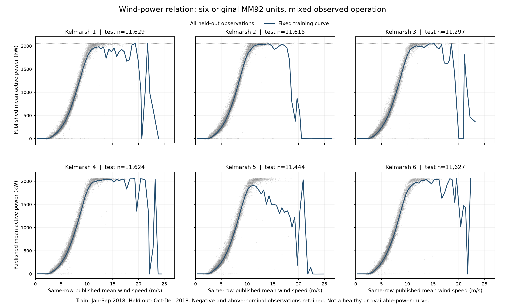

# 风电首轮基础成果：运行特征与同期功率曲线 v1.1

2026-10-16，D066。首轮基础包已按原定六项标准在“原六机组发布运行特征＋混合观察条件同期功率曲线”范围内有限收口。D065固定比较、参数、最终代码和成绩保持；新增完整曲线、回顾特征与六项审查，不是新增预测盲测。完整可调能力仍需专项。

这个程序回答：对研究中的某台风机，已知同一发布时段的平均风速，其平均有功功率大致是多少？输入为机组编号1—6和风速m/s，输出为kW及训练数据支持标志。它用于描述功率曲线、作为后续研究参照。输入中不需要当前功率或停机标签。

## 使用

本机可双击`运行示例.cmd`查看六个构造示例。程序需要Python 3，无第三方计算依赖；启动器优先使用本机已有Codex Python，否则尝试`py -3`。

也可执行：

```text
python run_example.py --unit 1 --wind-mps 8
```

`run_example.py`按自身位置找参数，在其他工作目录启动也可使用。代码入口为`code/wind_curve.py`中的`evaluate(parameters, unit, wind_mps)`，参数文件为`parameters/kelmarsh_mixed_curve_v1.json`。示例是构造输入，不是新的实测验证。原始数据、清洗/拟合/核验脚本不在本目录。

输出的`outside_training_wind`表示超出该机组训练风速范围；`outside_knot_centres`表示使用了端点常数延拓；`training_bin_count`为该0.5m/s风速箱中的训练记录数；少于20条时`rare_or_unseen_bin`为真。20仅用于提示，不是置信区间、删点规则或性能保证。当前评价没有超训练风速范围的点，**不能声称已验证域外能力**。负风速、NaN、无穷值、布尔值及不支持的机组编号会拒绝。

## 对象、时间和算法

来源为Plumley、Takeuchi发布的[Kelmarsh官方数据](https://zenodo.org/records/16807551)，DOI10.5281/zenodo.16807551，CC-BY-4.0。仅研究英国同一风场六台Senvion MM92机组的2018年原始十分钟数据。原静态表额定功率各2050kW、叶轮直径92m；部分论文直径表述为92.5m，当前模型未使用几何参数，不静默混用。原CSV明确UTC，但聚合区间边界和传感器/控制物理同步未确认。

风轮机理上，气流功率随风速立方增长，实际发电又受气动效率、控制和运行状态影响。这里不识别真实功率系数或制造商性能参数，而是直接建立统计曲线：先将训练风速按`floor(v/0.5)`分箱；每个非空箱的平均风速和平均功率形成一个节点；节点之间做线性插值，两端使用端点值。六台分别计算，共280个节点。每条训练记录在所属机组内等权，不平滑、不强制单调、不将输出裁到0或额定值。

分段线性曲线这一方法类别有[Kolumbán等论文](https://arxiv.org/html/1707.06497v2)依据；0.5m/s分箱和训练均值节点是本项目事前固定的实现选择，未复现该论文全部方法或成绩。论文的Vestas V80对象和切入/额定/切出阈值不移植给MM92。来源与事件背景另核对[Fiocchi等论文](https://doi.org/10.1002/we.70012)，未使用其神经网络或故障前一周筛除规则。

事件表69963条中60301条没有结束时刻，不能完整恢复每个采样时刻的健康/停机状态。模型采用所有核心字段合格的混合运行记录，不把“没有事件”视为健康。负功率、超过名义额定功率和大残差均保留。厂商提供的Potential power各列不作为独立可用容量真值；功率设定字段未用于模型或当作控制送达证据。

## 固定检验结果

原始315360行，303987条核心字段合格；11373条有无效风速或功率，重叠原因单列保存。原序时钟均为600秒，无倒序、重复或间隔异常。2018年1—9月训练234751条，10—12月检验69236条，同一批机组按整月留出，未随机拆相邻点。

| 模型 | 平均绝对误差 MAE（kW） | 均方根误差 RMSE（kW） |
|---|---:|---:|
| 风速直线回归 B_LINEAR | 150.473447 | 200.830358 |
| 风速立方回归 B_CUBIC | 262.829208 | 353.104135 |
| 分段统计曲线 M_CURVE | 55.175509 | 100.046282 |

总体、六台机组分别、三个检验月分别、实测正功率65829条组，M_CURVE的两项误差均低于两种基线，满足事前固定的相对标准。分段曲线比两参数回归更灵活；这里只证明它在本次固定比较中有效，不声称最优方法或正式90%精度。拟合后未修改分箱、模型或样本规则。

仍保留以下限制：

- 最差绝对误差2044.636561kW：4号机2018-11-28 15:50 UTC，风速13.607419m/s，实测−0.933625kW，曲线估计2043.702936kW。原因未确认，不能仅凭曲线判定停机、限电或故障。
- 稀疏/未见风速箱81条，MAE346.644032kW、RMSE576.771188kW；低支持区域误差明显较大，不能只引用总体均值。
- 检验保留3407条负功率、947条超过2050kW的源记录。曲线本身有1733个负输出和1个超过2050kW的输出，均未剪裁；统计结果不是物理上限或承诺值。
- 同期风速是机舱侧发布观测。真正提前预测还需要未来风速信息、输入可得时点与独立评价，本结果没有验证这些条件。

最终代码已回放全部69236条评价记录。独立核验另从原始ZIP读取、重建全部原行标志，用中心矩公式对照回归参数、另一种插值实现对照全部预测及180项指标；五科研产物两次运行逐字节一致。此处“独立复算”指计算实现独立，仍使用同一物理数据来源。

## 完整曲线与运行特征



灰点为全部69236条留出观测，蓝线为原280训练节点形成的固定曲线，六面板坐标统一，负值与超名义额定值保留。高风速段存在明显起伏，反映当前统计样本的混合状态及局部支持情况；不能由这些起伏认定真实切出风速或制造商特性，也没有为了图形平滑修改曲线。SVG与PNG从同一张图导出，PNG已目检，SVG未另行渲染。

完整303987条准入记录的分布、正负功率计数，以及303865组原序连续600秒相邻对已汇总。相邻功率差只是两条十分钟均值的变化，不能当物理瞬时爬坡率、指令响应速度或可承诺容量。所有非空训练/评价风速箱均保存，评价箱均值只作描述，从未替换原训练节点。特征核验以独立标准库有序分位数与pandas/NumPy对照，1678项数值检查通过；描述/分箱/最差上下文三项产物复跑一致。

六项有限审查覆盖对象与输出、曲线公式和依据、原件与适用参照、固定正向组件、完整对照和失败边界、复算及可运行代码。控制或容量真值仍是后续相应用途的准入要求，本次没有用基础验收替代这些验证。

## 文件与后续边界

- `results/validation_metrics.json`：全部预设分组及空组指标。
- `results/diagnostics_summary.json`：门槛、最差点和覆盖诊断。
- `results/frozen_protocol.json`：拟合前冻结的方案。
- `results/evidence_summary_v1_1.json`、`release_validation_v1_1.json`：现用描述/复算与发布核验范围；`basic_research_acceptance_v1_1.json`为六项有限审查。
- `results/observed_characteristics.json`、`power_curve_bins.json`、`power_curves.png/svg`：全机组描述、全部非空箱及图。
- `results/evidence_summary.json`和`release_validation.json`为D065首组件v1.0历史；对应旧README快照保存在work的PACKAGE_WIND_V1_1_01目录，旧收据不用于声称现用README身份。
- `source_manifest.json`：原始来源、署名、许可和文件身份；本目录是原数据的派生统计成果。

本轮基础阶段到此停止新增实验。下一类资源或专项由用户决定；当前五类基础包各有有限范围，至少六类目标还需一类，不自动启动第六类。健康标准功率曲线、真实可用/可调容量、限功率响应、独立风场迁移与现场控制仍需专项验证。本组件不与前四类自动整合，不能代表整个P1或103任务通过。

研究入口：[过程目录](../../work/wind_power_research_20261016/README.md)；[过程记录](../../work/process_notes/2026-10-16_风电资源研究.md)。
