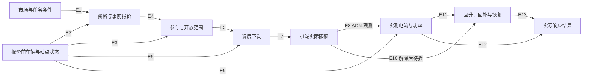

# 第 2 点 · 关系证据更新

| 边 | 现有证据 | 适合继续核对的关系 |
| --- | --- | --- |
| E1 市场与任务 → 资格、报价 | 超市作者描述了日前优化折扣的流程，公开小时表可核市场价与折扣。车辆调节任务的资格及报价规则待验。 | 按报价版本回放已知规则，核对当时可用的市场、任务和容量输入。 |
| E2 车辆与站点状态 → 资格、报价 | 项目假设。ACN 有部分预约和实时状态代理，缺同场报价。 | 核调度规则是否实际依据期限、需求和容量来划资格或调报价。 |
| E3 车辆与站点状态 → 参与及开放 | OptimizEV 有期限与开放余量的选择流程，本地无同场观测。 | 采集报价前 SOC、期限与申报电量，并对全体合资格人保留接受、拒绝和无回执。 |
| E4 事前报价与送达 → 参与及开放 | 本地缺直接证据。Calgary 是固定激励与充电时点的随机试验，未证逐任务接受状态。超市只提供站点折扣和用电旁证。 | 核送达日志和完整分母，再验证同场报价对参加率或开放量的关系。 |
| E5 参与、开放 → 调度 | 其他试验文档支持该流程，本地无授权与下发配对。 | 以任务、匿名资源、指令键连接，区分接受但未调用。 |
| E6 车辆与站点状态 → 调度 | 业务上合理，方向待验。控制器可能读取既有负荷后调限。 | 用控制规则、后台状态与时间戳检验。 |
| E7 调度下发 → 桩端实际限额 | ACN 只给本轮可观察的实际限额，缺独立后台发送及桩端生效时点。 | 加入后台下发、确认和桩端日志，核限额变化时序。 |
| E8 桩端实际限额 → 电流与功率 | **本轮支持观测关联。** 稳定孤立窗口的同步下降为 144/144 对 30/210，同会话率差同向。箭头沿业务时序提出，精确时点及因果方向没有从这些数据中识别。 | 有独立指令时间与分配依据后，再判断能否用外部控制变异检验其作用。 |
| E9 车辆与站点状态 → 实测功率 | ACN 能检事前电流、波动和结果的描述联系，缺 SOC 等关键状态。两组前电流水平明显不同。 | 加入车况、桩容量、负荷历史和共享站点约束，检验相同状态下结果。 |
| E10–E11 限额解除、实测功率 → 回升与恢复 | 首轮样例可见功率回升。回补、恢复目标和任务结束日志缺失，本轮比较只覆盖降限。 | 分开定义解除时刻、回升和恢复判据，记录提前拔枪及右截尾。 |
| E12–E13 执行、恢复轨迹 → 响应结果 | 从实测与基准计算累计有效减载秒数、减载与回补电量属于项目口径。ACN 缺正式任务及批准参照。 | 加入任务请求和基准版本，复核各项结果能否从同场时序重算。 |

**整图学习的数据条件尚未具备。** ACN 只有图中的局部观测。报价、受邀分母、参与、后台指令和恢复目标无法在同场连接。隐藏的车辆状态与站点调度也可能共同影响限额和响应。若后续数据对齐，先锁定时间先后、可调节变量和群组分配单位，核对有无足够变化、重复用户和共享配额，再选择图学习或干预检验。当前图表示业务顺序和待验假设。

## Calgary 复制包的有界复查

- 2026-11-04 复查 OpenICPSR 项目 202941 V1。点公开项目的 **Download this project**，`/download/terms?…&type=project` 跳转至 `login.icpsr.umich.edu` 的 OAuth 登录入口。另从公开单文件页点击 **Download this file**，`/download/terms?…&type=file` 在网页工具中返回 400 和超时。公开目录还索引到 2022 年 9 月充电月表。此次取得目录及论文，主表、分组文件和微观字段均未取得。限制停在上述正常入口，没有账号访问或进一步尝试。 [公开项目](https://www.openicpsr.org/openicpsr/project/202941/version/V1/view) · [单文件页面](https://www.openicpsr.org/openicpsr/project/202941/version/V1/view?path=%2Fopenicpsr%2F202941%2Ffcr%3Aversions%2FV1%2FReplication-File%2FData%2F20220314---charge-data.xlsx&type=file)
- 作者论文 §I–II 报告第一阶段将 **150 辆已安装监测设备的车**按事前数据分层随机分配，奖励 68、信息 45、对照 37。奖励为夜间 22:00–06:00 充电 3.5 加分/kWh。第二阶段在原奖励组重新随机，延续 33、停止 35。作者说明邮件是否被阅读未知。217 辆报名和 150 辆安装是不同分母。作者记录充电时点、用电量 kWh、最大功率 kW 与家内外位置，论文说明充电记录的粒度为 15 分钟。 [作者论文](https://fawolak.org/pdf/field_experiment_with_ev_charging.pdf)
- 论文主回归限有充电日，另用所有日期做扩展分析。若取得主表，先用匿名研究 ID 与阶段分组连接到车辆—日期或小时面板，验证时区和设备覆盖，区分设备掉线与确证未充电。之后可比较奖励和信息两组的按分配差异，结果为充电频率、充电时点或电量。实际列名与完整分母尚未核。原研究的充电结果无法补齐本项目的逐任务接受、减载时长或恢复。 [作者论文 §III、§V 及表 5–6](https://fawolak.org/pdf/field_experiment_with_ev_charging.pdf)
