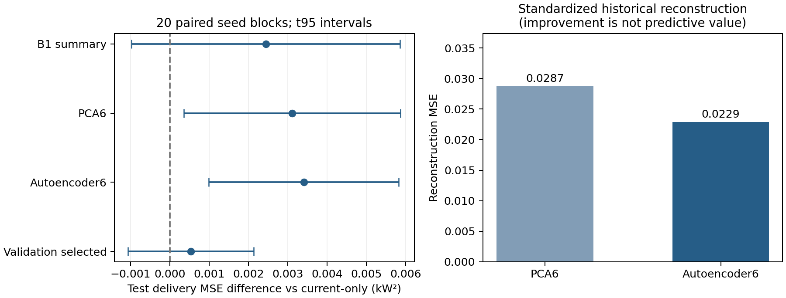

# B1历史特征接入B2：一次有限增量验证

本轮已完成B1历史曲线提取、B2预测消费及留出验证。结果不支持将历史分支替换为默认模型：历史统计、PCA和小型非线性表示都没有显示稳定的总体预测增量。保留当前D122的B2/B3默认入口及旧权重，不继续在本面板调参追分。

## 实际接通了什么

每次预测前，读取同一EV前三次已完整结束的事件，实际调用原B1通用F0提取器，得到交付比例、响应起点区间上端、达标起点区间上端和达标标记。汇成6个历史统计，或将按时间排列的3×30格归一化减载曲线压缩为6维表示，再进入新的B2六结果预测头。没有把因果平均作用当容量，也没有把同一次任务的事后曲线塞回事前预测。

原B1函数接受n个区间功率及n+1个边界。本轮显式使用1分钟采样、0—30分钟服务、120分钟完整观测、驻留1格；没有沿用旧10秒/20分钟任务的默认参数。未发生响应/未达标时，以1作为缺省延迟编码并保留达标标记；这个编码不代表观测到30分钟物理时延。

新接口为[api.py](api.py)的`predict_with_history(case)`，输入含资源/事件ID、带时区任务时点和信息截止时点、当前申报，以及最多3条完整历史。少于3条合法历史走C0；跨对象、未来、尚不可得、错序、缺测及非本理想模板族历史返回不可用。当前无许可或物理不可行仍阻断。输出含参加/条件状态/任务概率、期望曲线及回补，概率与曲线使用同一六结果分布，承诺继续为null。

接口是本轮**可选研究入口**，固定展示重复0的验证选择结果；该重复选择C0，因此提供历史也不会暗中启用一个未胜出的表示模型。其他重复的模型只用于研究比较。原B2→B3默认接口保持[上一轮入口](../b2_b3_integration_20261028/api.py)，本轮没有把新模型自动部署到B3，也没有做新的组合主实验。

## 数据和比较

20个新独立种子，每个400用户×12事件×3配对机制，共288000事实变体/96000基础事件。无持续作用、固定用户作用、变化用户作用共享申报及抽样随机数；它们是配对模拟变体，不能当作三组独立现实用户。用户240/80/80隔离，目标事件分别为3—6、7—8、9—11。只取前3次历史，事件间隔180分钟，120分钟观测结束后才可使用。测试期间可读取已结束的较早测试事件，模型不更新。

单EV、7.2kW上限、30分钟1.5/3kW任务、60/90/120分钟申报期限、AC侧精确理想计量和完整能量回补。状态仍为完整、延迟2/5分钟、15分钟退出、70%幅度五模板。行为由固定独立机制生成，不把拟合模型当真值；隐藏用户状态及真概率仅存work供审计，预测器不读取。无新增设备或真实现场数据。

四方案共用17维当前输入和同一类多项logit预测头。C1/C2/C3均加6维历史；C0输入较少，因此不声称四法总参数相等。PCA与90→24→6→24→90自编码器只用训练历史拟合，后者4752参数、固定60轮，不搜索网络/轮数。它是固定时间网格的多层非线性压缩，不能据此宣告通用时序深度方向完成。

复用本机已安装scikit-learn1.7.2及其MLPRegressor/PCA/logit，许可证BSD；方法及计算量匹配短定长曲线，不新增依赖。设计前也查看了[TS2Vec开源方案](https://github.com/zhihanyue/ts2vec)；本问题尚无需要其通用对比时序框架的证据，故不额外引入Torch训练链。实际采用实现见[官方MLP说明](https://scikit-learn.org/1.7/modules/generated/sklearn.neural_network.MLPRegressor.html)和[许可](https://github.com/scikit-learn/scikit-learn/blob/1.7.2/COPYING)。

验证集只在交付MSE严格改善且服务Brier不变差时选择历史法，否则回退C0。一个模型池化三机制，不把真实机制标签作为查询输入。验证选择、模型和预测先落盘冻结，再计算主测试分数。原冻结B2只作诊断参照；其训练结构和样本不同，不能把它与新头的差别全部归因于历史信息。

## 结果

下表为20个种子测试指标的平均值；RMSE是各块RMSE的平均，主比较及置信区间使用MSE。总体包含合法阻断的零交付，另列可发任务子集防止零样本掩盖误差。所有指标越小越好。

| 方案 | 实际平均交付RMSE（kW） | 任务Brier |
|---|---:|---:|
| C0 当前条件 | 0.588489 | 0.089596 |
| C1 加B1历史统计 | 0.590853 | 0.089870 |
| C2 加PCA6 | 0.591245 | 0.090089 |
| C3 加非线性表示6 | 0.591455 | 0.090152 |
| 验证选择后的方案 | 0.588948 | 0.089507 |
| 原冻结B2（诊断参照） | 0.579374 | 0.087983 |

验证选择14次C0、6次C1，PCA及自编码器各0次。选择后相对C0的交付MSE差为+0.000539724kW²，20块t95区间[−0.001061459,+0.002140906]；Brier差−0.000088702，区间[−0.000665462,+0.000488059]。两项均不支持稳定总体增量；6次选历史中仅1次测试主MSE改善，14次回退与C0相同，不把这14次说成改善。

C1相对C0总体MSE差+0.002441177，区间[−0.000976191,+0.005858545]。固定用户作用场景差+0.000085789，区间[−0.004384211,+0.004555789]；无持续作用场景差+0.003861812，区间[+0.000302111,+0.007421512]。变化作用场景也没有稳定改善。所有机制均保留，不挑一个有利结果升级。

仅可发任务子集，C0/验证选择后RMSE为0.852482/0.853141kW，Brier为0.187911/0.187724，交付MSE差区间仍跨0。原冻结B2本面板总体RMSE为0.579374kW、Brier0.087983，表内新模型没有提供替换它的依据。

自编码器测试历史重建误差0.022895，低于PCA的0.028739；但下一响应预测并未改善。自编码器与PCA的主MSE差+0.000293280，区间[−0.000517930,+0.001104490]。曲线重建质量不能代替任务预测价值。

## 核验与复现

主生成前冻结14项新代码/协议/开发收据和313项旧文件。原B1、B2、B3、74模型v15、同事代码、旧会议Word/PDF及真实冻结状态保持。开发30小例通过；独立核验46454259项逐元素/状态/预测检查通过，补充667项聚合、区间和12次实际查询对照通过。大数量来自同一批曲线和向量的数值检查，**不是独立试验次数**。最大预测概率差5.55e-16，最大电量误差5.33e-15kWh。

核验包括完整功率/能量、B1输出与直接阈值/积分、历史索引和用户/时点隔离、训练均值、PCA及自编码器前向、预测头手工softmax、全部测试指标、验证选择、t区间和冷启动/许可/未来历史查询。自编码器60轮预算到达警告全部记录，不声称优化已收敛；预测头最大229轮，未触1000轮上限。无新科学错误修复或主实验重跑。

生成及288000次B1提取54.11s，训练/验证及落盘87.62s，本机CPU，无新库/GPU/界面/上传/提交。主脚本为`generate.py`、`experiment.py train/evaluate`，审计为`independent.py`和`supplement.py`；写结果使用独占创建，原目录不直接重复运行覆盖收据。如需复算，复制代码到新的work目录并明确新数据版本，旧原件保持。

证据：[协议](protocol.json)、[来源冻结](source_freeze.json)、[预测冻结](prediction_freeze.json)、[逐块成绩](results.json)、[选择记录](selection.json)、[独立核验](independent_checks.json)、[补充核验](supplement_checks.json)、[示例输入](example_input.json)、[输出](example_output.json)。原件见[data入口](../../data/B1_B2_history_v1_20261028/README.md)。

## 阶段判断与后续

本轮完成的是“B1合法历史→B2可选消费”的实际接口和一次公平程度明确的有限新留出研究。现有证据不足以采用历史分支，保留原B2默认模型。本面板结束，不增加历史长度、潜变量强度、网络或调参直到获胜；旧D112负结果也不改写。

结论不能扩大为历史无用、深度方法无效或时序研究完成。只有3次短历史，许可/接受稀疏，三机制池化和有限预测头均限制可表达的信息；本轮没有给出历史信息价值的贝叶斯上界，也没有真实用户/测噪/多设备验证。这些是结论边界，不是补跑本面板的理由。

正式时序深度、多机制覆盖、真实市场/绿色及控制证据、B2两小时模型与B3三小时连续任务的完整相容迁移仍需后续研究。下一阶段应先围绕一个确实需要时间状态/恢复的具体任务确定模型和评价，使用新协议、新留出，不能将本次自编码器小试或已有几个独立小包当作整链完成。当前不自动开展第二机制、B4或新B3主实验。

并行形成[正式精度口径建议（待确认）](正式精度口径建议_待确认.md)，列明输出、真值、容差、分母及覆盖率；不自定一个有利于现成绩的90%门槛，不迁入01_项目依据。
