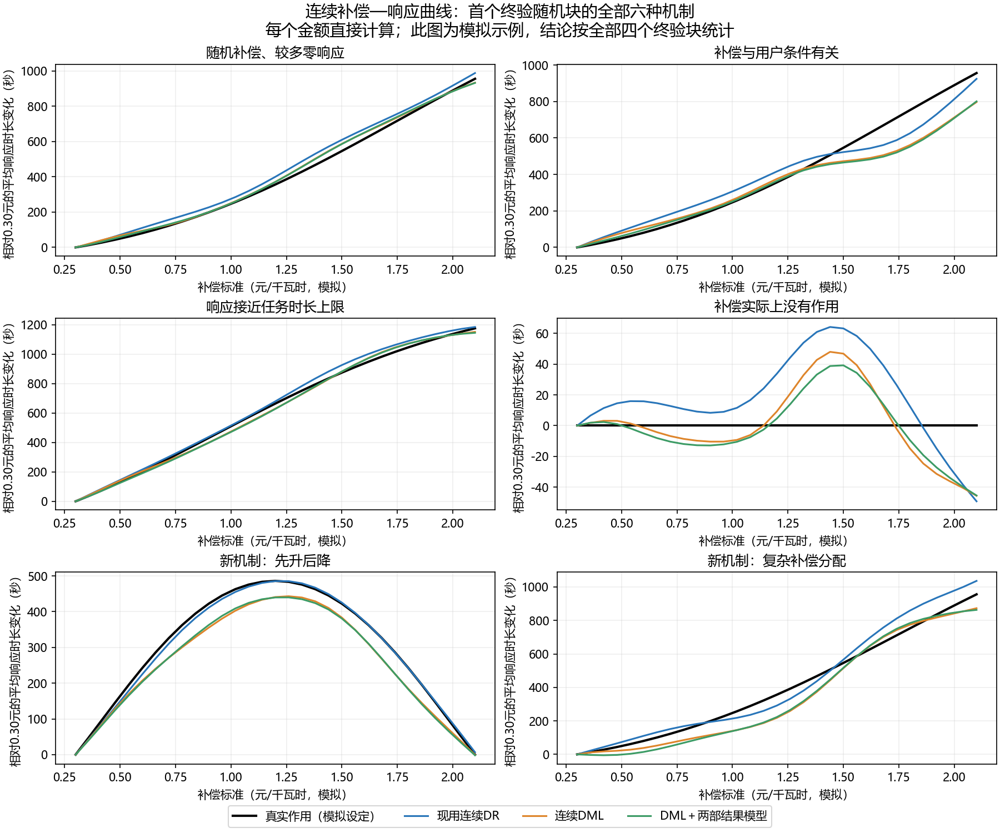
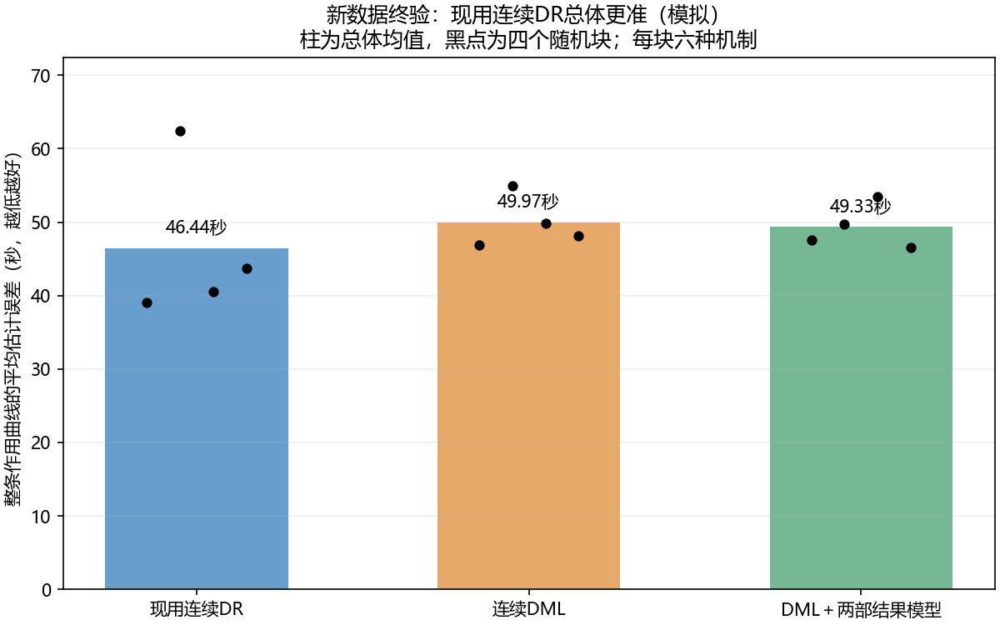

# 连续DML小规模复现与软两部改进：本轮保留现有连续DR

本轮完成了用户授权的三个动作：正确复现连续DML、与现有连续DR同条件比较、在开发选出的基线上试“响应概率×正响应时长”这一个结构改动。**新数据上现有连续DR总体更准，因此保留现有连续DR；DML保留为研究对照，两部候选未采用。** 第一部分源码、模型和既有结果全部不动。

所有结果为有明确补偿分配与作用真值的模拟。没有从ACN的电流上限编造补偿，未用真实数据验证补偿的因果作用，也未把第一部分旧112条模拟补一列金额充当因果数据。

## 实际比较了什么

现有DR通过正式 `fit_continuous_effects` 调用。连续DML按[Colangelo–Lee论文](https://doi.org/10.1080/07350015.2025.2505487)的查询金额处正交矩独立实现；[作者代码](https://github.com/KColangelo/Double-ML-Continuous-Treatment)作公式/实现核对。作者仓库为MIT，未执行其有共享模型缓存问题的普通路径，也未复现该文所有神经网络和MultiGPS实验。各用户折独立模型、重复用户分折等正确复现处理均对比较双方生效，不作为创新。

设补偿为a、事前因素为X、时长为Y。DML查询矩为 `m(a,X)+K_h(D-a)/p(a|X)*(Y-m(a,X))`。与原方法相比，变化在于查询处校正矩，而不是给原函数换名字。论文允许不同核及辅助模型，本轮统一高斯核/同一带宽规则，并使用和现有DR完全相同的补偿样条＋多项式X＋Ridge结果模型、logit-normal分配模型及用户折。因此这是共享辅助学习器下的方法复现比较，不是论文全部原始运行环境的逐结果复刻。

新候选只将结果均值换成 `P(Y>0|a,X) × E[Y|Y>0,a,X]`。仍对全部事件做原校正，不按概率设门槛，不筛掉未响应者；正时长辅助预测限制在任务长度内，最终曲线不裁剪、不强制单调。正响应状态不等于已识别的参与意愿，正响应者条件均值也不能当作固定人群的单独因果作用。

两个预先固定的控制用于检查收益来源：一个只限制单结果模型的辅助预测范围；另一个是近似参数容量匹配的单部fractional-logit（99个特征，对比两部2×47个特征）。后者是参数数目控制，并非严格证明函数类等容量。所有方法共用分配模型、用户划分、范围、带宽、预算与评估口径。

## 按先选基线、再确认的顺序完成

开发采用3个随机块、4种机制、每个机制240个模拟用户×2事件，共12条曲线。DML平均曲线误差49.18秒，现有DR62.94秒，故在开发阶段选择DML作为两部改进的基线；该选择、源码和配置随后冻结。

两部候选开发误差47.54秒，仅较DML小幅改善，并在3个零作用开发块中多出现1个条件带排零现象。没有把开发结果宣称为通过，也没有据此换模型或改阈值；按事前有限试验计划只做一次冻结终验。

终验有4个新随机块、6种机制，加入开发阶段没拟合过的非单调响应、混合分配机制。每条480个事件，24条曲线全部报告。另有4个近乎确定分配的弱支持块，全部方法都拒绝强行输出，不把拒答算成低误差。

同一随机块不同机制共享基础条件，属于配对机制变体。最终11520条主事实对应1920个基础事件条件、960个模拟用户条件、4个独立随机块，不能报成24次独立重复或上万真实用户。开发与终验的种子和用户角色隔离；未根据终验再调参。

| 终验全部24条连续作用曲线 | 作用曲线RMSE均值，秒↓ | 24条成功输出 | 平均水平MAE，秒↓ |
|---|---:|---:|---:|
| 现有连续DR | **46.44** | 24 | **35.01** |
| 连续DML | 49.97 | 24 | 36.12 |
| DML＋软两部结果模型 | 49.33 | 24 | 35.47 |
| DML＋仅辅助范围限制 | 50.87 | 24 | 36.61 |
| DML＋近似参数容量控制 | 54.22 | 24 | 36.66 |

曲线误差是在预先固定0.30—2.10元/千瓦时、31个金额处直接计算相对0.30元的平均累计时长变化，对照独立人群积分真曲线得到RMSE，再对各机制/块等权平均。输入补偿在0—2.4范围内连续生成，未人为分档；暂不把本批结果延伸到完整端点推断。

两部模型相对原DML只改善1.27%，未达到事前5%收益门；在两个新机制上的平均误差64.624秒，对比DML64.575秒，未改善。它优于两个辅助控制，但不足以支持替换基线，且仍不及现有DR。现有DR仅在本批平均更好，不宣称它对所有任务普遍优于DML。4个零作用终验块没有条件用户抽样带排除零的情况，样本太少，不能当成误报率或完整因果置信带保证。

现有DR沿用99次条件用户抽样，DML及其各改动使用199次；这不改变任何曲线点估计或RMSE。区间仅作辅助观察，未据此比较两种基线的区间精度或误报率；两部候选与它的DML基线使用相同199次。完整区间推断与覆盖率不属于本轮已验证成果。

### 连续曲线已经生成



图展示预先固定首个终验随机块的全部六种机制，不按胜负挑图。非单调场景中的差别最直观，完整结论以全部四个块为准。每个查询金额直接估计，线条连接仅用于显示，未把离散补偿档位插值成连续算法。



柱为全部主终验曲线的平均误差，黑点是四个随机块各自六机制的均值，展示本次小样本波动；没有把黑点当作置信区间。

## 第一部分接进去以后，结论是否变化

另按冻结方案生成640个新的物理任务，320个模拟用户，两个未见机制，各160用户×2事件。补偿先按明确机制分配，决定是否出现响应及持续时间，再生成同一10秒尺度、已知参照30分钟任务的实际功率与噪声。不是先有功率样本再随意贴金额。

第一部分仍使用原 `effective_response_refined`，实际运行原生CPOP和已冻结模型，取得累计时长。干净时长与提取时长配对，第二部分其他输入逐项相同；全部640条保留，没有按有效资格筛事件。物理真时长为10秒格取整值，人群真曲线也按Beta存活函数求期望取整时长，未用未取整曲线冒充。

| 两个新物理队列的曲线误差，秒↓ | 现有DR | DML | DML＋两部 |
|---|---:|---:|---:|
| 直接输入干净时长 | **40.93** | 62.54 | 54.48 |
| 输入第一部分实际提取的时长 | **41.47** | 57.08 | 48.31 |

接入实际提取结果后，现有DR仍最好。两部在这里比DML有明显局部收益，仍未超过现有DR，也不能抵消主终验未过门的事实。部分方法接入提取误差后恰好更接近真曲线，可能发生有限样本偏差抵消，不能解释成“第一部分误差能提升因果估计”。本批第一部分时长MAE9.39秒，只记录误差传递，不据此回头修改第一部分。

## 核验与可用入口

`technical_checks.json` 验过31个DML查询矩的独立标量计算、与正式DR辅助预测/密度/用户折及结果的匹配，0.73/0.85/1.17连续金额直接查询、增加绘图查询点不改变已有均值，以及非线性两部模型按实际训练X分布边缘化。没有把非线性预测在平均X处取值当作人群平均。

`verification.json` 核过58个正式文件、149个第一部分封存制品和6个上轮调研制品均未变；192组曲线评分独立复算、168组用户分折、640条物理生成原始值和实际原生输入逐一核过；4条公共API/native重放与原冻结过程结果相同。前级模型与原始数据未改，原先真实测试和外站数据本轮都没重开。

在项目根目录，无需安装：

```powershell
& "work/ride_b1_v02_reproduction_20261029/.venv/Scripts/python.exe" -B "work/b1_continuous_dml_pilot_20261103/replay.py"
& "work/ride_b1_v02_reproduction_20261029/.venv/Scripts/python.exe" -B "work/b1_continuous_dml_pilot_20261103/replay.py" --method existing_DR --amounts 0.73,0.85,1.17
& "work/ride_b1_v02_reproduction_20261029/.venv/Scripts/python.exe" -B "work/b1_continuous_dml_pilot_20261103/verify.py"
```

默认回放已存的模拟曲线。指定新金额时，使用同一冻结配置对原保存队列作直接查询，不生成新样本、调参或根据真值修正。试验文件单独留在work，未注册新正式方法、未替换生产默认。

最终取舍见 `decision.json`：开发阶段的DML选择保留作为试验历史；终验没有确认它相对现法的优势，因此**现有连续DR继续作为下一阶段主方法/主基线，DML是对照，两部候选不采用**。没有把“先推荐”当作必须胜出的结论。后续如继续研究，应有新的数据证据或新假设，不围绕本轮终验反复调参。
