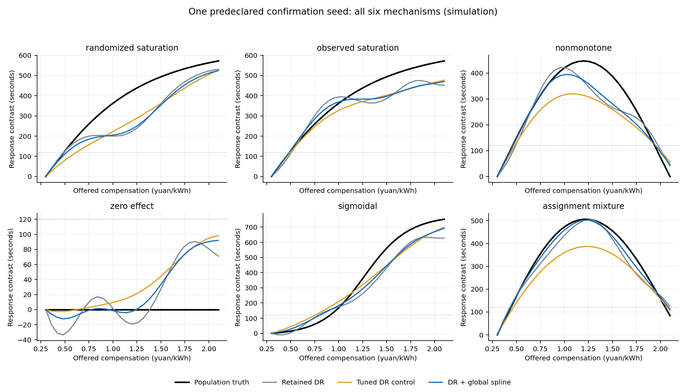

# 第三部分连续曲线：同一DR伪结果的全局样条比较

第二部分的因素定义已核清至当前模拟公式所能支持的范围；第三部分新候选在一次预定确认中，曲线误差由86.06490秒降至79.32092秒，平均减少7.83592%。与相同开发预算调过带宽的旧方法相比减少8.42656%。这是一项有收益的研究候选，当前正式默认未替换。

## 第二部分先核清的内容

| 项目 | 本轮处理 |
|---|---|
| 期限余量、需求紧迫程度 | 在观测分配模拟里同时影响补偿和响应，两法共同调整；随机分配模拟中可用于预测和异质性 |
| 补偿 | 事前形成的连续处理变量，金额不分档 |
| 是否响应、时长、处理后功率 | 属于中间过程或结果，不放进事前调整集，不据是否响应筛样本 |
| 用户ID | 用于保持同一用户的事件在同一折，不当作数字因素 |
| 负控 | 当前公式中独立无关，仅诊断，不再在新试验中声明为必要混杂因素 |

旧物理调用把所有三列包括负控交给默认DAG，默认图又为每列声明到补偿/结果的边，与已知模拟公式不符。本轮仅对新的比较双方共同纠正因素定义；旧代码、标签、结果与凭证不改写。

当前期限/需求是归一化模拟状态，不能代替现场SOC、剩余需求电量、计划离开、初始可调功率、市场/零售价、历史行为和时段。现有ACN没有事前补偿，不能给它追加假金额来检验补偿作用。详见 `factor_audit.json`。

## 方法依据与实际复用

采用[Bonvini–Kennedy《Fast convergence rates for dose-response estimation》2026修订版算法1](https://arxiv.org/html/2207.11825v2)中的两阶段思路：先构造连续双重稳健伪结果，再用回归或平滑学习整条连续曲线。本文也研究高阶估计器；本轮只采用其允许的平滑样条最终阶段，不称完整复现高阶方法或全部论文实验。

直接复用已安装的 SciPy 1.15.3 [`make_smoothing_spline`](https://docs.scipy.org/doc/scipy-1.15.3/reference/generated/scipy.interpolate.make_smoothing_spline.html)，[BSD 3-Clause许可证](https://github.com/scipy/scipy/blob/main/LICENSE.txt)，没有安装/升级依赖。没有找到该篇论文对应的作者完整复现仓库，不以别人的数据仓库充当方法源码。

候选把最终阶段的高斯局部线性回归换成带二阶导数平方惩罚的三次平滑样条。它兼顾整条曲线，减少不必要的局部弯折，允许非单调作用。原辅助结果模型内部本来已有三次金额样条，本轮改动位置与之不同。

任务适配包括金额/时长单位归一化、惩罚按样本数换算、同用户分折、连续金额直接查询与原支持诊断。金额除2.4、伪结果除1800；目标是平均平方损失加曲率惩罚，因此SciPy总损失参数传 `n_events * lambda_mean`。不裁剪DR伪结果或最终曲线、不强制单调、不筛零响应。相同金额仅精确计数加权归并，非金额分箱。

[Takatsu–Westling 2025](https://academic.oup.com/jrsssb/article/87/1/33/7685277)更适合后续偏差修正与统一区间，本轮未采用。2026年的[proximal连续作用方法](https://arxiv.org/abs/2608.00404)需要有科学依据的两类混杂代理，当前没有，未把普通因素改名当代理。源码、许可、适用条件及不采用理由见 `literature_review.json`。

## 同条件比较与新样本

三法共用同一份正式公开API拟合产生的DR伪结果、结果模型/GPS、用户三折和两列因素；只改变最后平滑。旧方法与候选各给5个预定平滑参数，避免把更多调参机会当方法收益。

- 新开发：3随机块×4机制×240用户×2事件，12曲线、5760事实变体。开发选出的全局固定参数为 `lambda_mean=0.0001`；旧方法带宽倍率为2。
- 新确认：参数和源码冻结后，一次生成8随机块×6机制，共48曲线、23040事实变体。对应1920模拟用户条件、3840基础事件条件；同块机制共用外生条件，独立重复只有8随机块。
- 查询范围0.30—2.10，参照0.30，31个连续金额处直接计算相对作用。主指标先对每条曲线算相对作用RMSE，再在48条曲线上等权平均，单位秒。
- 确认加入开发未见的S形响应和混合补偿分配。两者仍属于相关logistic/Beta生成族的变体，没有冒称完全独立物理生成器或现场数据。

## 确认结果

| 方法 | 作用曲线RMSE均值↓ | 全范围输出 |
|---|---:|---:|
| 现用连续DR＋局部线性 | 86.06490秒 | 48/48 |
| 同预算调过带宽的局部线性 | 86.62001秒 | 48/48 |
| 同DR伪结果＋全局平滑样条 | **79.32092秒** | **48/48** |

相比现用方法，8个独立随机块6个改善、2个退步；相比调参对照7个改善、1个退步。预定的两对照至少5%平均收益、至少6/8块改善、全输出和零作用误达目标不增加的门均通过。零作用8块中三法各1块误判达到120秒目标，未因样条增加。

| 模拟机制（各8块） | 现用DR | 调参DR | 样条候选 |
|---|---:|---:|---:|
| 随机补偿、饱和响应 | 83.43 | 71.39 | 83.11 |
| 观测补偿、饱和响应 | 106.36 | 96.18 | 98.56 |
| 非单调响应 | 94.68 | 109.37 | 83.61 |
| 零补偿作用 | 82.37 | 73.63 | 77.74 |
| 新S形响应 | 92.98 | 83.48 | 84.16 |
| 新混合补偿分配 | 56.58 | 85.67 | 48.74 |

总体平均有收益；样条没有在各类场景都胜过调参DR，随机饱和场景相对现用法也几乎不变。均值收益的8块配对描述性95% t区间仍含零：候选减现用误差为−6.744秒，区间[−14.985,1.497]秒；候选减调参对照为−7.299秒，区间[−19.210,4.612]秒。通过本轮预设实用门不等于已证明普遍或统计显著更优。

## 下游只计分，没有一起改算法

三条已拟合曲线的解析导数误差为现用209.57、调参149.49、样条155.92秒/金额。样条相对现用改善，但略差于调参对照。达到目标判断三法均47/48正确；40个真实达到目标的块中，金额交点MAE为0.10461、0.09593、0.09593。不能把第三部分的平均收益说成第五、第六都已完善。



该图固定展示首个确认随机块的全部六机制，未按胜负挑图；结论来自所有48曲线。

## 产物和后续边界

`candidate.py` 提供复用共享DR拟合结果的候选构建与连续曲线查询接口；`smoothers.py` 保存三次样条状态并直接查询任意金额。候选是当前特定任务/金额尺度的研究分支，没有替换正式默认、旧区间、第一部分、学图、分组或直接导数方法。

程序接口使用已带 `return_audit=True` 的基线结果，`X` 和 `users` 保持与原拟合同一事件顺序：

```python
model = fit_candidate_from_shared_result(baseline_result, X, users)
curve = query_candidate(model, [0.73, 0.85, 1.17])
```

模型为可保存的JSON字典；新金额直接查询已有样条，无需重新训练。当前默认参数只对应本轮0—2.4金额、30分钟累计时长的研究范围。

`protocol.json`、`development_source_freeze.json`及采样前异常分支修正记录、`selection_freeze.json`、开发/确认每队列facts/API结果/真值/评分/样条状态均完整保留。`decision.json`为全部确认队列的预定判定；`paired_seed_summary.json`记录随机块不确定性。独立数学及结果复核见 `audit_preflight.json`、`verification.json`。

下一步继续第三部分的稳定性研究，应先根据本轮暴露出的前级偏差或场景差异提出新假设，再使用新的开发与确认数据；不能用本轮已消耗确认数据继续改lambda追分。没有改第四至第六部分，没有重开第一部分测试、ACN或外站数据。
