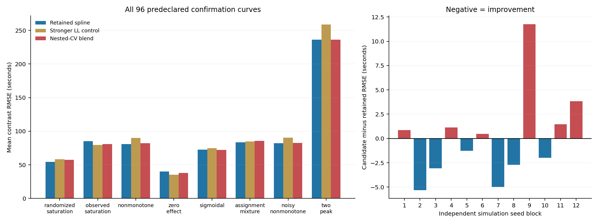

# 第三部分稳定性：两个退步块诊断与一次新比较

本轮结论：两个旧退步块的原因不同。按整用户嵌套验证学习平滑组合后，新确认96条曲线的平均误差由保留样条91.85603秒变为91.87151秒，略退0.01685%，没有获得额外收益。新候选不采用，上一轮有收益的固定样条和正式原方法均保留，其他部分不改。

## 两个旧退步块的诊断

旧8块48曲线全部参与诊断，没有只读两个坏块，也没有在它们上面试新lambda或混合参数。

| 旧随机块 | 原局部线性 | 保留样条 | 主要证据 |
|---|---:|---:|---|
| 90342003 | 128.67秒 | 130.98秒 | 低金额0.3参照误差从90.95增至97.86秒；其中响应抽样残差从79.87增至85.74秒。水平RMSE仅56.71→56.83秒，减去偏高参照后才放大为约129→131秒的作用曲线误差 |
| 90342005 | 110.29秒 | 121.10秒 | 其余估计误差与随机残差的抵消减弱，MSE交叉项由−167.22变为+3206.62秒²。S形和零作用两类约占该块净退步81%，不能统一说成样条噪声更大 |

第二个坏块的参照点还显示：辅助边缘均值误差约+61.89/+60.10秒，条件校正约−167.24/−155.92秒，其余分量约−105.35/−95.82秒；抽样残差约+32.49/+21.34秒只抵消一部分。两法共用GPS，其最大权重分别为6.72及9.04，不能把新旧差异直接归给GPS。

`diagnosis.py/json`把冻结伪结果分为响应抽样残差与其余分量，并保留MSE交叉项。辅助模型固定，因此其余分量混合了辅助估计、有限人群、校正和最终平滑误差，并非完整的因果方差分解。主评分严格取旧保存结果；等价样条算子重放最大数值差0.000294秒，作为数值余项单列。较早不稳定数值诊断路径均保留，没有改旧研究结果。

## 论文依据和本轮唯一候选

[Kennedy等2017，§3.5](https://arxiv.org/pdf/1507.00747)明确提出：训练折内估辅助模型和作用曲线，到留出折计算风险，再跨折平均。[Bonvini–Kennedy 2026修订版](https://arxiv.org/html/2207.11825v2)允许DR伪结果之后使用不同最终回归。[SuperLearner作者实现](https://github.com/ecpolley/SuperLearner)提供凸组合和整簇分折的成熟依据；其R包为GPL-3，未拷贝或安装R包，本轮在既有Python/SciPy栈独立实现两模型的一维最小二乘组合。

候选只在两条已经固定的方法之间学习比例：

- S：保留的 `lambda_mean=1e-4` 三次平滑样条。
- LL2：上一轮已固定、带宽为原规则2倍的强平滑局部线性对照。

用整用户外层3折验证。每一折的验证用户完全退出训练；训练子集内部重新按用户交叉拟合DR伪结果，训练两个平滑器，再用只见过训练用户的辅助模型构造验证伪结果。由验证平方损失闭式求样条权重α，限制在[0,1]。

为检查小样本下权重跳动，事前给5档收缩强度γ，实际样条权重为 `1−γ(1−α)`；γ=0精确恢复保留版。另给同样5档的常数混合β作对照，区分自适应选择与简单混合的收益。辅助模型类型、满数据最终DR伪结果、因素、金额范围、用户折、结果定义均一致，额外拟合只服务于组合选择。

此交叉验证优化的是观测金额分布下的水平预测风险；主评价是相对0.3参照、均匀查询金额下的作用曲线误差。二者不同，不能因为验证风险低就认定主目标更好。该组合也不是专门修正低金额参照偏差的方法。

## 新开发与一次新确认

开发：4新随机块×6机制×240用户×2事件，24曲线。选择γ=1、β=1；常数混合最优退回纯保留样条。新候选开发误差91.77935秒，保留版92.27624秒，仅改善约0.54%。按事前协议，仍做一次固定确认，没有根据开发结果增加候选或参数。

确认：源码和参数冻结后，12新随机块×8机制，96曲线、46080事实变体，对应2880模拟用户条件、5760基础事件条件。机制在块内配对，独立重复为12块。新增高方差正时长、双峰两种变化；仍是相关logistic/Beta模拟族，不是现场或独立物理验证。

| 本批方法 | 作用曲线RMSE，秒↓ | 全范围输出 |
|---|---:|---:|
| 原固定带宽局部线性 | 88.82424 | 96/96 |
| 保留样条S | 91.85603 | 96/96 |
| 开发选出的常数混合β=1（即S） | 91.85603 | 96/96 |
| 新嵌套验证组合 | 91.87151 | 96/96 |
| 强平滑LL2对照 | 96.49515 | 96/96 |

新组合相对保留样条略退0.01548秒，12块6胜6负；预定至少5%平均收益、至少9块胜保留版均失败。零作用12块误判达到120秒目标由3降至2，属于附带计分，不能代替失败的曲线主指标。新候选未采用。

所有96队列的nested选择均成功，没有通过回退制造更低误差；41队列选择纯S、19队列纯LL2，其余为中间权重。样条、LL、混合均未裁剪或强制单调；所有零响应/满响应保留。

## 新暴露的能力边界

新增双峰场景：原局部线性193.41秒，保留样条与新组合均236.23秒，LL2为258.73秒。12个双峰队列全部选择纯S，说明本轮组合没有解决该场景。

额外只做了固定两曲线集合的数学诊断：即使用真值为每条双峰曲线选择最佳组合权重，平均误差也只能降到234.17秒，改善不到1%。这不是可用算法，不参与选型/调参或正式计分；它说明仅靠这两个分量之间改比例，难以修补双峰短板。详见 `component_ceiling_diagnostic.json`。

原局部线性在本批96曲线上总体也比保留样条更准，因此上一轮7.84%收益只适用于上一轮同批比较，不能说样条普遍占优。旧版全部保留，未用新确认追调lambda、γ、β，也没有事后切换正式默认。

分层看，六种原有机制的新72曲线中，保留样条69.40913秒、原局部线性71.45538秒、新组合69.33102秒；组合依然几乎无新增收益。上述分层用于说明新增复杂场景的影响，采用判定始终以完整96条曲线为准。

## 文件入口

- `protocol.json`、`pre_sampling_amendment.json`、`pre_sampling_clarification.json`：预算、采用门及采样前双峰/支持定义修正；新研究数据生成前落地。
- `source_freeze.json`、`selection_freeze.json`：开发前源码与确认前参数冻结。
- `nested.py`、`audit_nested.py/json`：可复用的严格嵌套用户验证与泄漏微核。
- `development/`、`confirmation/`：每队列事实、正式API结果、真值、嵌套选择、最终共享状态和各策略评分。
- `decision.json`、`verification.json`、`completion_receipt.json`：判定和独立复核。

本轮仅第三部分研究；第一部分、第二学图、分组模型、直接导数与阈值算法不改。没有套用旧区间、安装库、生成CMD、删除或提交外发。下一轮需要新的方法假设与新数据；本轮确认已消耗，不重复追分。
