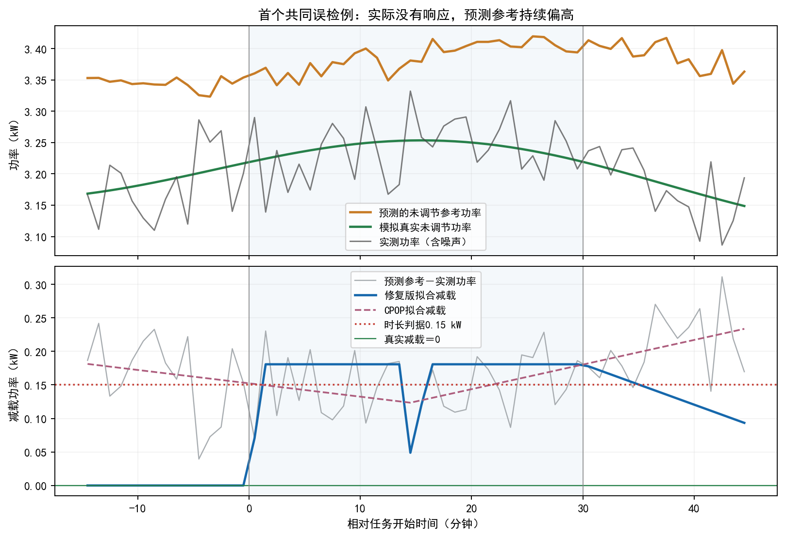

# B1误检与激励作用曲线诊断

2026-10-31。本轮只分析已见数据、复核实现和做受控诊断，没有修改正式算法、默认、阈值、模型或报告。**目前优先处理“参考功率误差怎样进入响应判定”，其次处理连续作用估计的有限样本波动；不建议继续把主要精力放在模板初始化，也不建议立即全盘换成CPOP。**

## 1. 两个问题需要分开解释

误检约15%指实际没有响应，却被算出正的累计响应时长。当前主结果按任务内每个完整分钟格的拟合减载是否达到0.1×请求功率累计；任意一格达到，就有正时长。它不是已经标定到5%的整次事件检验，也不是激励“零作用”的因果检验。

作用曲线比较则是“不同金额下的平均响应差异”。CPOP与修复版RIDE分别提供时长结果，后段都用同一个通用Kennedy连续DR。当前没有一个新的DR估计器可以预设应超过同一DR本身。原始η来自电量积分，不使用拟合曲线，三过程的η及η作用仍完全相同。

本轮重用原最终面板：8块、4096目标事实变体。它们是已见诊断数据，不能重新当独立测试。正/零机制、方法、同用户事件均有配对或相关性；1778个无动作变体只有1121个不同任务ID，657个无动作轨迹在正零场景中重复。

## 2. 误检的主要证据指向共同参考误差

| 过程 | 实际无动作时误检 | 比例 |
|---|---:|---:|
| 修复版RIDE | 263/1778 | 14.79% |
| 原CPOP | 274/1778 | 15.41% |
| 旧RIDE | 262/1778 | 14.74% |

修复版与CPOP共同误检246条，三法共同244条。共同误检组的参考功率在任务内平均偏高约0.214kW，已经高于本任务0.15kW的时长判据。190条无动作记录的整段任务平均参考偏差达到0.15kW，三法全误检。

原始残差严格为“真实减载＋参考预测误差－计量噪声”。参考持续偏高，即使用户没动作，也会形成持续的正减载残差。共同246条误检的原始残差全部至少连续两格越阈，193条至少连续五格。主要问题已经出现在拟合前；新模板把原本不越阈的记录拟合成越阈仅有两个变体，实际是同一基础任务的正零重复。

全体无动作记录的参考误差RMS约0.172kW，计量噪声RMS约0.050kW。本模拟噪声为有界均匀分布，上界约0.0866kW，原始噪声单独不能超过0.15kW。这不代表真实电表噪声有同样上界，也不能单凭原始信号断定拟合绝不会越阈。

需要避免另一个误读：全体参考误差平均为负，误检集中在正偏差尾部。不能将问题概括成“所有参考都偏高”，也不能统一减去一个偏移量。

### 同一批事件的受控核验

固定每块前16用户、目标事件3/4、正零配对共512变体，保留同样任务、计量格、声明噪声0.05及方法预算；仅在显式诊断里替换参考/功率。

| 修复版RIDE的条件 | 正作用时长MAE/秒 | 零作用时长MAE/秒 | 无动作误检 |
|---|---:|---:|---:|
| 原预测参考＋原实测功率 | 116.250 | 130.078 | 33/244 |
| 模拟真参考＋原实测功率 | 6.094 | 1.875 | 0/244 |
| 模拟真参考＋无噪功率 | 0.703 | 0.000 | 0/244 |

CPOP对应时长为104.766/145.313、8.672/2.578、4.453/0.938秒；其误检也由33/244降至0/244。修复后的模板在本机制的清洁输入下已可正常工作，不能继续沿用修复前“局部求解是主要剩余瓶颈”的判断。

这些oracle不是事前可得的真实参考，不是可部署方案，也不证明全量或现场零误检。headroom规则保持，但它由所供参考计算，替换参考会同时改变数字回补上限；因此该诊断反映参考输入及其派生规则的整体影响，不能分配成某原因占多少百分比。

图中例子按原面板顺序取首个共同误检，不挑最大误差。用户实际未响应，预测参考持续高于真实功率，两种过程方法都从这一差值识别出了减载。

### 参考选择器也需要复核目标

现有选择器只在最近3个已完非事件伪任务上比较任务窗平均绝对功率误差，再选GBDT或prev10；没有按当前事件误检或单侧误差尾部标定。本面板选择GBDT组误检61/1257，选择prev10组202/521。两组对象和选择条件不同，GBDT还有负偏差，不能直接据此关掉prev10或证明GBDT必然更好。它提出了可检验问题：历史选择是否稳定、选平均功率误差是否足以保证下游时长与误检可靠。

## 3. 曲线优势不稳，测量链与后段都有问题

把结果直接换成模拟真实已发生时长，其余用户折、配置、带宽及支持规则不变。下表均为8块“相对0.8金额的9点平均作用差曲线RMSE”，单位秒，区别于上表个体时长MAE。

| 输入后段的时长结果 | 正作用 | 零作用 |
|---|---:|---:|
| CPOP测量值 | 87.290 | 74.219 |
| 修复版测量值 | 79.732 | 68.874 |
| 模拟真实已发生值 | 75.449 | 47.517 |

即使去掉过程测量误差，后段仍有显著剩余波动。因此“把参考预测做好，曲线就必然稳胜”没有依据。当前修复版对CPOP的曲线差为−6.452秒，8块描述性MC95[−15.698,2.795]含零。

一方面，过程总体MAE衡量单次时长准不准，作用曲线衡量金额改变时的平均差异。共同偏移在减去参考金额时会抵消；误差随金额/条件变化的部分仍会进入曲线。但本轮没有证明“多数过程改进都被共同偏移抵消”，不能把低线性相关当成这个结论。

另一方面，逐点核验发现测量链误差与真实Y下剩余估计误差有正负抵消。零作用下，新过程的测量链平均平方分量没有更小，总平方误差却更低，交叉项更负。不能把这个有限面板里的抵消当成稳定增益，更不能把MAE或RMSE简单分摊成原因百分比。

后段的具体迹象：

- 每组256事件、128用户；每折仅85/86用户训练，局部金额点实际只有约41—49个最近用户，局部事件有效样本最小约39—67。用户重复事件不能算独立扩样。
- 真时长的留出结果残差仍大，正/零场景RMSE块均值约616/434秒。参加与不参加、稳定用户差异都造成真实异质性。
- 校正权重最大3.31—17.48，未触及既定30上限，但仍会放大残差；单个事件可对某个对比点产生很大贡献。未超上限不等于估计已稳定。
- 默认平滑带宽仍是经验公式0.256—0.276；未按本任务的曲线风险进行用户隔离选择。结果模型名义359列，实际47个非恒定列、有效自由度约35；不能误称359个有效独立参数，也不能仅凭维数断定过拟合已经成立。
- 密度模型族包含当前DGP，未发现“必然密度错设”的证据；平滑、辅助估计和抽样波动尚未分别定量识别。通用DR的稳健性也不保证小样本下点误差永远最小。[原作者论文](https://pmc.ncbi.nlm.nih.gov/articles/PMC5627792/)讨论了辅助估计、带宽与偏差/方差关系。

未调整曲线在本面板甚至在真Y下也有胜出：真时长正作用56.897秒，DR75.449秒。机制中L/U都提高分配金额，L提高响应而U降低响应，存在混杂部分抵消迹象。不能因曲线更好看就取消L/U调整；这组观察也不证明混杂等于零。

## 4. 建议下一轮按这个优先级决定

| 优先级 | 有针对性的工作 | 要同时验证什么 |
|---|---|---|
| 1 | 让参考误差及其不确定性真正进入响应判定，复核历史参考选择目标 | 误检、弱响应漏检、时长/电量偏差、可用率；同时检查正偏差尾部和负偏差，不能只追总体MAE |
| 2 | 在独立伪事件上做整次任务的可靠性标定，区分“测得时长”与“有足够响应证据” | 固定W/q/计量口径，有持续参考偏移及弱响应；证据不足可明确不确定，不能简单抬高物理阈值或只保留检测通过者做因果分析 |
| 3 | 按用户隔离评估连续作用估计的复杂度、平滑与校正项波动 | 必需混杂仍调整；新验证/测试下同时比较曲线偏差、波动和支持，不能在当前8块反复调带宽/权重到赢 |

前两项是一个“参考误差下的可靠过程测量”问题，可以做成一次有限候选；第三项独立保留，防止只改善上游却对作用曲线无收益。具体候选、预算及新评价数据仍需下一步决定，本轮未实现。

当前不优先扩大网络、继续增加模板起点或直接改成CPOP；这些都没有解决共同参考误差的证据。也不把通知后任务前[-15,0)整段当成事前信息：当前激励在−15形成，真正可用输入前缀为[-75,−15)。之前偏移校正误检上升的负结果保持有效，不能在此面板上重调后再当未见成绩。

## 5. 核验和保存

- [协议](protocol.json)在新增诊断前冻结；正式35项运行文件及645项原科学文件保持字节相同。
- [误检全量核验](detection/无动作误检诊断.md)：4096行join、三法身份、参考/噪声恒等式、分组；原129读取输入SHA同，另36864数值核对通过。
- [作用链核验](effects/mechanism_notes.md)：64次旧结果精确复放、32次trueY oracle、2304个分解点、378原文件SHA同，96次调用全部按原支持规则输出。初始支持统计因手工数组内存顺序差8.33e−17已保留并按原布局核同，未改科学参数。
- [过程oracle](process/summary.json)：512事实变体、3072方法/条件行，约215秒；另一路审查逐输出身份、积分与时长通过。无新独立事实、无新优化候选。
- [root交叉核验](combined_verification.json)：67项聚合/恒等式/分母/原源身份核对通过。
- 示例图已逐图查看。绘图初次未按UTF-8 BOM读CSV导致表头错误，修读码后成功；未触及任何算法或数据。

这些核验数量不作为性能样本数。本轮不改报告、不推进B2/B3/B4或其他资源，不宣称真实可靠性或任务书正式精度完成。
