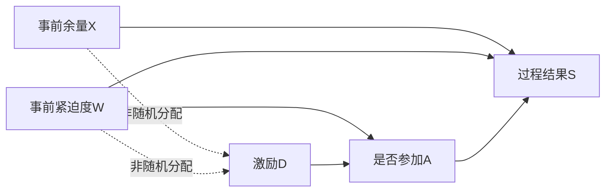

# B1同一EV机制的因素—全周期特征贯通实验

2026-10-26｜接续D114，执行一项明确问题：**激励对累计减载时长的总作用，如何与事前需求、期限余量造成的组间差异区分？** 本轮完成首个有限主链：结构假设→可调整因素识别→观测曲线特征→因素估计→独立评价。不是界面/脚本拼接，也没有继续调PCA。

## 结果与方法取舍

20组新重复，表为400个测试用户的总体效应，单位秒。真值指声明模拟总体中相同X/W构成的平均作用，不是个体实际延长时长。

| 场景 | 参考真效应 | G0直接比较均值 | G1按合法事前因素调整 | Gbad错误调整参加结果 |
| --- | ---: | ---: | ---: | ---: |
| 随机正作用 | 200.58 | 209.10 | 209.10 | −0.40 |
| 非随机正作用 | 200.58 | 120.45 | 211.24 | 0.03 |
| 非随机零作用 | 0 | −73.50 | 12.73 | 0.06 |
| 非随机负作用 | −162.57 | −221.01 | −147.94 | 0.39 |

- 非随机正/零/负场景，G0效应RMSE为84.41/77.97/63.96秒，G1为27.59/30.95/31.00秒。随机场景G0与G1都25.05秒：随机分配时不因增加方法步骤就宣称有增量。
- G1仍有偏差，三非随机场景平均偏差+10.66/+12.73/+14.63秒，MCSE5.84/6.47/6.27秒。零作用不是估成精确0，不改种子、增样或硬置零；上述频率/误差不是个体置信区间或103准确率。
- Gbad把激励后的“是否参加A”放进总效应调整，会阻断本轮设定的参与路径，正/负作用都被估近0；仅在真零时误差较小不能证明它适合总效应。**本轮生成器设定激励只通过参与影响执行**，这条机制是假设，不是新发现的真实用户规律；没有估计一般自然直接/间接效应。
- 辅助结果“累计减载≥600秒的比例”在非随机正作用中，真作用+18.70个百分点，G0+9.16、G1+19.74；零作用G0−8.38、G1+1.36个百分点。600秒及0.15kW均是数值研究判据，不是现场服务验收门槛。

**保留原理明确的G1作为本轮B1因素分析基线。** 它依赖所声明因果结构及无遗漏混杂假设，不因误差下降就升级为真实EV因果结论或正式采用全部模型。

## 图在算法中做了什么

X=事前期限余量组，W=事前需求紧迫组，D=低/高激励状态，A=单独记录的是否参加，S=累计减载≥600秒指示。独立期限扰动、动作延迟和计量噪声在简化图中边际化；T仍以调用前声明期限保存在原件，不把事后离站当输入。

该图是**物理与时序的分析假设**。总效应调整使用图的后门识别：随机场景为空集，非随机场景为X/W；A为后处理变量，不能加入总效应调整。枚举事前子集、删去D出边后做祖先道德图分离，独立核验另用活动路径枚举。累计时长R与S采用相同物理父集假设；S的结构筛选不证明连续R的完整因果图。

另在训练数据上用五个二元节点做**给定时间顺序的BIC父集筛选**，代替不适用的连续高斯Fisher-z。枚举Bernoulli条件表父集；每父状态至少20训练样本，不足则候选不可用，0log0按数学约定处理，不裁剪概率。箭头方向来自时间先验，数据主要筛边；X/W独立根也来自本轮设计，不是从数据发现全部结构。

完整图恢复随机20/20，非随机正/零/负9/20、9/20、8/20。80图中33次单漏X→D，另1次漏D→A及X→S；无额外边。非随机三组学习图建议的调整集分别仅9/20、9/20、8/20与假设所需一致。父状态不足候选合计0/18/18/19项，保留完整记录。

因此自动图仍是辅助结构筛选，不能凭“未筛出X→D”就取消对X的调整。本轮G1遵循冻结的机制假设，不由学习图单独决定；未声称自动发现EV完整因果图、完成PC/CPDAG或识别真实隐藏混杂。这一限制是本轮研究结果，不追20/20改BIC惩罚。

## 曲线与物理依据

单向充电参考3kW，已声明连接期限T到达后参考为0，最大功率4.5kW；请求600—1800秒减载1.5kW。T=2700+600X−300W+10J，J取−30至30；延迟0—60秒。参加后减载时长为`min(1200-delay,T-1800)`：保存电量必须能在1800秒后、离站前以1.5kW额外功率回补。完整潜在功率0—4.5kW，满足相对参考能量守恒与离站截止。这些是模拟控制/需求/许可假设，不补齐真实EV证据。

特征提取器只读公共参考和观测功率，不读A/T/隐藏动作时长。主结果为请求窗内减载≥0.15kW的**累计时长**，不同于最长连续时长；后者按至少3格驻留单列。不能拿累计600秒当连续600秒承诺。还保留原始有符号交付电量、Y和截止欠量，不用阈值替代积分或把末端噪声符号当恢复结论。

160000观测变体相对潜在物理时长，累计时长平均绝对差1.124秒，最长连续时长0.0088秒；无动作的单格噪声会增加累计时间，连续3格误检本面板为0。作用真值已按计量噪声及float32舍入边界计算，不能用物理时长直接冒充观测结果的无偏真值。

## 数据与复算

20新种子2610261101—1120，每次2000独立用户各一个事件、四机制配对，共40000基础事件/160000观测变体。用户1200/400/400训练/验证/测试，同用户四变体同区，变体共享条件/随机量/噪声，不能当160000独立用户。原件[data新版本](../../data/驱动因素解耦模拟数据集_B1_ev_factor_chain_v1_20261026/README.md)。

G0训练臂均值；G1训练内按识别集合的饱和条件表，测试只对事前X/W标准化；Gbad按X/W/A条件表，是故意错误的诊断对照，A不是合法事前输入。G0/G1每臂状态最少20条，Gbad最少5条；本次三个方法全部20/20可算，失败规则仍保留，绝不删无效样本重算分母。未训练DML/森林或神经网络。

主程序先冻结8个科学源码/协议SHA，再生成、提取、学习、拟合并存预测，随后独立评价。真值对61种期限扰动×7种延迟平均，按高斯噪声与存储float32阈值边界求累计时间均值、二项卷积求S均值；对测试X/W构成标准化，不是对每个测试实际T条件化的CATE，也不是实现的个体反事实差。

复核：项目根执行`python work/b1_ev_factor_chain_20261026/verify.py`。主入口已执行`run.py freeze → generate → fit → evaluate.py → plot_results.py`，原件/预测拒绝覆盖。13项微型及另写验证器43280项通过/0失败；验证器不导入主科学模块，独立重算曲线、直接条件似然BIC、活动路径调整集、训练条件均值/预测、2880指标/144汇总/80图和特征记录。真值差1.42e−13、BIC6.82e−13、指标最大1.97e−12，训练均值/预测完全一致；检查数不是研究样本量。

`features.extract`、`graph.adjustment/learn`、`estimators.fit/predict`为研究函数；输入角色及单位如上，不代表平台已接。证据：`observed_features.npz / graphs.json / models.json / predictions.npz / metrics.csv / graph_metrics.csv / feature_metrics.csv / evaluation.json / independent_verification.json`。图为`factor_effects.png`及`graph_screening.png`，完整20重复。

生成9.91秒、提取/筛图/拟合0.84秒CPU实测，无新依赖/GPU/界面/上传/提交。先审[DoWhy官方项目](https://github.com/py-why/dowhy)及[MIT许可](https://github.com/py-why/dowhy/blob/main/LICENSE)、[causal-learn](https://github.com/py-why/causal-learn)及[MIT许可](https://github.com/py-why/causal-learn/blob/main/LICENSE)：均有持续社区维护，分别适合假设识别与结构学习；本机未安装。五节点枚举/条件表用现有NumPy/SciPy即可透明核验，无需增加依赖；没有复现完整两库或把Fisher-z套二元选择。原D106/D112及74现用资源模型SHA不变。

## 完成边界

本轮完成D114要求的**首个同机制有限主链验证**，不是B1全部完成。保留“结构假设约束＋观测过程特征＋合法调整估计”原型，学习图作辅助并显式保留漏边；无需把EV小图调到完美才允许后续跨机制验证。时序/深度表示、更多因素/机制、真实因果识别和正式精度均未完成，原真实冻结及全局待审稿位置不变。本轮不因发现漏边自动扩图/换测试或宣布下一资源研究已启动；后续按这些明确缺口与任务价值选择有限实验。
