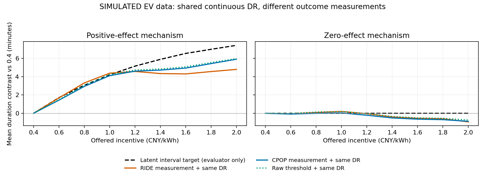

# EV B1主线开发：步骤1—3

2026-10-30。按用户批准的[最终规划](../b1_research_point1_final_plan_20261030/研究点一B1算法范围、现状与后续实施规划_定稿.md)实施。正式源码仍在根[B1算法](../../B1算法/README.md)，本目录只存过程、实验和核验。报告未改。

本轮已经实际贯通“合法历史参考→实际功率过程分析→声明结构与调整→过程结果的连续激励作用”。这表示步骤1—3的限定实现和首轮研究完成；参考误差造成的误检仍未解决，不能把它写成整个研究点一或真实EV能力验证完成。

## 做了什么

1. **研究合同与变量角色。** [步骤1口径](步骤1_EV主问题与字段口径.md)固定同任务下的连续激励、累计减载时长和并行原始η；将事前期限余量/需求紧迫度与事后参加/执行分开。新 `EVFactorStudy/describe_ev_study` 核查声明DAG、时间顺序、后门集合；因素接口逐任务核对对象与处理形成时点。未知图、处理后调整、错对象、不同测量判据或坏事件拒绝，不隐删失败。
2. **未知参考的过程研究。** 新增可选 `select_ev_reference`，用已完成历史伪任务比较既有GBDT和历史均值，不读当前响应、不重训、不作已失败的偏移校正。RIDE/CPOP使用完全相同的所选参考；新生成的形状含缓慢波动、间断及提前退出，不由RIDE模板生成。
3. **过程到连续因素作用。** 新 `fit_ev_factor_curve/analyze_ev_factor_study` 将实际事件输出接入现有Kennedy连续DR。累计时长按选择曲线、CPOP曲线、原始阈值三种测量比较；η原始积分并行。期限余量负/非负的两个事前组分别估计，不把参加当总作用混杂条件。辅助激励父集BIC只读训练用户，不据筛选删混杂。

源码增量主要在 [factors.py](../../B1算法/b1_algorithm/factors.py)、[ev_selection.py](../../B1算法/b1_algorithm/reference/ev_selection.py) 及统一 [b1_api.py](../../B1算法/b1_api.py)。旧过程核心、连续DR核心和原η计算未改。

## 本轮数据与比较口径

[protocol.json](protocol.json)在主运行前固定。8个新独立种子，每个200用户×2事件；正作用/零作用共6400个配对事实变体，基础事件3200个。每个方法的行数、机制变体和用户重复均不当独立试验。另有20/37分钟任务、高噪声的256个事实变体，只作过程压力检查。

主任务30分钟、1.5kW、完整1分钟计量，噪声标准差0.05kW，前后窗各15分钟。连续激励范围(0,2.4)，查询0.4—2.0，相对0.4；只有查询网格，没有训练档位。L/U是[-1,1]的标准化条件。对生成的观察分配，D的logit含L/U，因此声明图要求调整两者。未观测行为差异不影响条件D，是本次生成假设，不能直接推广给现场。

参考模型使用已有冻结权重，无新训练。历史只含同车、同表的完整非事件片段；选择时比较最近3段，每段以前的至少2段给历史均值。正/零机制共享相同用户、D、历史、计量噪声等基础随机量。真值单独在 `evaluator/`，不传给任何拟合器；独立生成器见 [simulation.py](simulation.py)，205项小型检查原收据保留。

连续作用的拟合目标是所声明的**测量结果**。下面作用误差另与评价器给出的共同、无噪声1分钟区间目标比较，反映测量和效应估计的综合偏离；不是仅属于DR本身的误差。没有据测量定义变换宣称因果识别得到加强。

## 实际结果与采用判断

[完整汇总](results_summary.json)、[补充对照及恢复状态](additional_diagnostics.json)、[原始逐行过程指标](process_metrics.csv)、[作用指标](effect_metrics.csv)均保留。

### 历史参考

| 方法 | 主任务平均参考MAE/kW | 平均偏差/kW |
|---|---:|---:|
| 冻结GBDT | 0.1444 | -0.1109 |
| 历史均值prev10 | 0.1783 | -0.0057 |
| 历史片段选择 | 0.1406 | -0.0611 |

3200次选择中GBDT2235次、历史均值965次。选择在这批数据上只带来小幅平均改善，不能称已消除参考偏差。该选择是可选入口，原预测默认没有被改成自动最优。

### 过程测量

| 主场景/方法 | 平均曲线RMSE/kW | 累计时长MAE/秒 | 真无动作误检 | 真有响应漏检 |
|---|---:|---:|---:|---:|
| 正作用/CPOP | 0.1514 | 111.6 | 140/995 | 0/2205 |
| 正作用/RIDE | 0.2311 | 275.5 | 130/995 | 0/2205 |
| 零作用/CPOP | 0.1480 | 162.2 | 256/1737 | 0/1463 |
| 零作用/RIDE | 0.1593 | 311.1 | 239/1737 | 1/1463 |

零作用表示金额不改变响应，不表示所有人都无动作；误检分母始终为真实累计阈上时长为0的子集。所有主事件均有输出，无fallback，但“有输出”不能当“测量准确”。

正作用累计时长的RIDE−CPOP配对平均误差差为+163.9秒，8块均值差的t型蒙特卡洛区间[155.0,172.8]秒。这个区间描述本模拟中8个独立块的平均差异，不是测量区间覆盖率或现场可靠性。新响应形状下，模板拟合损失了间断/提前退出的信息；不能沿用旧模板匹配场景的优势结论。

20分钟高噪声下时长MAE为CPOP85.8秒/RIDE159.4秒；37分钟为265.3/461.3秒。真无动作误检分别为4/45（两法相同）及14/47对13/47。小分母压力例不支持精确误检保证。

删失保持原状态。例如正作用的估计功率恢复右删失CPOP1490/3200、RIDE839/3200；这两数差异包含拟合策略影响，不能解释为两种真实恢复能力。完整功率/电量恢复状态及不适用分母在补充汇总中，未把右删失填成未恢复或恢复成功。

**当前采用判断：**这条“未知参考→累计时长→作用”的EV研究调用显式选CPOP；RIDE保留为可选模板与比较方法。原始阈值结果亦保留，不强行用复杂拟合替代。原通用事件API默认保持兼容，不把原1分钟RIDE路由描述为普遍最优；最后统一路由在步骤6的新独立评价中确认。两法真无动作误检约13%—15%，还不能把输出当可靠的参加判定或物理动作识别。

### 连续作用及通用对照

| 总体目标 | CPOP测量+同一DR | RIDE测量+同一DR | 原始阈值+同一DR |
|---|---:|---:|---:|
| 正作用曲线RMSE/秒 | 97.9 | 132.8 | 95.3 |
| 零作用曲线RMSE/秒 | 72.4 | 89.3 | 71.3 |

原始η在两过程方法间逐项相同。其正/零作用曲线误差分别为0.0367/0.0279（比例单位，即3.67/2.79个百分点），没有把CPOP的时长改善算成η改善。

对相同CPOP测量结果，Kennedy DR、共享结果回归、未调整局部曲线、同伪结果直线的正作用误差分别为97.9/108.9/91.4/110.0秒；零作用为72.4/102.1/74.6/48.5秒。**DR没有全面领先，未调整在本正作用小面板上更低，直线在零作用更稳。** 这不取消声明图所要求的混杂调整，也不证明未调整真实可识别；同时它不支持“新B1因果估计器优于通用方法”的表述。

两组事前分层中，期限余量负组8/8块可输出；非负组仅6/8，另外两块因局部支持不足拒绝整条曲线，四种结果与两个机制均保留该拒答，共16/192个作用输出拒答。分组曲线误差通常大于总体，不能用小分组制造确定的异质规律。

辅助父集筛选8块中6块选齐L/U，2块漏L；声明调整仍保留L/U。这是有限的激励分配子图筛选，未实现完整EV因果图自动发现。

零作用下，条件抽样带的9个查询点同时含零次数为时长三法均7/8、η5/8。只有8块，且带未传播完整参考/过程/辅助模型和平滑误差，不能据此宣称名义95%覆盖通过。零作用曲线不硬置零。

图中黑虚线只供评价器核验，其他曲线共享同一连续DR；横坐标为示例补偿单位，不是现场价格建议。线连接9个已评估金额，连续接口本身可直接计算任意支持金额。

## 核验和透明修正

- 主运行收据 [research_receipt.json](research_receipt.json)：约299秒CPU/4进程，无新依赖或模型训练；原源代码身份见 [scientific_source_freeze.json](scientific_source_freeze.json)。
- 根功能核验26项通过，原收据保留；严格合同修正后另跑[26项核验](verification_post_contract_fix.json)，旧η与冻结旧源码/现用旧接口相同，公开因素桥接等于直接共用Kennedy核心。
- [独立47项核验](technical_review/audit_receipt_corrected.json)通过，发现并修正了历史来源对象/日历可得性、已完成过程与任务错配、非计量格时长/曲线结果不一致及坏study类型等入口问题。独立核验第一版两个天气/日历负例改了过时顶层字段，核验器自身更正并保留旧失败收据，不是隐藏生产失败。
- 主研究是在原冻结入口上运行。历史身份与日历在生成机制中有明确含义，但原事实文件没有逐条显式保存这几个元字段。现只给生成器补元数据、给正式入口加严格校验，**没有改原始事实文件和主结果**。[元数据配方](historical_metadata_recipe.json)逐文件记原SHA，限定为本模拟时钟，不能拿来补真实数据来源。
- [修正复放](corrective_replay_receipt.json)核对全部6656个事实与真值：新生成结果除这些元数据外逐项精确相同；已存事件53248个结果行通过严格合同，192次选择重算的分数/数值输入摘要相同。未重新拟合主实验或替换其成绩。
- [公开总入口检查](wrapper_check_receipt.json)实际调用 `analyze_ev_factor_study` 复算400个事件，与已存CPOP输入、曲线、特征、η一致，因素结果与两阶段调用完全相同。这是功能复放，不算新增独立性能试验。

纠正前源身份与纠正后源身份同时保留；不能把原主运行描述成当时已经执行了新增严格校验。

## 使用与接续

开发调用见 [运行库说明](../../B1算法/README.md)。`analyze_ev_factor_study` 是正常Python项目入口；已有过程结果用 `fit_ev_factor_curve` 继续分析，避免重复过程拟合。保存研究结果到新的work子目录，不覆盖本轮冻结文件。

复核命令使用当前Python环境及 `-B`；`run.py` 和核验脚本都有完成文件防覆盖。旧主研究无需重复运行。若开展新研究，应另建协议/目录/种子；不能删收据来重跑。

后续仍按已批规划：步骤4连续敏感性/候选阈值及冻结查询，步骤5一次目标匹配的B1时序用途，步骤6最终EV候选的新独立全链比较。当前结果尤其要求保留参考误判、模板错设和小分组支持不足这些失效情形。报告、其他资源、B2/B3/B4继续后置。本轮不把53,248项复放或检查数当作研究创新和精度证据。
