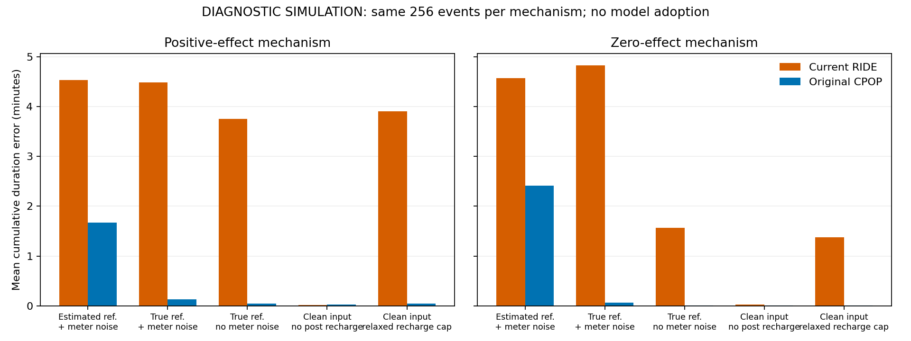

# 当前RIDE为何不如CPOP：失效诊断与待决定路线

2026-10-30。本轮按用户要求先分析，再决定保留、替换或采用何种改进。**没有改正式算法、默认路由或报告，也没有采用新候选。** 上轮“时长研究优先调用CPOP”的建议不视为正式替换决定。

结论：**当前失败不能主要归咎于参考预测，也不足以否定模板思想。直接证据指向后窗回补处理与当前局部求解/初始化的交互；回补幅度配置也与本情景不符。应先做一轮有限的模板求解修复候选，再决定是否转向CPOP增量路线。** 这项建议等待用户决定，尚未实施。

## 诊断怎样保证可比较

[协议](protocol.json)在新增拟合前固定，源码身份保存在 [source_freeze.json](source_freeze.json)。使用上轮已见数据，8个独立块，各固定取前16用户的两个事件；正/零作用配对共512个事实变体。这是机制诊断集，不能再当作未见测试。主任务仍为30分钟、1.5kW、完整1分钟平均值、前后窗各15分钟。

两法用相同功率、参考、观察窗、名义噪声和时长定义。原CPOP仍为原生cpop1.0.10、beta=2log(n)、精确剪枝，未改变其惩罚和输入以制造输赢。无噪声诊断仍声明sigma0.05，避免把去噪与改变算法选择尺度混在一起。回补幅度单项实验仅改变RIDE边界，CPOP输入与参数完全相同，复用同一结果。

真实未调用参考与无噪声功率只从模拟评价真值读取，直接进入显式的过程诊断；没有伪装成部署时事前可得数据，也没有进入正常预测模型或因素拟合。去除后窗回补仅改变任务结束后的功率，任务窗内输入和真值逐项相同。它用来定位影响，不是可部署的改进。

## 数值结果

下表为固定256个正作用记录上的平均累计响应时长绝对误差；它是上轮3200个正作用记录的预定子样本，不能与上轮全样本数直接混成一个分母。

| 同一事件的诊断条件 | 当前RIDE/秒 | 原CPOP/秒 |
|---|---:|---:|
| 原预测参考、有计量噪声 | 271.9 | 100.1 |
| 换模拟真实参考，保留噪声 | 269.3 | 7.7 |
| 真实参考，再去掉计量噪声 | 225.0 | 3.0 |
| 上述清洁输入，另外移除任务后回补 | 1.2 | 1.4 |
| 清洁输入，保留回补，仅放宽模板回补上界 | 234.1 | 3.0 |

零作用机制对应RIDE/CPOP误差为274.5/144.6、289.7/3.8、93.8/0.7、1.9/0.7、82.7/0.7秒，方向与交互并不完全相同。参考改善有时会让RIDE某项误差变大，说明误差之间存在抵消，不能把MAE简单分成“参考占X%、模板占Y%”。零作用允许存在真实响应，只是激励金额不改变该响应。

所有5120行方法/条件结果均保留，无不可算或fallback。原预测参考下，正/零机制CPOP真无动作误检为7/76及16/145，RIDE为6/76及13/145；换真实参考后本子样本两法均为0。这个结果支持共同参考误差造成误检，但不构成实际误检率已经标定通过。

完整结果见 [summary.json](summary.json)、[逐行指标](diagnostic_metrics.csv)、[形状分组](shapes.csv)。曲线RMSE、时长偏差、误检/漏检、后窗残差和η误差同时保留，未只挑时长一项。

## 原因已经明确到哪一层

### 1. 参考预测确实有问题，但不能解释当前方法与CPOP的全部差距

参考功率偏差会被当作减载，尤其影响真无动作事件。换真实参考，CPOP时长误差从100.1降至7.7秒，RIDE却仍为269.3秒；去掉计量噪声后RIDE仍为225.0秒。因此，仅继续训练参考模型，不足以解决当前主要时长损失。

当前适配器传 `sB=0/lr_crit=None`，走BIC检测；源码中sB只影响LR及区间。单把sB改成非零而继续BIC，点曲线和检测不会因此得到修正。参考不确定性要真正进入观测模型、判别或独立伪事件校准，不能只增加一个字段。

### 2. 后窗回补明显干扰任务内拟合

生成过程允许先停止减载，再等待到任务结束才回补。M1规定回补紧接正响应释放结束，没有独立等待时间；拟合后窗可能通过拉长正响应/释放来妥协，进而高估任务内阈上时长。本清洁诊断的RIDE时长误差几乎全部是高估。移除后窗回补后，任务内原曲线完全不变，RIDE误差却从225.0降至1.2秒，说明后窗拟合是重要触发条件。

不能进一步把全部差异都归给“回补开始时刻绑定”：移除回补同时消除了幅度越界、时序约束和优化难度。M2还可以把唯一的掉落段放在保持段末尾，表示提前结束后的空档；因此“整个模板绝对不能表示等待”是错误的。已有内部间断又要末端空档时，一个gap可能不足；非线性波动等表达问题仍需分别检查。

### 3. 找到了明确的求解/初始化不足

本轮选取每块最先出现的两个参与near_step记录，共15例（其中一块仅1例），不按误差挑样本。对它们构造合法的M2参数见证：回补幅度先放到合法域，末端gap表示等待。见证的完整60格曲线与模拟真值误差小于1e−10、RSS约1e−27，证明这些情况属于模板表达范围。

但当前默认搜索有12/15例的M2目标值差于已知可行解；将起点下限从3增到12后仍有11/15例没有找到该解。默认15例的时长MAE320秒，增起点后276秒，改善有限。注意默认3是下限，实际通常已有启发式/穿越/抖动/DP等约5个初值，不能描述为只跑3个初值。

另一个幅度完全在原边界内、无噪声、精确属于M2的正控，当前实现选M1，时长误差600秒；原CPOP为0。真正M2精确解的BIC应低于这个坏M1，因此核心证据是M2拟合没得到好解，随后基于坏候选作选择。不能把这种失败归为BIC合理偏爱简单模型。

`_fit_one`只保留最低cost，没有记录/核查优化器成功、达到迭代上限等状态；公开 `ok` 只表示有有限数值输出，不认证找到了好的局部解。下一候选需要从参数化、初始化、边界退化和求解诊断入手，不能仅不断增加随机起点。

### 4. 回补上界配置不匹配，是另外一项问题

默认允许的回补为1×q，即1.5kW；本模拟实际回补1.8kW。全量旧真值核查中，所有真实响应记录都有后窗格超过该界。这个面板对当前默认幅度域是系统性域外。它反映配置适用范围不匹配，不能直接证明模板方法整体无效。

不过单独把上界放到1.5×q后，正作用时长误差仍为234.1秒，未解决主要失败。边界修正是必要的适用性工作，不能据此宣称新的算法创新或已超过CPOP。

### 5. 模板有可用部分，也有尚未验证的限制

8个预定正控包含4种精确可表达结构的干净/带噪版本。标准M1的两种正控时长误差均为0，部分带噪曲线误差略低于CPOP；末端等待和某些间断版本则明显失败。移除回补后的本诊断中，RIDE任务时长误差也很低。因此当前证据支持先修当前求解过程，不支持立即把模板全部丢弃。

另一方面，时长接近并不等于曲线处处更好；完整窗口平方误差与任务阈值时长是不同目标。更灵活形状、计量噪声和参考误差会改变排名，不能在本诊断上修到满意后当作最终验证。

## 两条待决定路线及我的建议

| 路线 | 实质工作 | 做完怎样判断 | 当前意见 |
|---|---|---|---|
| A. 先修现模板的求解与后窗处理 | 依据实际功率余量设置回补边界；加入从可观测信号构造的末端空档/回补初值或更稳定参数化；核对求解状态；明确需要时的任务/回补分段处理，保持区间平均算子 | 先通过精确可表达正控，再在新用户/新种子、含匹配与错设形状、真实与预测参考的数据上与原CPOP比较；原始η不变；不得用诊断真值初始化部署算法 | **建议优先做一次有限候选**，已有明确可修问题，代价比立即重写核心小；不保证最终胜出 |
| B. 采用CPOP为通用核心并研究实质增量 | 明确新增的参考误差处理、任务/恢复结构信息或计量区间观测建模；证明这些信息怎样进入目标/约束/输出，而不是仅重命名调用 | 与原CPOP在同信息、可比开发调参预算和新测试上比较，主要指标、误检/漏检、可用率和计算代价共同评价；与简单基线和消融同时比较 | 若A修复后仍在目标范围无稳定增量，可转此路线；本轮未开始实现 |

建议先选A，修当前已经证实存在的求解缺陷，再据新数据决定是否保留模板或转B。只增加起点、只放宽边界、用真值给初值或直接调用CPOP均不能构成已经超越baseline的证据。

若采用B，CPOP已经在自己的分段折线/L0目标上作动态规划优化，研究改进应来自更适合本问题的观测模型、可用资源信息或可靠输出，而非声称在完全相同目标下任意压低原算法最优值。[作者论文](https://www.jstatsoft.org/article/view/v109i07)、[CRAN源码镜像](https://github.com/cran/cpop)。它已有异方差权重和CROPS惩罚路径支持，不能把这些现成功能重新宣称为本项目原创。GitHub镜像中1.0.10日期2026-10-13、GPL≥2，与本机已装版本一致；沿用成熟原实现，无新安装。网络核验页为[包元数据](https://raw.githubusercontent.com/cran/cpop/master/DESCRIPTION)。

“超过原算法”应落实为预定任务范围和主要结果上的可复现改善，同时说明其他指标及代价；不能预先保证每种场景、每个指标都胜出。两路线都须保留原CPOP作为强主对照。因素侧共享的连续DR本轮未改、未重新开展因果效应实验；上游曲线改善不能自动算成η或因果估计创新。

## 复核与保存

- [主诊断收据](diagnosis_receipt.json)：512事实变体、5120方法/条件行，约117秒，15机制探针及8个功能正控；这些不是5120次独立实验。
- [根复核](verification_receipt.json)：源/旧结果身份与逐曲线指标重算，无求解重跑。
- [独立静态审查](independent/数学与代码静态审查.md)、[独立结果审查](independent/结果与归因复核.md)、[62项独立收据](independent/result_review_receipt.json)。academic技能仅用于技术证据复核。
- 本轮只在work新建诊断材料和项目接续记录；正式B1源码、原始事实、旧结果、75项资源/b123保护文件保持，未改报告、task、01依据或B2/B3/B4。

等待用户根据上述诊断决定A/B及具体候选。原最终规划的连续阈值、时序用途、独立全链比较没有取消；当前先处理影响这条主线的过程缺陷，本轮未自动展开这些后续研究。
