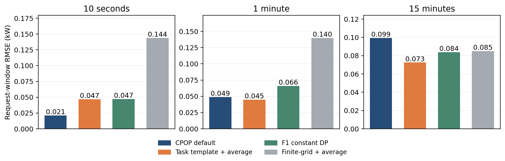
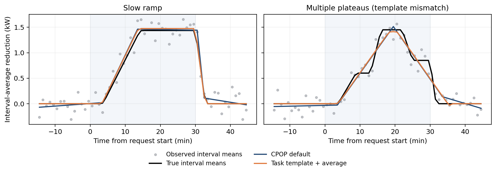

# B1过程识别：CPOP强基线与RIDE成分适配

日期：2026-10-29。研究对象是带独立计量噪声的区间平均功率。原始RIDE、旧F0/F1与其他冻结科学结果保持不变。本目录实现通用连续折线的平均观测适配，并用原生CPOP及RIDE任务模板开展有限比较。

## 1 研究结论

**区间平均应按区间积分解释，但这一机制改正本身没有在10秒、1分钟观测中带来稳定精度增量。RIDE任务模板在1分钟和15分钟的平均曲线RMSE较低，10秒则明显不如默认网格CPOP；多平台错设时模板也明显更差。因此目前不能把候选整体替换成“全面升级后的B1”。**

本轮得到两项可以复用的候选：连续折线的平均观测模型，以及带延迟/爬坡/保持/释放假设的任务模板模型。接口要求显式选方法，没有根据主测试选出默认赢家。原项目b123默认入口不变。

## 2 方法及公平比较

连续折线使用截距、全局斜率及内部结点的hinge基函数；拟合目标为标准化残差平方和加斜率变化个数的惩罚。候选`Grid_average`以每格曲线精确平均值拟合，而`Grid_point`使用中点值拟合。两者共用相同结点子集、最大4个内部结点、联合满秩规则、QR求解、惩罚`2log(n)`和择优规则。两法输出的潜在曲线都投影为区间平均值后评价。

该适配吸收了RIDE显式平均观测算子的思想，没有把原RIDE模板改名为CPOP，也没有声称自行实现了原生CPOP的动态规划。有限结点枚举只对给定满秩子集族求最优；候选网格与结点上限的限制必须保留。

通用主对照为原生R包`cpop 1.0.10`。最初为匹配有限网格消融，在固定约4分钟候选网格上运行了CPOP；这会限制细分辨率性能。故又在同一批冻结观测上，事前登记一项必要公平性补充：**使用原生默认`grid=x`，其他参数不变，无调参搜索**。最终报告应以默认网格版本作为主要强对照，粗网格保留为消融背景，不能据粗网格成绩宣布优越。

原生CPOP同时给出两种明确解释：

- `CPOP_default_binned`：直接把原生中点拟合值当作对应计量格的估计功率，作为操作性强对照。
- `CPOP_default_average_projection`：把原生结果解释为潜在连续曲线，再积分得到计量格平均值。端点半格沿原首末直线自然延伸，不重拟合。

RIDE任务模板通过原源码只读导入，结构M0/M1/M2、名义`n_starts=3`、原启发式初值、BIC回退检测、无参数置信区间。曲线按原平均算子投影后执行共同特征规则，不使用仿真真参数。任务模板、通用网格和原生CPOP的模型假设与计算预算并不相同；模板收益不能归于平均算子一处。

F0调用原冻结阈值/驻留提取器。F1调用原冻结常均值DP求解器，按前/请求/后窗分段，最短驻留30秒、惩罚`3sigma²log(n_phase)`；为30分钟请求提供显式时间窗适配，没有改原源文件。

## 3 冻结数据与评价

[主协议](protocol.json)、[主冻结收据](main_freeze.json)。20个新独立种子块，每块8种基础机制：无响应、阶跃、部分响应、慢爬升、提前退出、中断再响应、二次曲线爬升/释放、多平台。每条基础曲线派生10秒/1分钟/15分钟及0.05/0.15kW噪声观测。

总计160条基础机制、960条配对观测变体，不能称960个独立事件。两个噪声强度在同一曲线和分辨率下共用标准正态噪声；统计比较按20个种子块汇总。开发种子与主种子隔离，参数使用固定文献规则，没有用主结果调参。

参考功率3kW与计量噪声标准差在本有限实验中已知，请求1.5kW、窗口0—30分钟，观测−15—45分钟。该设计隔离过程模型，未知参考影响由另一联调包检查。

主指标为请求窗区间平均曲线RMSE，单位kW。特征真值是无噪区间平均曲线经过同一F0阈值和30秒驻留后的结果。物理动作细时点不与观测阈值混评。MAE同时报告共同有效数、真值应有数、漏检和误检。全部方法共享原始观测积分计算净交付比例，不以拟合电量制造方法优势。

曲线真值按线性/二次段解析积分构造；生成器没有使用RIDE模板，二次曲线和多平台明确属于任务模板外机制。尽管如此，单平台梯形等机制仍与任务模板相容，不能据总体平均结果推成跨机制普适优势。

## 4 实际结果：以默认网格CPOP为强对照

下表为各320条配对变体的请求窗RMSE均值：

| 方法 | 10秒 | 1分钟 | 15分钟 |
| --- | ---: | ---: | ---: |
| 原生CPOP默认网格，直接格值 | 0.021106 | 0.048930 | 0.099290 |
| 原生CPOP默认网格，平均投影 | 0.020961 | 0.051256 | 0.158461 |
| RIDE任务模板＋平均观测 | 0.046639 | 0.044727 | 0.072552 |
| 原F1常均值DP时间窗适配 | 0.047041 | 0.066120 | 0.083901 |
| 通用有限网格＋平均观测 | 0.143576 | 0.139679 | 0.085030 |

任务模板减去默认CPOP直接格值的20块配对RMSE差为：

| 分辨率 | 均值差kW | MC95区间 | 改善块数 |
| --- | ---: | --- | ---: |
| 10秒 | +0.025533 | [+0.020156,+0.030910] | 0/20 |
| 1分钟 | −0.004203 | [−0.006611,−0.001796] | 15/20 |
| 15分钟 | −0.026738 | [−0.034037,−0.019438] | 19/20 |

区间为20个独立种子块均值差的t19近似蒙特卡洛区间，描述本模拟机制下重复实验均值差，不能解释为真实设备部署可靠性。补充分层未做多重比较校正。

**模板外的多平台是重要失败。** 在10秒、1分钟下，模板相对默认CPOP直接格值RMSE差分别为+0.112325、+0.060147kW，对应MC95分别[+0.104101,+0.120549]、[+0.052044,+0.068250]，均0/20块改善。15分钟下差−0.009203，区间跨零。二次曲线场景中，10秒模板也略差，1分钟/15分钟有所改善。不能用总体平均掩盖这些条件。

曲线RMSE改善也不等于全部过程特征改善。1分钟下，模板阶段准确率0.984375，默认CPOP直接格值为0.993750；目标时点MAE模板28.85秒、共同有效235条，CPOP21.68秒、共同有效238条；恢复MAE分别20.79与17.36秒。特征评价分母见完整CSV。

共同原始积分的净交付比例MAE在10秒/1分钟/15分钟分别为0.4098/0.9510/3.5941个百分点，全部方法相同。本轮没有证明过程拟合改善电量效应标签，也没有证明15分钟细时点唯一可识别。

证据：[默认CPOP汇总](supplement_native_default/summary.csv)、[默认CPOP配对与分层](supplement_native_default/paired.csv)、[主面板特征与分母](main/summary.csv)、[模板对旧方法等补充分层](supplement/template_paired.csv)。

## 5 平均观测消融与粗计量病态

保持同一有限折线族，只改变平均/中点算子时，10秒和1分钟的平均RMSE差为−7.89e−8和−8.85e−5kW，20块区间均跨零，没有稳定收益。15分钟下平均算子明显降低模型所暗示的区间平均误差，但每条观测仅4格；不能将粗观测拟合曲线解释成已识别的分钟级动作。

粗候选网格的原生CPOP在15分钟中可能产生极端但能解释少量中点的潜在曲线：最大绝对瞬时拟合366.30kW、平均投影38.29kW，而观测最大1.785kW。直接格值RMSE却约0.0856kW。这揭示了点值拟合与潜在曲线解释的差异，不能把平均投影的大误差当成通常CPOP操作性估计的误差。

默认`grid=x`补充修正了强基线的网格限制；其直接格值和平均投影都已完整报告。没有根据哪种解释更有利于候选来选报。

证据：[匹配算子消融](main/paired.csv)、[粗网格直接格值诊断](main/cpop_direct_binned_summary.csv)、[粗网格幅度诊断](supplement/cpop_amplitude_summary.csv)。

## 6 复现、核验与接口

实际运行：开发96变体，主Python960变体约113秒；粗网格原生CPOP批约8.65秒，默认网格补充批68.1秒。Python主批包含五种方法，不能直接与单一R方法批耗时作严格速度排名。R4.6.1、cpop1.0.10及依赖本地安装在本轮runtime，原生会话见各`.session.txt`。

- [主曲线及逐事件输出](main)、[默认网格补充协议](supplement_native_default/protocol.json)、[默认补充事前冻结](supplement_native_default/freeze.json)。
- [主审计](audit_receipt.json)：32份原科学源码SHA不变、模型/协议SHA不变、17280个特征独立检查通过、5760输出有限，原始电量一致至浮点容差。
- [默认补充审计](supplement_native_default/audit.json)：960事件齐全、1920条RMSE独立重算通过。原生cost按自身结点计数独立重算最大差约7.77e−11。
- [必要方法检查](checks.json)：解析平均算子、线性复原、同族秩规则、独立最小二乘目标核验、缺测拒绝、解析真值积分、冻结阈值特征及RIDE只读导入。
- [包接口核验](package_api_checks.json)：唯一包名导入可用；残差减法往返下，通用模型数值一致，任务模板保持原非线性求解器，曲线差低于1e−4kW，不据此声明参数稳定。

解析适配保留失败日志：主开发CPOP端点半格延伸、CSV浮点键归一见[收据](parser_correction.json)；默认网格输出含28条相同端点的零长度段、涉及28事件，其斜率为NaN，解析时只忽略空区间，原native CSV、拟合和cost保持。没有重跑R以改变结果。

研究接口为[api.py](api.py)，可通过本目录`__init__.py`按唯一包名加载：

```python
fit_average_process(starts, ends, power, reference, sigma,
                    method="task_template")  # 或明确选择"grid_average"
```

输入区间单位分钟；只支持−15—45分钟完整规则网格、请求0—30分钟和1.5kW，计量宽度10秒/1分钟/15分钟；reference是调用方提供的参考或估计，不自动证明其正确。返回平均减载曲线、共同观测特征和原始积分交付比例。缺测和域外输入报错，不静默插值或外推；物理细时点与过程置信区间不作已验证输出。方法参数必填，不用主测试自动选方法。

已运行目录受保护，脚本默认拒绝覆盖完成收据。复核现有结果运行`audit_process.py`和`audit_default.py`，不会重新拟合；原运行命令见[run_process.py](run_process.py)、[原生批桥接](cpop_default_batch.R)及日志。

## 7 图与研究边界

图中比较均使用默认网格强对照，保留失败例：





本轮只完成已知参考、已知独立噪声、限定单次任务族的模拟研究。没有参数区间覆盖率、未知参考全链可靠性、真实设备/用户验证，也没有证明新颖性或全部B1完成。原报告和统一b123入口由根任务按完整研究证据决定如何衔接，本子任务未替换。

方法依据：[CPOP正式论文与软件](https://www.jstatsoft.org/article/view/v109i07)、[CRAN源码镜像](https://github.com/cran/cpop)。
