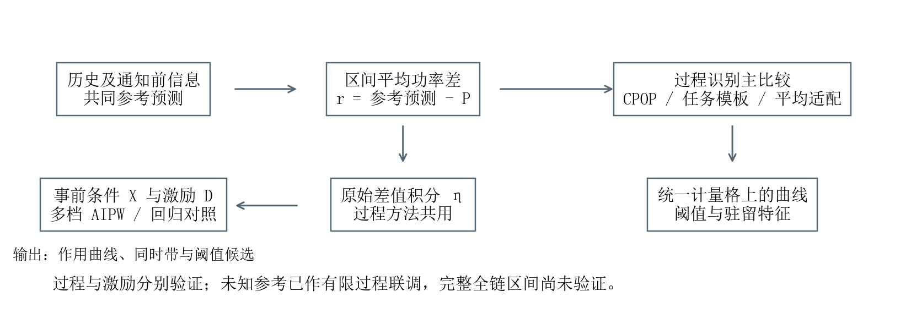
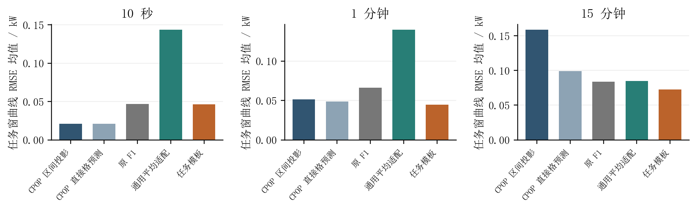
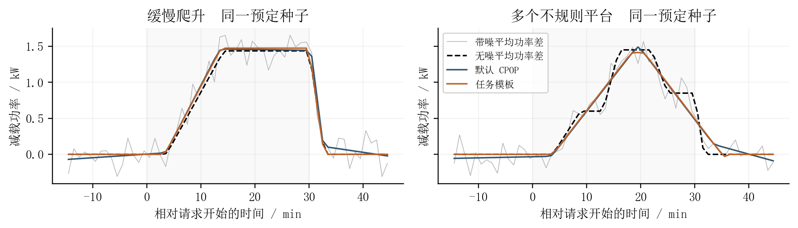
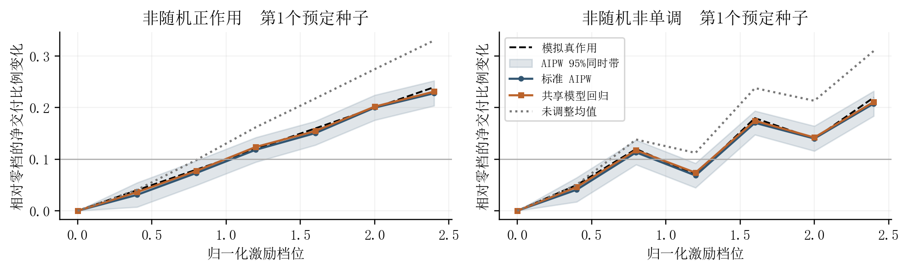

# 课题一B1响应过程识别与多档激励效应研究报告

刘文轩　2026年10月29日

本轮完成未知参考估计、过程识别和多档激励效应的有限实现与比较。结果显示：方法取舍依赖计量分辨率和响应形态，阶段模板及区间平均不能统一替代通用方法；激励侧标准AIPW也未全面胜过正确设定的回归。
## 1 研究问题

虚拟电厂收到一段功率降低记录后，需要判断资源是否发生了有效响应、何时达到任务要求、持续了多久，以及请求结束后如何恢复。用户原本的用电也会随气温、时段和充电需求变化；电表又可能每隔数分钟才上报一次平均功率。因此，直接把功率下降当作调节响应，或者把电表时间戳当作实际动作时刻，都可能产生偏差。

另一个问题是激励的作用。较高补偿下观测到更多响应，并不直接说明补偿产生了这些变化。若紧迫度不同的用户获得不同补偿，档位之间的差异会同时包含原有用户条件和激励影响。需要在明确事前条件及可比性的基础上，估计提高激励对人群平均响应的作用。

本研究将B1分为两项通用问题：响应过程的分段曲线识别，以及多值处理下的平均因果效应估计。未调节参考功率估计为前者提供输入。单次事件的响应特征与人群平均激励作用分别输出，后者不能解释为某个资源下一次任务的可承诺容量。

## 2 方法依据与研究框架

本轮以EV和空调的明确假设模拟为验证对象，没有新增真实设备控制证据。过程识别采用离线分段回归作为通用依据，以CPOP连续分段线性方法为主要对比。CPOP通过动态规划寻找连续折线，在拟合误差与斜率变化数量之间平衡，提供了比常均值分段更适合缓慢爬升的参照[1–2]。本研究吸收RIDE实现中的延迟、爬坡、保持、释放等阶段结构，并显式考虑电表的区间平均观测。阶段模板是有适用条件的候选模型，不能直接等同于任意资源的真实物理过程。当前RIDE式模板仍是对通用连续分段问题加入任务阶段结构的候选，并非CPOP算法本身的新全局优化解。

激励侧以多档交叉拟合AIPW/APO为通用baseline，估计各档平均潜在结果及相对零档的作用。多值处理具有既有统计依据[3]，交叉拟合与正交得分用于降低辅助模型估计对目标参数的影响[4]。本轮将这些成熟方法适配到按用户重复观测的事件数据，并吸收RIDE的支持诊断和聚类推断结构。该组件属于通用方法的可靠落实，不作为新提出的因果估计器。

本轮研究据此形成“未调节参考估计—响应过程识别—多档激励作用估计”的框架。验证时先分别隔离各环节，再检查衔接，避免同时更换参考、过程模型和因果方法后无法解释收益来源。

图1 B1研究框架

## 3 输入输出与核心计算

### 3.1 未调节参考与响应曲线

输入包括计量区间及平均功率、预定请求窗口与减载量、通知前条件、已完成历史日记录。设第k格时间为\([a_k,b_k]\)，单位分钟；\(P_k\)为实测平均功率，\(\widehat B_k\)为同格未调节参考预测，二者单位均为kW。观测功率差为\(r_k=\widehat B_k-P_k\)。

参考估计比较历史日均值、固定GBDT和按资源选择的候选。选择使用独立用户的伪事件绝对窗口误差，按预定请求量归一；校准再使用另一组用户。特征限于历史记录、通知前功率及明确事前可得的时段和环境条件，不以实际离站或事后电量补充事前字段。输出包括参考预测、所选方法和窗口误差校准状态。该预测仍需验证伪事件向实际事件的迁移条件，不能直接当作已观测的反事实轨迹。

### 3.2 平均计量下的过程识别

设\(f(t;\theta)\)表示潜在减载过程，单位kW，\(\theta\)包括阶段时点、幅度和斜率等参数。过程拟合对应：

\[
r_k=\frac{1}{b_k-a_k}\int_{a_k}^{b_k}f(t;\theta)\,dt+\varepsilon_k.
\]

\(\varepsilon_k\)为该格记录中的误差。积分平均使模型预测与电表记录具有相同含义；一格完整位于直线段内时，平均值与中点值相等，跨越转折时才会出现差异。

过程侧设置两类比较。第一类将吸收RIDE阶段结构的平均观测模型与原生CPOP及既有规则、常均值分段比较。第二类在同一连续折线模型族、结点集合、复杂度惩罚和求解预算下，仅改变中点解释与区间平均解释，隔离观测算子的影响。有限网格枚举适配不继承原生CPOP动态规划的搜索范围与复杂度保证。

计算上，CPOP最小化噪声标准化残差平方和与转折数量惩罚之和，惩罚系数固定为2ln(n)，n为该事件计量格数；默认候选结点为观测中点。阶段模型比较无响应、延迟—爬坡—保持—释放及一次中途掉落结构，按预定的多初值预算进行有界最小二乘，再由BIC选择结构，幅度不足预定判据时不检出响应。本轮使用BIC回退检测，没有调用伪事件LR标定。它是带幅度与时长界的局部拟合，不具有CPOP相同的全局最优保证。上述边界只对应本实验任务条件。

各方法均在同一计量尺度下提取0.15kW响应阈值、90%请求达标及不少于30秒的驻留特征。时点误差须同时给出有效分母、漏检和误检；物理细时点另行标为未知或不可识别。请求净交付比例共用原始积分：

\[
\widehat\eta_i=\frac{\sum_{k\subset W_i}(\widehat B_{ik}-P_{ik})(b_{ik}-a_{ik})}{q_i|W_i|}.
\]

其中\(W_i\)为通知前固定的请求窗，长度单位分钟，\(q_i\)为请求减载功率，单位kW；分子、分母均为kW·min，比例无量纲。完整窗口由完整计量格组成，缺测和边界切格不能静默按剩余均值处理。

### 3.3 多档激励的平均作用

设\(D_i\)为激励档位，\(X_i\)为事前条件，\(Y_i\)为事先定义的事件结果。\(e_d(X_i)\)为分配到d档的概率，\(m_d(X_i)\)为该档条件平均结果。标准多档AIPW计算为：

\[
\widehat\mu_d=\frac1n\sum_{i=1}^n\left[\widehat m_d(X_i)+\frac{\mathbf1(D_i=d)}{\widehat e_d(X_i)}\{Y_i-\widehat m_d(X_i)\}\right],\qquad
\widehat\tau_d=\widehat\mu_d-\widehat\mu_0.
\]

\(\widehat\mu_d\)为目标人群在d档的平均结果，\(\widehat\tau_d\)为相对零档作用。本轮Y采用净交付比例，作用也以比例表示。两类辅助模型按原始用户分折；同用户事件不跨训练与评价折。随机分配使用已知概率，非随机分配需满足事前充分调整和共同支持等条件。程序诊断通过不能证明不存在隐藏混杂。

不确定性按用户汇总中心化得分，构造多档作用的同时置信带；反演增加10个百分点的首次网格达标位置时，保留非单调曲线、多候选和未达状态，不自动把曲线收紧为单调。双重稳健不自动纠正与激励相关的结果测量偏差，因此尚不能将该区间直接称为包含全部参考和过程误差的全链区间。

## 4 实验条件与主要结果

### 4.1 未知参考比较

参考实验采用20个独立种子，每种子200用户、每用户4事件，设置普通和高温集中的配对条件，共32000模拟事件。训练、选择、校准和测试用户分离。1分钟计量、0.15kW噪声下，各次测试任务窗RMSE的20次均值如下。

| 条件与资源 | 历史日均值RMSE kW | 固定GBDT RMSE kW | 选择后RMSE kW |
| --- | ---: | ---: | ---: |
| 普通空调 | 1.2005 | 0.1575 | 0.1575 |
| 普通EV | 1.1351 | 0.3927 | 0.3927 |
| 高温空调 | 2.1736 | 0.2395 | 0.2395 |
| 高温EV | 1.1351 | 0.3878 | 0.3878 |

表1 未调节参考误差

条件预测优于简单历史均值，但四组每次均选择GBDT，未显示选择器相对固定GBDT的额外收益。GBDT在EV上仍有约−0.30kW平均偏差，不能将其视为无误差参考。用户最大伪事件窗口残差的校准覆盖接近预定目标，其窗口半宽并非逐时点协方差，不能直接转作过程模型的独立噪声。原始伪事件残差η大于0.1的频率，与过程检测误报率分开，不据参考误差降低宣称检测已校准。

### 4.2 过程模型与通用方法比较

过程实验包含20个独立种子、8种机制，覆盖无响应、近阶跃、部分响应、慢爬升、提前退出、中断再响应，以及模板外的弯曲和多平台过程。3种分辨率、2档噪声构成960个配对观测变体，独立单位仍为20个种子块。首轮共用已知参考和噪声，以隔离过程模型差异。

主要指标为请求窗平均功率曲线RMSE。原生CPOP除早期固定粗网格外，补充默认观测网格作为主要强baseline。粗网格会限制快速变化的表示，不能将阶段模板与粗网格之间的差距全部解释为新方法优势；默认网格比较使用同一960个冻结观测与相同惩罚、噪声，无测试后调参。

| 方法 | 10秒RMSE kW | 1分钟RMSE kW | 15分钟RMSE kW |
| --- | ---: | ---: | ---: |
| 原生CPOP 默认网格 区间投影 | 0.02096 | 0.05126 | 0.15846 |
| 原生CPOP 默认网格 直接格预测 | 0.02111 | 0.04893 | 0.09929 |
| 同族折线 区间平均适配 | 0.14358 | 0.13968 | 0.08503 |
| 阶段模板与区间平均 | 0.04664 | 0.04473 | 0.07255 |
| 原常均值分段F1 | 0.04704 | 0.06612 | 0.08390 |
| 原始规则F0 | 0.09906 | 0.09713 | 0.08317 |

表2 过程曲线识别误差

表2是每个观测变体请求窗RMSE的平均值，三种分辨率各320变体。CPOP区间投影将连续拟合解析积分到计量格；直接格预测则把其在观测中点的拟合值作为该格功率，作为对已观测计量格的操作性强对照。10秒下，默认CPOP明显优于任务模板；按20个种子块配对，模板减去CPOP直接格预测的误差差为+0.02553kW，Monte Carlo 95%区间为[+0.02016,+0.03091]。1分钟和15分钟的差分别为−0.00420kW与−0.02674kW，对应区间为[−0.00661,−0.00180]、[−0.03404,−0.01944]。这些区间描述本模拟中种子间平均差，不是单事件置信区间。

1分钟的曲线RMSE小幅改善没有覆盖全部过程指标：默认CPOP直接格预测与任务模板的阶段分类准确率分别为99.38%和98.44%；90%达标时点MAE为21.68秒（共同有效238例）和28.85秒（235例），恢复时点MAE为17.36秒和20.79秒。完整输出另列漏检、误检和不可用分母。多平台分层中，模板相对默认CPOP的10秒、1分钟曲线误差均更大，20个种子块全部未改善，说明阶段结构错设会造成明显损失。分层区间为补充分析，未作多重比较校正。

匹配连续折线消融使用相同候选结点、最多四个转折、相同秩筛选、QR枚举与惩罚，仅更换观测算子。10秒和1分钟下没有稳定增量，有限网格适配也劣于默认CPOP。15分钟下平均适配避免了部分点模型格内反演的不稳定，但不能据此宣称细时点恢复成功；直接格预测、原规则与区间投影须同时阅读。

15分钟只有少量格记录，格内过程可能不唯一。两条开始、达标和恢复时刻均相差1分钟的曲线，可具有完全相同的三个15分钟记录。粗观测下连续重构、直接格预测与物理时点是不同目标，结果须分别说明。

图2按分辨率比较请求窗曲线误差。图3选用第一个预定种子的1分钟、0.15kW噪声样例，同时展示慢爬升与多平台响应，未按结果挑选最佳样例。

图2 过程曲线误差

图3 响应曲线比较

### 4.3 激励作用的通用baseline落实

因果实验采用20个独立种子，每种子600用户、每用户6事件，设置随机正作用、可观测非随机正作用、零作用、非单调作用和确定分配五个配对场景，共360000事件变体。结果模型固定为按档二次回归，非随机分配模型为多项logit；生成机制的条件均值为二次形式、分配由多项logit产生，因而估计模型与本模拟设定匹配。IPW采用未归一的Horvitz–Thompson形式。

| 场景 | 未调整档均值 | 直接标准化 | IPW HT | 标准AIPW |
| --- | ---: | ---: | ---: | ---: |
| 随机正作用 | 0.00817 | 0.00653 | 0.02737 | 0.00655 |
| 非随机正作用 | 0.06470 | 0.00697 | 0.01459 | 0.00749 |
| 非随机零作用 | 0.06238 | 0.00697 | 0.01373 | 0.00749 |
| 非随机非单调 | 0.06437 | 0.00697 | 0.01456 | 0.00749 |

表3 激励作用曲线误差

表中为每次六档相对作用曲线RMSE的20次均值，单位为比例。非随机场景的未调整档均值仅用于展示混杂影响。调整明显减小了该模拟下的误差，但AIPW未优于匹配正确结果模型的直接标准化。原生DoubleMLAPOS 0.11.4[5]使用相同折和辅助预测后，与本组件逐档作用数值一致，确认其通用方法含义；这不构成新的因果估计创新。

支持与平衡诊断的加权标准化差异筛查阈值事先固定为0.2，区别于RIDE原默认0.1；这是一项筛查规则，不是无隐藏混杂的证据。四个支持场景的同时带与阈值集合各20/20包含真值，确定分配场景20/20拒绝输出因果结论。20次重复不足以证明真实覆盖率精确达到95%；非单调场景仍平均保留1.55个候选位置，说明集合包含真位置不等于唯一定位。该实验直接使用模拟事件结果，只验证模块C，尚未覆盖未知参考和过程识别误差。

图4展示第一个预定种子的两类作用曲线。横轴是模拟设定的归一化激励档位，不对应已验证的实际人民币价格；阴影表示标准AIPW的用户聚类同时带。

图4 多档激励作用

## 5 阶段结论与后续研究

方法来源上，阶段结构和部分实现吸收自课题组提供的RIDE v0.2代码包，连续分段与多档AIPW引用相应文献。本轮贡献是针对既有缺口的实现适配、信息边界修正和公平比较；尚不据这些组成部分宣称独立算法创新。

本轮将B1建立在两个明确的通用问题之上，吸收了RIDE中未知参考、阶段过程与平均计量的合理成分，并落实了可核验的多档因果baseline。条件参考改善了模拟中的历史均值错配；阶段模型的价值与模板适用性有关；因果侧保留成熟方法和简单合法回归，没有预定复杂方法胜出。

已开展一项未知参考到过程模型的有限联调：10个新种子、两种温度条件，按测试用户的30分钟任务和1.5kW请求筛选，共得到52事件记录，未因样本不足替换种子。1分钟下，同族平均适配的描述性曲线RMSE由真参考时的0.08202kW升到共同预测参考时的0.23154kW；共同原始积分净交付比例RMSE由0.01265升到0.14200。两个过程算子共用相同电量，不能通过改变拟合电量算法制造增益。这表明该有限子域内参考误差明显大于观测算子之间的差异。

本轮形成独立研究入口，保留任务模板、通用平均适配和原生CPOP的明确区别。过程入口限于已核验的30分钟、1.5kW、完整规则计量窗，阶段模板须保留多平台失效；未自动替换原B1稳定默认。下一项必要研究是合法过程结果进入因果模块后的误差影响及整体不确定性，不能用参考窗口校准代替。隐藏混杂、真实数据的事前可得性、跨资源机制和物理细时点识别仍需单独证据。本阶段属于限定模拟原型的完善，不代表整个B1或项目验收指标已经完成。

## 参考文献

[1] Fearnhead P, Maidstone R, Letchford A. Detecting Changes in Slope With an L0 Penalty. Journal of Computational and Graphical Statistics, 2019, 28(2):265–275. DOI:10.1080/10618600.2018.1512868.

[2] Fearnhead P, Grose D. cpop: Detecting Changes in Piecewise-Linear Signals. Journal of Statistical Software, 2024, 109(7):1–30. DOI:10.18637/jss.v109.i07.

[3] Cattaneo M D. Efficient semiparametric estimation of multi-valued treatment effects under ignorability. Journal of Econometrics, 2010, 155(2):138–154. DOI:10.1016/j.jeconom.2009.09.023.

[4] Chernozhukov V, Chetverikov D, Demirer M, et al. Double/debiased machine learning for treatment and structural parameters. The Econometrics Journal, 2018, 21(1):C1–C68. DOI:10.1111/ectj.12097.

[5] Bach P, Chernozhukov V, Kurz M S, Spindler M. DoubleML An Object Oriented Implementation of Double Machine Learning in Python. Journal of Machine Learning Research, 2022, 23(53):1–6. 软件来源：https://github.com/DoubleML/doubleml-for-py；文献：https://www.jmlr.org/papers/v23/21-0862.html。
