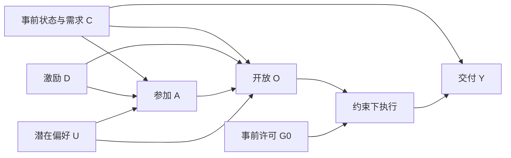

# B1全周期特征提取与因素分析：总体方法设计与可行性论证

**版本：v1待审稿｜日期：2026-10-21｜范围：研究设计与可行性审查，尚未开展新实验**

## 1. 本轮结论与要解决的问题

建议按“**明确事件和结果 → 提取全过程特征 → 建立结构与识别设定 → 比较因素效应方法 → 检验异质性及阈值 → 独立评价**”推进B1。首个代表问题采用单向EV充电模拟，先用规则与变点方法提取特征，再用透明回归和改进DML比较激励作用。结构因果模型和图学习单独设可验证任务，不以DML代替。

可行性判断是：**基本方案有方法与工程基础，可以进入最小实现准备；复杂图学习、激励阈值和严格推断需分步满足条件。** 这是设计审查结论，不是算法已跑通或有效性的实验结论。本轮完成设计后交用户审查，再开始样本生成、模型修改与实验。

B1首先回答两个问题：一是某次调节何时开始、达到什么幅度、维持多久、怎样恢复；二是在调用前状态等条件下，改变一个因素会怎样改变参加、开放或交付。两部分要衔接，也要分别评价：曲线提取正确不等于因素识别正确，预测误差降低也不能证明因果效应正确。

### 1.1 已确认与待审内容

四算法范围及B1优先已由用户确认；“先规划方法、论证可行、再实现”是本轮明确安排。本文选择的EV首例、候选方法、样本规模与实施步骤为待审设计；DML仍为候选。原四算法主规划仍在work待审，本轮不视为其整体审查通过，不移入`01_项目依据/`。

## 2. 首例选择及研究边界

### 2.1 为什么先选单向EV充电模拟

单向充电的需求电量、连接期限、功率和减载任务可分别定义，可以在同一会话观察减载、持续和回补，也能构造拒绝、响应不足与截止未恢复，适合检验B1的全过程及因素问题。选择依据是研究问题的覆盖和可检查性，不是替换六类研究主体或宣告EV真实证据更齐全。

现用EV-CAP-v1能在声明条件下检查能量/期限可行性，但不包含真实动力学、通信延迟、用户选择及执行误差。它可作模拟条件的约束组件，**不能充当动力学或用户偏好的真值**。未调用参考策略、延迟、回补和选择机制必须独立声明。[P3]

储能LMO1已有设定/实测及过程证据，适合作后续连续指令与观察时钟挑战；当前物理时点、能量端点及完整恢复参照仍受限，不将其当首个全周期受控真值。EPFL、KIT和储能不拼为同一实体链。其他六类及新增算力中心继续保留自身机制与待办。

### 2.2 本轮拟研究的最小对象

一个用户的一次独立声明充电会话，一次不重叠的减载请求，完整观察请求前、执行窗及请求后直到声明截止。首轮暂不加入多车共享控制、资源组合、多市场报价或学习最优调度，这些属于其他算法或后续扩展。

物理全过程与用户激励分两组模拟实验：**事件识别组**通过声明的执行/拒绝/故障情景检验特征方法；**因素估计组**让激励影响选择和实际执行，估计总体及预定分组作用。两组共用机制组件，但分开样本身份与评价目标，不把强制执行结果当真实意愿样本。

## 3. 对象、方向、结果与输入输出

### 3.1 请求与参考定义

约定网侧用电功率为正。记声明的未调用参考为`P_ref(t)`，实际执行为`P(t)`，减载量定义为：

\[
r(t)=P_{\mathrm{ref}}(t)-P(t).
\]

`r>0`表示少用电，`r<0`表示相对参考额外用电。首轮参考来自按初始需求、连接和功率条件固定的未调用策略，政策及参数在分配激励前确定；不从事件后的最终电量反推。能力核返回的任意可行计划不自动称为未调用参考。

记录请求生效`t0`、解除`t1`、观察终点`H`及独立发送/接收/动作标签。模拟中可知道这些真值，但检测器只获得协议允许的公共时钟；隐藏动作标签只供评价。观察延迟按允许时间戳定义，不从真实日志标签推断未记录的通信或物理时延。

首轮先在参考已知的声明场景隔离检验提取方法；参考估计误差另设压力测试，不能将理想参考结果当实际基线预测能力。采样可先采用10s模拟网格，另测更细/更粗采样；这些是场景设置，非真实EV测定分辨率。秒与EV核分钟单位显式换算。

### 3.2 首个因素估计目标

建议以**提高补偿对请求窗内观测净交付比例的总作用**为首个估计目标。请求幅度`q>0`、窗口及请求电量均在激励分配前固定；分母不能随参加或实际执行而变化：

\[
E_{\mathrm{req}}=q\,(t_1-t_0),\qquad
Y=\frac{\int_{t_0}^{t_1}r(t)\,dt}{E_{\mathrm{req}}}.
\]

上式时间按小时计，功率kW，电量kWh。`Y`称**净交付比例**，保留负值和超过1的值，不剪裁成完成率。缺失无法积分时返回缺失；拒绝者在无动作且观测完整时才可为零。回补电量另报，不混入本次请求窗结果。原D069的截断`completion_ratio`保持旧名称和旧结果，不混称新目标。

训练表中的`Y=Y_obs`只由协议允许读取的参考、观测功率和时标积分产生，包含声明的观测误差。评价器另从无噪声潜在轨迹独立计算`Y_star`，禁止把精确潜在交付量直接放训练表。首轮主要效应针对`Y_obs`；`Y_star`的作用作为物理过程参照单列，并报告两者差异及观测/提取误差传播，不能默认两种作用相等。无噪声理想研究若开展则单列为实现参照。

主比较先采用完整观测的随机场景，避免缺失选择改变总体。缺测压力下不得静默丢弃事件再冒称原总体作用；先报告分处理档的缺失/不可算覆盖和偏差，缺失机制导致总体作用不可识别时返回不可估，需额外识别方案才能扩展。

首轮处理`D=0/1`表示低/高两档激励，具体水平在实验协议中固定，可参考既有0.4/1.6元每kWh，但它们仅为模拟水平，不是市场价格建议。主要估计：

\[
\mathrm{ATE}=\mathbb E[Y(1)-Y(0)],\qquad
\tau(z)=\mathbb E[Y(1)-Y(0)\mid Z=z].
\]

`Z`为预定的事前异质性条件，例如需求期限余量。结果以比例或百分点报告，并可给出固定请求条件的电量对比；不能直接称价格弹性。参加、开放和恢复可作为后续各自单独的结果，但首轮不同时训练多目标大模型。

### 3.3 输入与输出契约

| 部分 | 输入 | 输出 |
| --- | --- | --- |
| 全过程提取 | 事件ID、允许读取的时标、请求/参考/实测曲线、观测质量、任务前状态及后窗 | 阶段、起响应与到目标时间、幅度、跟踪/持续、电量、回补和恢复、适用性与删失 |
| 结构与识别 | 变量含义/先后顺序、明确处理和结果、机制假设、观测范围及结构限制 | 假设图、候选结构/等价关系、调整集理由及不可识别原因 |
| 因素效应 | 事件级处理D、由公共观测计算的Y_obs、事前控制W、异质性Z、实体/基础场景分组 | 总体与预定组作用、作用条件、误差/区间、支持不足及域外情况；Y_star仅评价器读取 |
| 向B2/B4提供 | 经检验因素关系、调用前可得历史特征、适用条件与版本 | 可用于能力建模/画像的研究输入，不能把当前事件未来特征回填事前 |

每项附对象、任务、窗口、方向、单位、来源、模型版本及状态。研究建模使用事件级样本；高频曲线采样行不计成独立因果样本。

## 4. 全周期特征提取：先规则基线，再比较变点

### 4.1 特征定义与特殊情况

| 特征 | 首轮定义 | 不能作的替代 |
| --- | --- | --- |
| 起响应与到目标 | 越过预定可检测阈值/目标带并满足驻留条件；报告首次满足区间和确认时点 | 以未来最终响应幅度当分母；采样不足却报精确秒级 |
| 10%/90%时间 | 仅在适用时相对事前请求幅度q定义；未达到分别登记 | 没到90%就算完全未响应；拒绝者延迟填0 |
| 幅度与跟踪 | 指定窗均值/峰值及目标误差，均说明参考和方向 | 用额定功率代实际响应或最大可调容量 |
| 持续性 | 目标容差带内累计时长、最长连续时长、中断和全窗满足 | 每个噪声穿越都判业务失败，或用累计时长冒充连续持续 |
| 电量 | 真实时标或声明分段保持下的有符号积分，另报正/负部分 | 采样行数代时长；末行自动延长；跨缺口无说明积分 |
| 功率恢复 | 解除后重回参考带并持续预定时间 | 功率回到参考就认定用能服务恢复 |
| 服务/能量恢复 | 相对同需求参考的欠充量补回，并检查声明截止需求 | 观察结束/提前离开就填恢复时间0或窗口长度 |
| 后窗回补/反弹 | `r<0`的额外用电、峰值和发生窗口，保留净量 | 请求少用电自动等于持续能力或后续可再调用量 |

小请求接近噪声时登记不可辨识。未响应、部分响应、右删失、后窗不完整、缺测与不可适用分别标记。下一指令若提前到来，截断对前事件的独立归因窗或报告联合事件；首轮不重叠，后续专门作压力测试。

恢复的潜在时间真值和“达到约定观测判据的时间”不是同一对象。评价分两项：看方法能否正确恢复声明的可观测特征，并报告这些特征相对潜在动作/恢复标签的系统差别。不能用同一检测程序生成标签又检验它自己。

### 4.2 两个必要方法

**F0：任务约束的规则基线。** 依据请求、噪声/分辨率和驻留条件检测响应，计算幅度/持续/电量/恢复。阈值、容差带、最短驻留和允许短跌落在开发/验证侧确定并冻结；物理和数值容差、统计检测阈值、业务允许偏差分别记录。没有业务依据时报告参数敏感性，不伪造业务通过门槛。

**F1：惩罚分段/变点候选。** 用PELT等方法搜索曲线变化段，再结合指令窗口、方向和机制约束赋予阶段含义。PELT解决给定代价与惩罚下的分段搜索问题，不自动识别业务阶段；其线性计算量结论有条件，不能承诺所有情景都线性。[M1]

建议阶跃场景先比较分段均值代价；斜坡/缓慢恢复另比较适合的分段代价或保留规则法，避免错用均值突变。最短段长及惩罚只在训练/验证侧选。可用小曲线的穷举/动态规划独立核查搜索结果，再用隐藏过程标签检验业务特征。

首轮不引入HMM、深度事件分割或大规模表示学习。只有F0/F1出现明确且重要的局限，再论证新增方法；自监督多能力表示由B4负责，B1可在后续检验时序表征的增量。[P1、P2]

## 5. 因素分析：先识别设定，再比较效应估计

### 5.1 结构方程与假设图

模拟器分开生成事前需求/状态`C`、未观测偏好`U`、激励`D`、选择`A`、开放`O`、实际执行及净结果`Y`。初始许可`G0`在激励前固定，与激励后用户选择/开放区别：

该图是首轮的机制假设，结构函数和随机项须在实现协议中逐项给出，不代表现实结构已证实。随机处理首例中`D`独立于`C/U`；可测混杂场景再令`C→D`；隐藏混杂失效场景令`U→D`。未观测偏好只影响结果而不影响随机分配时属于异质性，不能一概称混杂。

估计激励总作用时，`A/O`是作用途径，不能作控制或仅保留参加者。响应延迟等对未响应者可能无定义，因此采用“是否响应＋响应者过程描述”分别报告；条件描述不冒充总体激励因果作用，不把缺延迟填0。

### 5.2 图学习的独立可行路径

图学习首轮设小型、可控、无隐藏共同原因的结构方程子问题，先检验受时间/机制限制的PC-stable候选。在其适用假设下评价骨架、可识别方向和等价关系，不能要求恢复观测分布无法区分的全部方向。[M2]

条件独立检验须匹配变量类型。先用满足所选线性/噪声设定的连续变量子问题核方法；包含二态选择、饱和及隐藏偏好的完整EV事件图，不直接套简单偏相关检验并声称发现真实结构。完整混合变量/非线性图学习属于条件扩展，若需新检验或FCI等方案，另作必要性论证。

先验给定的边与数据学到的边分开评价；真值图只给评价器。初版效应估计可依据明确的随机/调整设计进行，不必等待图学习能完整恢复EV机制；图学习仍有独立交付问题，不能无限延期或被手工图替代。

### 5.3 必要对照与DML候选

| 方法 | 作用 | 使用条件 |
| --- | --- | --- |
| G0 随机组均值差 | 随机处理场景的总体作用基线 | 真正随机且保持完整样本；不直接用于混杂场景的因果结论 |
| G1 透明回归/预定交互 | 同信息下的可解释基线，分析状态差异 | 基函数及分组由训练/验证固定；混杂场景模型正确性需检验 |
| G2 改进线性异质DML | 检验残差化/交叉拟合的增量 | 明确识别、处理支持、合法分组和变量，保留同事可用核心 |
| G3 森林DML（有条件） | G1/G2不能合理表达重要非线性时的候选 | 独立事件和状态覆盖足够；不因已有代码就默认加入大规模寻优 |

DML通过正交化与交叉拟合减少辅助模型误差影响，因果解释仍依赖识别条件。[M3] 本例为二档处理，需合法的处理概率模型；随机场景可使用已知分配概率作参照，观测混杂场景估计条件概率。模型残差R²、标准差和条件数仅为数值诊断，不证明无混杂或有足够识别。[M4]

同事代码需要先补：保存训练侧变换与辅助学习器、完整新表推理、分组内折和支持诊断闸门。`final.effect(new_X)`已有作用查询基础，但原`baseline(df)`复用训练数组不能当完整新样本结果预测；原数值门槛也需核量纲。作用模型与结果预测分别提供，不因B1而扩建完整B2兑现模型。[P5、P6]

### 5.4 非线性与阈值的范围

两档首例可以检验端点作用及随事前状态变化的异质性，**不能定位激励轴的阈值、饱和点或完整剂量曲线**。后续若确需激励阈值，另冻结多档或连续处理设计，保证各状态区间的支持，再比较透明分段/样条等曲线与预定阈值方案。

首轮可以在事前定义的需求期限余量组报告作用，不能看测试曲线后挑分组或命名转折。物理可行边界、用户保留成本门槛、统计估计转折分别解释；无支持时返回未知，不强行给阈值。

## 6. 模拟、真值与评价隔离

### 6.1 数据分层

| 层次 | 生成内容 | 读取权限 |
| --- | --- | --- |
| 机制层 | 声明需求、期限、功率、参考策略、状态与可行执行 | 算法只读协议允许且可得的状态/参数 |
| 决策执行层 | 处理分配、选择/开放、延迟、执行误差与回补 | 隐藏偏好、随机数及潜在标签不作为因素输入 |
| 观察层 | 允许时标、曲线采样、噪声、缺失与观测截止 | 特征提取器读取；不泄漏隐藏动作边界 |
| 评价层 | 原时标潜在轨迹、结构、干预结果及独立过程标签 | 评价器在预测保存后读取 |

每个基础情景配对运行低/高激励及未调用参照时保持相同外生条件，用于定义潜在结果；训练只看到被分配的一档。配对对比不直接等于条件平均效应真值：评估CATE需在给定可观测条件下对隐藏偏好/执行随机性作解析平均或独立重复模拟，报告真值近似误差。逐事件配对差异仅作辅助，不能要求DML恢复不可观测的个体随机差异。

评价平均作用时同样区分`Y_obs`与`Y_star`的潜在结果；前者需将观测误差分布纳入平均，后者不包含观测误差。公共参考的声明条件、误差机制和积分规则固定后，分别建立独立评价参照，不通过复用被测提取代码生成真值。

可暂以简洁的用户接受/开放机制作为数据生成假设，B1只检验识别能否恢复它，不把该机制称为B2意愿模型已验证或完整心理参数研究。

### 6.2 划分与建议规模

首先以少量实体/事件检查实现、语义和资源需求，其输出明确标为开发检查。主比较候选规模可从200个模拟用户、每用户8个独立事件起评估，按用户120/40/40划训练/验证/测试；这1600个事件是预算建议，**不是统计功效证明或已生成数据**。最终数量在协议中根据预设最小作用、事件内相关和精度需求论证，不以结果好看决定。

首例事件独立初始化，用户偏好可在用户内相关，处理在每个事件独立二档随机分配。不给定额“每用户必有各档”后仍谎称独立伯努利；记录真实分配机制及支持。可测混杂场景按预设函数分配，且留足两档重叠，不默认旧D069边际0.25就是条件概率。

外层按用户及基础情景隔离，同一基础场景全部干预/噪声/采样变体不得跨分区。训练内按用户分组交叉拟合；有连续历史的扩展另加时间块及必要隔离，首轮不伪造小时历史或强套7天滞后。

训练/验证负责阈值、惩罚、特征、基函数、模型选择；测试在方法冻结后评价一次，旧测试已见者只作回顾。未见参数范围和生成机制另作迁移压力评价；改变参数仍是同机制迁移，不自动算独立物理验证。

### 6.3 最小评价矩阵

| 场景 | 检验目标 | 预期结论强度 |
| --- | --- | --- |
| 已知参考/完整阶跃及回补 | 特征、积分、阶段与恢复区别 | 核算与声明场景识别能力 |
| 噪声/采样/缺失/后窗截断 | 检出、定位区间、删失与不可计算 | 方法的观测条件边界 |
| 真正随机两档激励 | 总体及预定组作用，零作用与反向作用 | 该模拟干预设计内的作用恢复 |
| 可观测混杂、状态交互 | 调整和异质方法相对透明基线增量 | 识别假设满足下的条件性能 |
| 支持不足/隐藏混杂/主体干扰 | 诊断、误估与降级范围 | 不预期标准DML自动解决 |
| 参考误差/斜坡/连续指令 | 特征泛化与重叠归因局限 | 后续扩展，不一开始混入全部复杂性 |
| 多档激励与非线性 | 剂量曲线与阈值稳定性 | 后续另冻设计；二档不作此结论 |

零作用至少包含“激励不影响选择/开放且不直接改变执行”的机制；反向作用另设合法场景，不强制所有效应非负或单调。不能按已知真值类型硬置零，或删除不符合预期的结果。

### 6.4 指标与结论

特征主报定位/幅度/持续/积分误差、未响应识别、删失与不可算覆盖；因素主报总体偏差、预定组平均作用误差、零作用偏差及方向恢复。所有指标固定单位和分母，按独立事件/用户解释。

若报告区间，需有足够独立用户及相应重采样/估计理论。原森林接受`groups`参数不代表其内部区间已经处理用户内相关，固定第一阶段残差只重拟最终层的bootstrap不能直接作严格整体推断。先报告点估计与重复生成的误差分布；需要推断时论证完整流程的用户级重采样和覆盖，不用少数聚合体硬报显著性。

无响应者的延迟/恢复单列不可定义；描述性“绝对效应超过某阈值比例”不叫显著性误报率。真实缺失不填零，真实负响应不删除。数值计算容差与经验效果/业务门槛分开，模拟结果不直接等于真实能力或103正式90%通过。

## 7. 可行性论证

### 7.1 方法与工程条件

| 部分 | 现有依据 | 当前判断与缺口 |
| --- | --- | --- |
| 事件/特征基线 | 原逐类曲线和局部特征；规则/积分易独立核算 | 可先实现；完整动态、参考与恢复仍须声明并验证 |
| 变点候选 | PELT有原始方法依据[M1] | 条件可行；代价与阶段约束需匹配，当前环境未安装ruptures，不为本轮规划安装 |
| 结构因果组织 | 现用技术方案已定义结构方程/变量角色[P1、P2] | 可先固定假设与识别；手工图不能冒充图学习成果 |
| 受约束图学习 | PC-stable原始方法[M2] | 小型适用SCM可做；混合/隐藏混杂完整图结论受限，当前未安装causal-learn |
| 透明因素模型/DML | 已有D069/D078适配与原源码[P5、P6] | CPU最小比较有基础；需修推理、合法分组及估计目标，效用尚待新独立比较 |
| 严格推断及激励阈值 | 需设计/支持/独立样本 | 条件扩展，不能由现有可运行代码或二档首例自动得到 |

本轮仅只读核对既有DML环境安装元数据：Python3.10.6、NumPy2.2.6、pandas2.3.3、SciPy1.15.3、scikit-learn1.7.2、LightGBM4.6.0、EconML0.17.0；ruptures和causal-learn未安装。该核对不等于导入/运行兼容性或性能检查，实际依赖及锁定版本在实现前核验。

最小实现以CPU、小型事件表及按需曲线为先。没有计时/内存实测，不承诺具体耗时或显存；若后续复杂模型规模明显增大，按既有约定准备任务与本地检查后再申请用户连接服务器，不因服务器存在就先上深度模型。

### 7.2 允许得出的结论

**有基础可做：**声明EV场景下的全过程特征、两档随机总作用与预定组作用、透明对照及原DML必要修正。

**条件成立后做：**可测混杂效应、小型结构学习、非线性剂量/阈值、严格区间和跨机制推广。它们各自需要设计与独立验证，不能用某一分支成功代替全部。

**当前不支持：**证明真实用户价格偏好、真实设备物理延迟/最大能力、DML自动因果发现、隐藏混杂/干扰自动消除、六类观察预测成绩证明因果、二档激励定位价格阈值或直接宣布正式精度通过。

可行性依据来自任务契合、方法设定及已有工程组件；是否有效、优于何种基线、能否迁移，均待协议下的实验回答。

## 8. 实现前后的步骤与停止条件

| 步骤 | 做什么 | 进入下一步的条件 |
| --- | --- | --- |
| S0 本轮方案审查 | 确认首例、目标、F0/F1与G0/G1/G2、结构学习路径及边界 | 本轮交付本文，不生成主样本或训练；用户审阅后再接续 |
| S1 固定实施协议 | 变量/参考/方向、结构函数、采样、结果、组别/划分、阈值依据、方法预算与评价 | 问题可计算、真值隔离清楚，用户不必先选技术库 |
| S2 最小生成与F0 | 少量用户/事件及拒绝/未恢复反例，先核积分/状态/标签，再实现规则 | 独立算术和语义核查通过，完整失败记录；未见评价仍隔离 |
| S3 F1与结构子问题 | 变点对照及小型可识别SCM图学习；固定代价/先验/检验 | 分别有合法参照和冻结比较，不要求整图唯一恢复 |
| S4 因素基线与DML修正 | G0/G1、分组交叉拟合、新样本作用/结果接口、诊断；再G2比较 | 不读评价真值，拒绝/零交付保留，保存训练变换及模型 |
| S5 独立评价与收口 | 主比较与预定压力，复跑及独立指标/原始结果核查 | 保留或降级候选，记录适用条件；效果不足也可形成结论 |
| S6 后续扩展 | 必要时G3、多档阈值、第二机制/公开受限组件 | 先说明解决哪个已见缺口，另留评价，原真实冻结按新证据重开 |

首轮只比较必要方法，不作不封顶的模型搜索。若F1无稳定增量，保留F0；若DML不优于公平简单基线或零作用仍明显失真，降为对照；若识别/支持不满足，返回关联或不可估。发现代码错误可修复并保留旧产物，不能借修错改样本、目标或测试门槛。

每个工作包固定输出和完成条件后收口。当前没有新代码训练、数据生成、依赖安装、服务器使用、模型发布、页面开发、上传、提交或外联。原模型/数据卡/实验台账不为设计论证改写为已开展实验。

## 9. 本轮审阅要点及文件地位

建议用户重点审阅：首例是否同意采用明确的EV模拟、首个因素问题是否用二档激励对净交付比例总作用、是否接受规则/变点与透明回归/DML的逐层比较，以及图学习/阈值分条件推进的安排。

本文是B1专项方法设计，存于work。此前四算法内容与输入输出主文档仍为[待审主稿](../four_algorithm_plan_review_20261021/课题一四算法内容与输入输出规划_待审稿.md)，审查通过后才移入01。本文不自动修改其状态，也不产生第二份已批准的全项目框架。

## 10. 依据与追溯

### 项目与本地基础

- [P1] [现用需求框架](../../01_项目依据/课题一需求分析与研究框架_整合修订版_v1_20261011.md)：第6节因素与时序、第11.3节模拟和第12节验证。
- [P2] [现用技术方案](../../01_项目依据/课题一技术路线与模型设计方案_v1_20261011.md)：第2.2—2.6节及因素实验。103正式任务及方法方向由其与四算法规划映射，本轮不改正式范围。
- [P3] [EV现用README](../../资源能力模型/03_电动汽车充电设施/README.md)、[现用能力核](../../资源能力模型/03_电动汽车充电设施/code/capability_model.py)：理想能量可行性，非动态/心理标定。
- [P4] [旧模拟数据说明](../../data/驱动因素解耦模拟数据集_v2/README.md)：旧2.4及连续资料用途分开，不重命名旧真值。
- [P5] [D069项目模拟结果](../process_notes/2026-10-17_已有模拟数据接入DML.md)、[拟合前协议](../vpp_dml_project_trial_20261017/protocol.json)。
- [P6] [D078六类真实资料试跑](../vpp_dml_real_data_trial_20261018/六类真实数据_DML试跑结果.md)：条件关系而非经济因果；[原辅助学习器](../vpp_dml_review_20261017/vpp_dml_framework/vpp_dml/nuisance.py)、[原pipeline](../vpp_dml_review_20261017/vpp_dml_framework/vpp_dml/pipeline.py)。
- [P7] [决定记录](../../docs/DECISION_LOG.md)：D102—D105；[教师交流稿](../../outputs/课题一四算法简要介绍_教师交流稿_20261021.md)。

### 本轮核对的原始方法来源

- [M1] Killick、Fearnhead、Eckley：[Optimal Detection of Changepoints With a Linear Computational Cost](https://doi.org/10.1080/01621459.2012.737745)，JASA，2012；[作者预印本](https://arxiv.org/abs/1101.1438)。用于分段搜索候选及其适用条件。
- [M2] Colombo、Maathuis：[Order-Independent Constraint-Based Causal Structure Learning](https://www.jmlr.org/papers/volume15/colombo14a/colombo14a.pdf)，JMLR，2014。用于PC-stable、等价关系及假设边界。
- [M3] Chernozhukov等：[Double/debiased machine learning for treatment and structural parameters](https://doi.org/10.1111/ectj.12097)，The Econometrics Journal，2018。用于正交化、交叉拟合及识别后的效应估计。
- [M4] [EconML LinearDML官方接口](https://www.pywhy.org/EconML/_autosummary/econml.dml.LinearDML.html)、[官方DML方法说明](https://github.com/py-why/EconML/blob/main/doc/spec/estimation/dml.rst)：核二态处理与接口含义；线上说明不代替本地0.17.0实现核验。

以上文献支持候选方法原理，不证明本项目已取得相应效果或新颖性。
