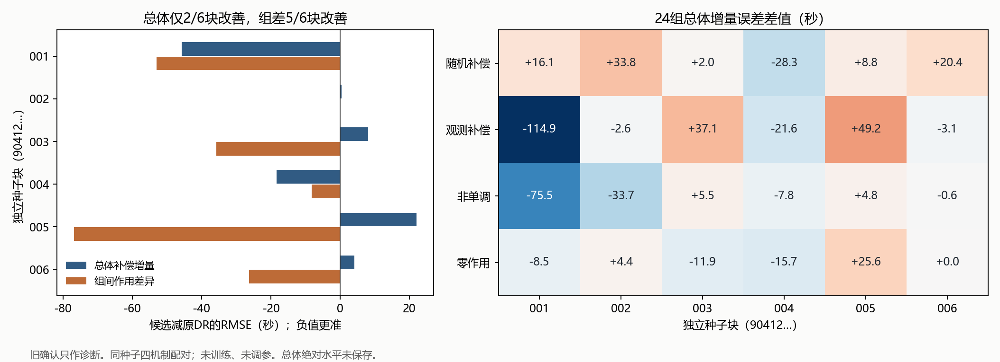

# 第4点｜稳定性诊断及一次新比较设计

2026-11-05。**旧合并结果回归候选继续不采用。** 24组保存结果复算一致：总体补偿增量误差平均减少9.67%，但仅2/6独立种子块改善，收益受首块影响很大。组间补偿作用差异则有5/6块改善，值得单独检验能否在保留现用DR校正的同时利用全队列辅助信息。本轮0次新拟合、未生成新开发或确认队列；新方案待总管审查。

[全部24组](cohort_diagnosis.csv) · [六块汇总](block_summary.csv) · [逐金额误差](point_errors.csv) · [独立复算](diagnosis.json) · [新比较协议](experiment_plan.json)

## 已保存的到底是什么

旧脚本 `contrast()` 对每个人口先减去同人口0.4处预测；`curve_rmse` 对比的已经是这一**补偿增量曲线**，并非绝对响应水平。`subgroup_rmse` 是高、低离站余量两组的增量差误差。原始水平及0.4处水平没有保存在24组文件里。

| 量 | 本轮可复算范围 |
| --- | --- |
| 绝对响应水平 θ(a) | 无法从旧保存结果恢复水平RMSE或单独的0.4参照偏差。给水平加任意常数不影响已保存增量。新协议要求保存水平和参照。 |
| 总体增量 Δ(a)=θ(a)−θ(0.4) | 原DR 50.1821、合并回归45.3292秒，均24/24输出；逐组12胜12负，逐独立块2胜4负。 |
| 条件差异 D(a)=Δ高(a)−Δ低(a) | 原DR116.2015、合并回归82.8811秒，均24/24完整；逐组17胜7负，逐块5胜1负。低组自身增量误差73.48→38.19秒，高组87.86→76.56秒。 |

旧文件的导数和目标计分保持原样，本轮不把它们作为第4点新改进或第5点结果。

## 为什么平均改善而多数块退步

下表每行先平均同种子下四机制的增量RMSE。差值为候选减原DR，负数表示候选更准。六行才是独立重复，24组不是24次独立实验。

| 种子块 | 原DR，秒 | 合并回归，秒 | 增量误差差值，秒 | 组间差异误差差值，秒 |
| --- | ---: | ---: | ---: | ---: |
| 90412001 | 88.04 | 42.32 | −45.72 | −53.02 |
| 90412002 | 48.95 | 49.44 | +0.50 | +0.09 |
| 90412003 | 29.40 | 37.59 | +8.19 | −35.71 |
| 90412004 | 61.40 | 43.03 | −18.37 | −8.23 |
| 90412005 | 43.14 | 65.24 | +22.10 | −76.74 |
| 90412006 | 30.16 | 34.35 | +4.18 | −26.31 |

首块中，观测补偿机制127.39→12.46秒、非单调120.75→45.24秒贡献了大部分收益。去掉整个首块后，其余五块候选误差反而高7.79%；去掉第四块后，平均收益只剩4.48%。六块误差差值的中位数为+2.34秒。原“均值至少改善5%”和“至少4/6块改善”回答不同问题，两者并不矛盾。[去一块复算](leave_one_block.csv)

| 机制（每种6块） | 原DR，秒 | 合并回归，秒 | 胜出块数 |
| --- | ---: | ---: | ---: |
| 随机补偿、饱和响应 | 35.42 | 44.23 | 1/6 |
| 观测补偿、饱和响应 | 66.18 | 56.86 | 4/6 |
| 非单调响应 | 55.17 | 37.28 | 4/6 |
| 零补偿作用 | 43.95 | 42.94 | 3/6 |

改善主要见于观测补偿与非单调，随机补偿多数退步；第五块四机制全部退步。直接把24组相对误差百分比取均值，候选反而退10.30%，因为原法误差较小的组被比例放大。原采用标准使用“先算各组RMSE，再取等权均值之比”，本轮保持该口径，其他统计只说明收益分布。

两法还同时改变了多个环节：原DR按总体和两组分别拟合辅助模型及校正；合并回归只拟合一次全队列结果模型、取消DR校正，再按组平均。合并回归的加权组曲线与总体在数值上精确相合，原DR单独估出的两组加权后与总体平均差43.94秒；这可由估计合同不同产生，**不是原DR不一致性的证明，也不证明跨组共享就是收益原因**。组差的平方误差还受两组误差的交叉项影响。保存结果不足以把退步归给噪声、GPS或参照点，本轮仅作代数和误差分布诊断。

## 只保留一个待验证假设

**共享全队列的条件辅助模型，仍按组构造DR伪结果和最终曲线。** 条件结果均值 μ(a,x) 和条件密度 π(a|x)可借用另一组的训练信息；各组的边缘结果均值 m_g(a)、边缘密度 varpi_g(a)仍只对训练折中该组的事前状态平均：

ξ_g = [Y−μ(A,X)] × varpi_g(A)/π(A|X) + m_g(A)。

最后沿用组内局部线性、原带宽规则、原支持门和同组0.4参照。总体直接复用原DR，逐点必须相同。该候选只研究条件差异，**不宣称修好了总体增量的2/6稳定性**。这是Kennedy目标人口映射的分组适配；条件公式为本项目推导，不称新发明的因果估计器。[Kennedy2017 §3.1–3.2](https://arxiv.org/html/1507.00747v3) · [作者公式实现](https://raw.githubusercontent.com/ehkennedy/npcausal/master/R/ctseff.R)

此前连续DML和两部在新确认中没有胜过现DR；样条早期有益，后96曲线未保持优势；嵌套平滑组合也没有新增益。本轮不再替换这些环节。固定样条和旧合并回归仅保留作参照。[原DML/两部决定](../b1_continuous_dml_pilot_20261103/decision.json) · [样条比较](../b1_curve_spline_pilot_20261103/README.md) · [组合失败](../b1_curve_stability_20261103/decision.json)

作者 `npcausal` 声明GPL、未写版本，公开最新可见提交为2021-02-25；其R实现依赖较旧且不是本项目的整用户交叉拟合。本轮只核公式，不安装或复制R源码；复用项目现有Python和SciPy。Bonvini–Kennedy的两阶段论文提供辅助估计与最终回归分开的依据，其iid速率结论不直接套给重复用户。许可、维护和不采用其他路线的理由见[方法来源表](sources.json)。[作者许可](https://raw.githubusercontent.com/ehkennedy/npcausal/master/DESCRIPTION) · [维护历史](https://github.com/ehkennedy/npcausal/commits/master/) · [两阶段论文](https://arxiv.org/html/2207.11825v2)

## 新比较怎样执行

新开发6块×4机制，每组240用户、每用户2事件，共24组。候选没有待搜的超参数；开发只检查是否值得继续。新确认预留20块×6机制，共120组，增加“组间响应形状错设”和“组间分配均值及方差变化”两类压力。仍是相关模拟族，实际新增队列尚未生成。

同批比较五种输出：现用DR B0；统一用户折、尺度及平均损失惩罚但仍分组训练的必要对照C0；唯一共享候选C；固定旧OR；固定样条S。C与C0除是否借用另一组条件模型训练样本外保持一致。原B0的原折、尺度和alpha0.1保持。C/C0把Ridge惩罚统一为平均损失lambda=0.1/320，防止更多训练行自动降低相对正则而混入另一改动。

同一用户的两个事件可能跨组，必须先在全队列按用户定折，让该用户所有事件一并退出训练。不能沿两组独立折拼共享训练，更不能直接拿总体伪结果当两组伪结果。

开发需组差误差相对B0/C0均下降至少5%、至少4/6块胜两者、B0/C0/C的24组全范围输出且总体精确不变，否则停止。确认需同时过组差平均至少5%改善、相对两对照分别至少15/20块改善、去任一块仍不劣、总体精确相同，三法两组120/120全范围输出。四种原机制和两种新压力分别不得退步，每机制20/20完整；零作用误差与单组误差另有限制。采用门保留固定的机制和块权重，避免缺输出后改变比较集合。全部门槛见[机器协议](experiment_plan.json)，不因确认结果再改。这里的覆盖是输出覆盖，不是置信区间覆盖，也不是第4点整体验收的90%准确率。

训练入口为[run_experiment.py](run_experiment.py)，默认只做预检；`--stage development`与`--stage confirmation`留待总管放行后调用。训练阶段按新数据保存事实、水平/参照/增量、分组、OOF辅助、密度、边缘化、伪结果、支持账和失败。确认检查开发通过和源码散列，不覆盖旧文件。现有本地CPU环境可用，训练耗时尚未实测。此轮只运行预检；公式小核及静态检查不等于候选训练成功或性能已验证。[预检](preflight.json) · [复核凭证](verification.json)

真实补偿缺口沿[首轮总管裁定](../b1_point4_ev_admission_20261105/ROOT_REVIEW.md)保留，不下载电表或改做报价关联。可信随机分配下的平均用电差不要求SOC/离站齐全；这些字段主要限制分组与解释。其他分点、默认和旧制品保持。
