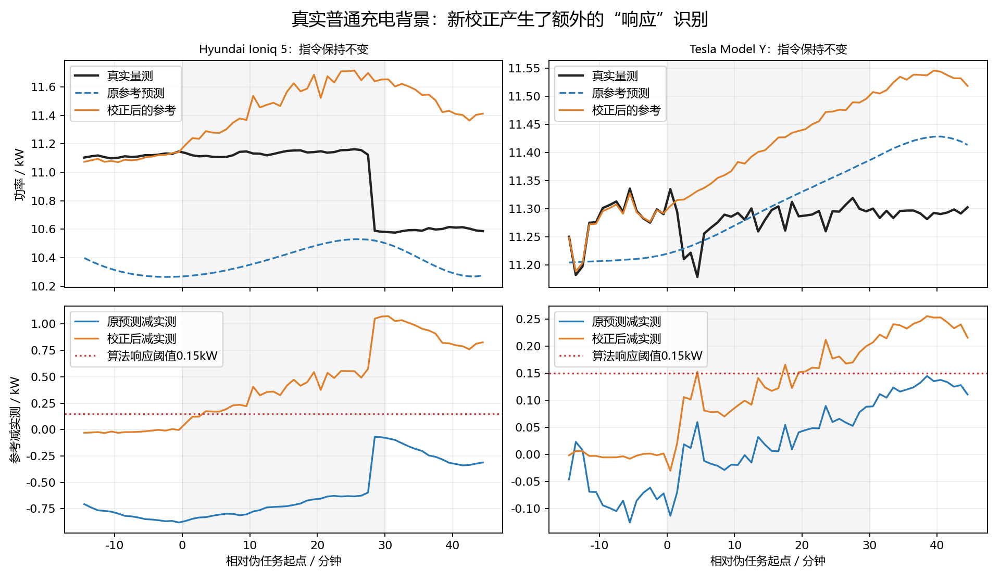

# 真实数据验证：已实际运行，模拟中的30%提升未得到实测支持

**真实数据一直有，本轮已读取原件并运行当前冻结算法。真实背景迁移检验未通过，不应再将模拟中的约30%改善写成实际效果。**

## 数据在哪里

| 来源 | 本地原件 | 本轮用途 |
|---|---|---|
| 多特蒙德实车实验，AC/DC、静态/动态、外部功率分析仪 | `data/public_datasets/德国_多特蒙德_电动汽车充电实验/dataset_merged.zip` | 实际主测试：全部12份普通交流充电文件筛查，选11个完整背景窗口/6份记录/5种EV车型名称 |
| KIT实车充电，18份记录、24,474,687行、电流/电压/功率/电流指令 | `work/ev_charging_research_20261016/downloads/KIT_LF_SOURCE_01/ev-charging_lf.parquet` | 原始数据实际读取、聚合8578分钟并检查时长；恒定有效电流指令≥60分钟的段仅3段，不拼接短段伪造历史 |
| EPFL运营站CCS分钟级数据 | `data/public_datasets/瑞士_EPFL_三级充电站/Measurement_data.xlsx` | 核实真实数据及字段；是DC快充，不直接充当当前单向AC算法的完整验收 |

官方来源：[Dortmund数据](https://zenodo.org/records/14065331)、[KIT数据](https://zenodo.org/records/17866847)、[EPFL作者仓库](https://github.com/DESL-EPFL/Level-3-EV-charging-dataset)。[Dortmund作者论文](https://doi.org/10.1038/s41597-025-05524-5)明确区分恒定功率静态充电与动态给定值试验，以及独立网侧功率分析仪G数据。

## 实际做了什么

固定现有参考预测器、CPOP、LABS、保留时长模型和新参考误差校正模型，不在真实数据上训练或选参数。多特蒙德原始外部PQA总功率取每分钟原样本均值：Wirelane用`P_kocos_210`，EVTEC用`P_kocos_200`，CSV单位均为kW。原文件与全部算法权重保持SHA不变。

每份记录只取最早两个合格窗口，分析窗口彼此不重叠。每窗使用两个此前完整60分钟同车观测段作历史、再以前60分钟作通知前前缀，最后保留完整前15/任务30/后15分钟量测。全部选择先按时间覆盖和缺测规则固定，再运行算法；没有按结果挑车或挑片段。缺点、缺口、时间倒序不填补或修复，受影响窗口按预设规则记录排除。

这些是**真实普通充电轨迹上的伪任务背景检验**：没有为这些分析窗口另发调节任务。未来真实功率可用于检验参考估计；不把它们冒称为有干净反事实标签的真实调节响应。本轮没有生成模拟响应或加噪。

## 结果

| 指标 | 原保留版 | 新参考校正+保留版 |
|---|---:|---:|
| 背景窗口被识别成正响应 | 3/11 | 6/11 |
| 仅看有完整恒定指令记录的子集 | 2/6 | 4/6 |
| 未来实际功率RMSE | 3.0836kW | 3.1156kW |
| 未来实际功率MAE | 1.1135kW | 1.0538kW |
| 单窗RMSE变好 | — | 6/11 |

平均绝对误差略降，但平方误差没有改善，背景正响应输出反而增加，**不支持“30%模拟提升已迁移到实测”的结论**。11窗来自6条记录且历史可能重用，不能当11个独立真实调节任务，也不能直接称真实总体误报率。

同条件对照完整保留：原参考CPOP/保留版/LABS分别有3/3/3个背景正响应窗口；共享新条件参考后CPOP/新版/LABS分别6/6/7个。

新增的3个背景正响应（Hyundai、Tesla、VW）在把校正后参考送入原CPOP时就已出现。Hyundai与Tesla两条有实际日志证明给定电流和充电使能在整个分析窗保持不变。主要新增问题出现在**参考偏差校正层**，不是时长模型先把原CPOP的任务状态翻转。原始功率正常变化、缓慢变化或接近充满后的自然下降，不能只因与估计参考有差，就认作调节响应。

图示是后验选取的前两个新增背景正响应，仅用于解释，未据此改模型或重计主结果。黑线为原始PQA均值，蓝线为通知时刻预测，橙线为新增校正后背景；模型阈值0.15kW。原记录、观测与量纲未修改。

## 能验证和不能验证的部分

已验证：当前冻结链能读取真实AC功率数据并完整运行；真实普通充电背景中的参考估计、背景误识别与跨车型迁移表现。

尚不能据这批普通充电窗口计算真实短响应漏检率或真实响应时长MAE，因为没有发生我们下发的新任务，也没有对应的干净响应真值。现有25份AC动态实验有实际指令变化和双量测，可核对局部动作，但约43分钟的总观测不足当前完整60分钟窗口；没有补点、拉伸时间或混接不同实验来冒充适配。

本轮保留模拟有效版本与所有失败记录，算法参数未改。当前未知参考校正应保持研究状态，不能声称已经通过真实数据验证。

入口：[最终实测判定](real_assessment.json)、[完整逐窗输出](results.json)、[输入来源](input_ledger.json)、[指令核查](command_context_audit.json)、[独立核验](verification.json)、[完成收据](completion_receipt.json)。独立回源重算55个分钟均值，新旧共22个公共事件及66条方法曲线、原始积分与参考元数据一致性核验通过。报告与第二部分未改。
