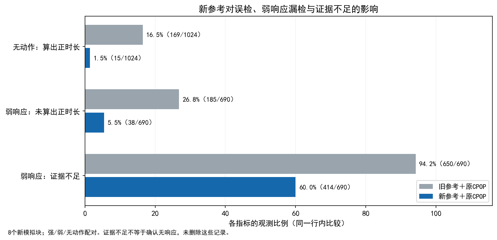

# B1参考误差、整次任务证据与连续作用配置

**2026-10-31用户纠偏后的状态：** 本轮参考处理、任务证据及连续配置实验实际完成，但不等于现有B1已被优化完成。`validation_decision.json` 中把“新参考＋原CPOP”升为后续测量主线，是助手自行作出的路线选择，未经用户确认替换现有B1过程算法；现撤回其作为正式选型的地位。原决策、输出、源代码与冻结收据保留以便追溯。CPOP仍为独立主对照；新参考+CPOP相对旧参考+CPOP的结果用于识别参考模块收益，不作为改进模板优于CPOP的证据。以现有融合B1/修复模板继续研发，或转为基于CPOP的实质改进研究，是需要明确区分的研究路线，不能以本轮选型记录自动替用户决定。下文“统一测量研究路径/采用”仅描述本轮已经发生的实验。

本轮按用户授权顺序实施：先开发参考误差处理与整次任务响应证据，运行新数据的四路公平比较；完成后再验证连续作用配置选择。正式运行源码仍在根 `B1算法/`，过程、协议、模型、日志和核验均在本目录。没有生成正式报告或扩展B2/B3及其他资源。

## 正式新模块

- `reference/reliable.py`：从完整通知前60分钟的四个15分钟均值、历史观测形状，预测本次未调节功率。固定31特征、Ridge10；训练使用明确未发任务的独立非事件记录。原GBDT/prev10模型和选择器保留。
- `response_evidence.py`：在独立非事件用户上校准整次任务扫描分数，每个用户两次任务先取最大值。返回响应证据或证据不足，保留原时长/η，不自动置零，也不筛掉证据不足事件。
- `effects/tuning.py`：在独立正作用验证cohort选择既有连续DR的回归配置与平滑倍数，再冻结应用于新的正/零作用cohort。它是既有方法的配置改进，不是新因果估计器。

范围固定为本轮完整1分钟、30分钟/1.5kW、提前15分钟通知的EV任务；模型/校准都绑定该口径。其他时长/采样仍可使用原有接口，不自动继承本轮新模型和校准。

## 比较与时间隔离

[协议](protocol.json)在训练/评价前冻结，SHA为`d095a56114f34f6d827e708a8f063b4dd758c5b113abc222f73f259e72cf3749`。训练192用户×2次明确非事件，校准96新用户×2次；验证2块×32用户×2事件，测试8新块×64用户×2事件×强/弱/无动作配对。弱响应包含低幅短时3/6分钟和低幅持续响应，幅度0.14q/0.20q，不能用大功率短任务代替。

三个时间阶段按整周平移，原时钟/星期等显式日历不变；训练标签完成早于校准通知，校准标签完成早于验证/测试通知。`non_event`为明确未发任务的观测，不是挑出“未响应”的已发任务；原金额字段仅为配对生成的未宣布信号，不是已实施激励。

四条流程完整保留：旧参考+CPOP、旧参考+修复模板、新参考+CPOP、新参考+修复模板。CPOP同样收到新参考、相同校准样本/统计量/α，原生算法与配置保持；因此不能把CPOP因信息更少导致的差异冒称模板优势。

校准的5%是带条件的秩标定设定。需要校准/测试用户块可交换、相同两事件结构；不代表实际现场误报已经通过5%认证。每个路径同时报告原始正时长误检、校准证据误检、弱响应证据不足/不可用，以及测量时长误差。

## 事前验证取舍

一次小规模验证1536/1536输出正常。其83条真实弱响应中，新参考+CPOP原始正时长漏1条，新参考+修复模板漏28条；新参考后CPOP的强/弱时长误差也较低。依据这些已事先验证的结果，[验证决策](validation_decision.json)将新参考+原CPOP作为后续统一测量研究路径，全部事件一视同仁，不根据未知的强弱真标签路由。

通用兼容默认未改变，主测试仍评价四条路径。改进归因于参考适配和任务证据处理；原生CPOP自身没有被重命名成新算法。短弱响应在验证中仍多为证据不足，此代价必须保留。

## 后续连续作用比较

[连续阶段设计](effects/selection_design.json)固定先完成上述比较，再用一个正作用验证cohort选择一套配置，全部正/零作用测试共用。零作用仍允许用户实际响应，只是金额不改变响应分布；它与本阶段的物理无动作null不同。

默认和选择配置使用完全相同的新参考+CPOP测量Y、合法L/U、用户和任务，不使用响应证据筛样本。先按实测Y的OOF风险选择回归配置，再按同一固定伪结果的整用户留出风险选择平滑倍数；该风险不是每次重训全部辅助模型的嵌套全链风险。模型选择、参考、过程和辅助估计的全部不确定性尚未传播。

方法复用与许可证评估见 [method_reuse.md](method_reuse.md)。

## 新数据上的最终结果

阶段一测试为1024个基础任务、强/弱/无动作共3072配对事实变体，四条过程路径12288个输出全部正常；不能把这些行当作12288次独立实验。八个种子块在模型、校准及验证取舍冻结后生成和评分，没有重训追分。

下表是相同原CPOP、相同物理时长判据下，仅替换参考路径后的比较；不同指标按自己的固定分母列示。

| 指标 | 旧参考＋原CPOP | 新参考＋原CPOP |
|---|---:|---:|
| 无动作却测出正时长 | 169/1024（16.50%） | 15/1024（1.46%） |
| 实际阈上弱响应却测不到正时长 | 185/690（26.81%） | 38/690（5.51%） |
| 强场景累计时长MAE（含该场景未参加者） | 124.98秒 | 18.46秒 |
| 弱场景累计时长MAE（含该场景未参加者） | 374.36秒 | 112.03秒 |
| 无动作场景累计时长MAE | 216.33秒 | 13.71秒 |
| 唯一基础任务参考误差 pooled RMS | 0.17464kW | 0.06217kW |

仅真实阈上正响应子组，强场景时长MAE从79.48降到19.39秒；完整分层在 `study/stratified_metrics.json`，没有仅靠零轨迹拉低平均值。参考pooled RMS先合并唯一1024任务的平方误差再开方；它不同于各事件RMSE均值（旧0.14690、新0.05231kW）。

两条路径都另外接受了同样96用户的独立任务标定。无动作时“有响应证据”的误报为18/1024→11/1024；弱响应的“证据不足”为650/690→414/690，仍有60%。因此不能把原始时长漏检降到5.51%解释成94.49%的弱响应都已经有充分证据。低幅短时，尤其3分钟弱响应，仍是重要限制。

同一新参考下，修复模板弱响应漏151/690，而原CPOP漏38/690；强场景MAE22.68/18.46秒、弱场景137.81/112.03秒，仍未支持强行优先模板。本轮采用验证前已声明的新参考+CPOP作为统一研究测量路径，修复模板保留可选对照。原CPOP自身保持原样，改进归因于参考适配及任务证据处理。

阶段一四并发批耗时之和，新参考+CPOP约84.13秒、旧参考+CPOP88.46秒；新参考+模板1670.40秒、旧参考+模板1451.53秒。完整阶段一主测试墙钟约887秒。原 `assessment.json` 的计时汇总因长/短label匹配错误为0，该字段明确废弃，使用 `study/timing_corrected.json`；原拟合/指标/记录均不改、不重跑。以上不是独占单次延迟。

## 连续作用配置的独立结果

正作用验证512事件、256用户，仅用已测Y风险选出：`ridge_alpha=10, spline_knots=4, bandwidth_scale=2`。选择先冻结，再生成测试；测试每组128用户×2事件，8块正/零配对共4096测量事件。所有事件保留，默认/选择配置共32条曲线全部通过原支持规则，16个冻结模型查询逐项相同。

| 相同新参考＋CPOP测量下的作用曲线RMSE | 原默认配置 | 验证选择配置 | 选择配置更低的块数 |
|---|---:|---:|---:|
| 正作用 | 73.597秒 | 49.381秒 | 5/8 |
| 零作用 | 59.657秒 | 34.858秒 | 8/8 |
| 每块先等权合并两机制MSE再开方 | 68.919秒 | 43.422秒 | 5/8 |

正作用配对差−24.216秒，描述性MC95[−61.290,12.858]含零；合并差−25.496秒[−52.337,1.344]也含零。零作用差−24.799秒[−42.787,−6.810]，八块均较低。结论是**零作用更稳定，正作用及总体尚无稳定增量证据**，不能仅报均值下降就说整个作用模块已胜出。

其他通用对照也有胜出：选择配置下正作用的未调整曲线RMSE41.646秒，低于DR49.381；零作用的结果回归23.163秒，低于DR34.858。合法调整要求仍由研究图和识别条件决定，不因一组RMSE较小删除L/U或改用未调整方法。既有连续DR、其默认配置与全部对照保留，新选择器为可选研究功能；不全局替换兼容默认，也不声称提出新因果估计器。

## 核验与边界

参考60项功能/数学控、任务证据24项根小控及28个独立合同反例闭合/4数学控、连续46项小控及5独立数值核验通过；失败检查脚本、修正与审查原件保留。阶段一164175项只读复核，连续输入55664项核验，连续结果4960项核验完成；这些计数不是性能样本数。

阶段一830项研究/事实/运行来源封存，连续共享输入201项另封存；旧研究、原CPOP与原连续核心、物理模型和B2/B3接口保持。所有模型、校准标签与选参完成时点均早于相应查询通知；没有用通知后前窗修正预测、没有用真值初始化或选参。

本轮结论限定单EV、单机制族、1分钟/30分钟/1.5kW的模拟。低幅短时响应的可靠证据仍不足；新参考不是已识别的单体真实反事实，5%秩设定不构成现场5%误报认证，条件曲线带也不含全链误差。其他资源/任务/真实部署及整个研究点一正式验收均未据此完成。报告、压缩包、启动器、平台和其他算法未展开。

## 正常项目中的产物入口

- 新参考模型：[reliable_reference.json](study/models/reliable_reference.json)。
- 新参考+CPOP任务校准：[evidence_new_cpop.json](study/models/evidence_new_cpop.json)。
- 连续配置：[selection.json](effects/selection.json)；直接使用已完成测试cohort的冻结曲线示例：[首个正作用模型](effects/test/models/7520300_positive.json)。该模型只代表其拟合人群，不是任意新单车的交付预测。
- [连续金额示例图](continuous_curve_first_test_block.png)来自事前指定首块7520300，直接查询保存模型41个金额，无重新训练；0.73/0.85/1.17直接查询也通过。首块恰是选参误差70.28秒大于默认58.36秒的失利样例，未为展示更好看的结果更换样本。

完整读写调用见根 `B1算法/README.md`。这些为模拟研究产物，不直接作为真实现场部署模型。
