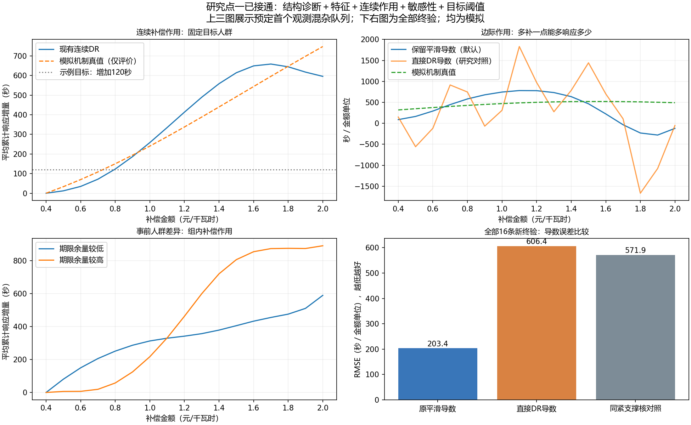

# 研究点一整链第一版：已实现并通过新模拟整链核验

用户授权将全过程特征、因素结构、连续作用、人群差异、敏感性与阈值连成一套可运行算法。本轮完成了实现、实际开发比较、冻结终验、原始物理输入贯通、保存查询和启动演示。

使用入口：[算法说明](../../B1算法/RESEARCH_POINT_ONE.md)、[双击启动](../../B1算法/运行研究点一.cmd)。演示读取已拟合的本轮模拟模型，不重新训练；输出JSON和曲线图。新原始任务可通过research_request_example.json及`run_research_point_one`运行。

## 实际采用与未采用

- 全过程提取仍是原effective_response_refined，代码和权重不改。
- 修复“直接估计时长”接入因素层的缺口：显式`duration_estimates`来源与旧曲线来源分别处理，新时长与发布字段/计量格一致，原始电量定义不变。
- 新增真正PC/KCI和FCI/KCI结构模块，保留等价类端点；学图不自动改变声明的调整集。
- 主均值曲线保留原连续Kennedy DR。连续金额直接查询，全人群包括零响应；下游不是新单车未来容量预测。
- 新直接DR导数正确复现、保存查询和实际比较已经完成，开发未通过预定5%改善门，保留为对照；默认仍原平滑导数。
- 新增目标多交点/未达、有限设计局部三次曲率修正、整用户抽样并真实重拟合辅助模型的经验区间。偏差修正不是完整TW论文复现，重拟合区间覆盖尚未认证。

方法来源与最新论文筛选保留在[前轮研究入口](../b1_factors_nonlinear_research_20261103/README.md)。causal-learn0.1.4.8与三个缺失依赖安装在本轮runtime/site-packages，原Python环境未更新；算法Python模块不导入work业务代码。

## 预定比较与结果

`protocol.json`在开发拟合前写入。开发2新seed×3机制×180用户×2事件=2160事实变体；默认导数选择存`development_selection.json`，源码在首次终验前冻入`source_freeze.json`。终验4新seed×4机制=16队列/5760事实变体；每seed不同机制是配对，不当16次独立重复。另隐藏H→补偿且H→结果独立诊断360事件，不混入主因果排名。

| 全部16新终验 | 结果 |
|---|---:|
| 连续补偿作用曲线RMSE均值 | 64.4422秒，16/16输出 |
| 原平滑导数RMSE均值 | 203.4206秒/金额单位，16/16 |
| 直接DR导数RMSE均值 | 606.4097秒/金额单位，16/16 |
| 同Epanechnikov核局部二次导数控制 | 571.9165秒/金额单位，16/16 |
| 两组作用差异RMSE | 207.7837秒，仅10/16全网格可输出；不拿缺输出压误差 |
| 真目标可达队列的首次交点MAE | 0.08786金额单位，仅12个真可达且估可达队列 |
| 真可达漏报 / 真未达错误报达 | 0/12；1/4 |

图学习两法终验骨架同，TP28/FP7/FN40，微精确率80%、召回率41.18%；负控6/64邻接机会误连。FCI35条预测边中32条有未定端点。它是诊断工具已落地，不是完整机理恢复证明；80%也不是任务书模型精度。

图上三面板是预定首个终验观测混杂队列，下右为全部16队列。新直接方法在小样本更不稳定，按开发选择继续保留原默认。金额曲线没有强制单调，未对终验追调带宽或GPS。

## 原始功率实际贯通

另按协议生成240新物理模拟任务、120用户：先明确事前连续补偿及状态，生成响应与10秒格功率；30分钟/q1.5/已知3kW参照/0.05kW噪声/前后15分钟。全部经实际公共analyze_events和原生CPOP，再经高层fit_research_point_one，没跳过新时长合同，也没按有效响应筛事件。

`physical/score.json`：240全部ok、240行全过程特征，时长MAE8.2083秒；输入提取时长后的连续作用RMSE127.6279秒，原平滑导数仍较直接导数稳定。本队列没有独立真实现场标签，数值只属该物理模拟。

`audit_physical_result.json`独立核240输入digest、432000原数值、86400原生点；从原生分段系数重建曲线最大差2e-11。全部高层Y与第一部分直接时长一致，存取、插点及单金额查询核同。

## 重拟合区间已经跑到什么程度

`refit_plan.json`先固定全部16队列、每队列99整用户抽样。1584次都实际重新拟合结果模型与估计GPS（随机已知分配的密度固定）；同原用户重复副本保持同折，原带宽固定，目标人群经验分布随重抽变化。

6队列99次全成功，10队列有支持失败，全部draw状态与失败保留，不完整队列的带标`band_valid_for_use=false`。有输出的诊断带本批均含真曲线，不能把成功draw条件下的包含情况报成16/16正式覆盖；只有4个独立随机块。详见`refit_summary.json`与各队列refit_uncertainty.json。普通查询不自动重跑这些拟合。

## 独立核验与可复查入口

- `verification.json`：另用23节点积分及解析链式导数重算全部终验真值/48组分数，最大差2.9e-6；阈值按真函数直接求根，没有用画图点插值冒充。
- `audit_interface_result.json`：新旧时长来源、重复发布字段、计量格与累计/最长约束6检查。
- `nonlinear_test_receipt.json`、`audit_nonlinear_result.json`：新实际拟合与现CT辅助结果/密度精确同、解析样条导数、Eq8逐项复算、保存查询、曲率修正与多交点。
- `audit_research_result.json`：新标量研究链真实调用两结构算法、两组作用、导数、阈值及存取。
- `audit_refit_result.json`：另一新队列99次真实重拟合与独立首draw公共API核同。隔离注入失败测试单列audit_refit_failure_result.json，不当作经验失败率。
- `structure_evaluation.json`：只读已有开发/终验结构，不新增拟合，保留假边和未定端点。

旧58正式清单中只改公共导出、时长桥接、依赖及README；原第一部分源码/权重、连续DR核心、旧标签/数据和旧终验产物未改。旧真实主test和外站未重开。正式新增模块为research.py、structure.py、effects/nonlinear.py、effects/refit.py；不是把work试验代码导入生产。

## 接续重点

这一版可以直接使用和继续研究。真实补偿与独立结果参照、多资源提取适配、可靠人群异质性及机制恢复仍需对应数据；现终验已消耗，不继续围绕它补规则或追加抽样追通过。下一项优先恢复并核已验证iFlex归档的真实价格路径，再按具体设计做独立验证。当前不宣称课题一全部任务或正式90%验收已完成。
