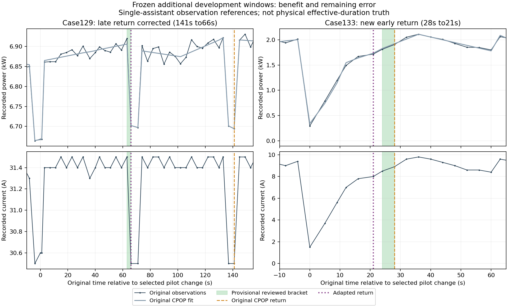

# 已有改进方法的真实观测适配分支

本轮保留已有改进版 `effective_response_refined`，在其“结构提取、原始量测补检、证据核验、特征校正”的处理思路上，训练了一个真实观测适配分支。原版 CPOP 和 LABS 继续作为同条件对照。此次初步收益在**恢复点定位**，没有把前期成果退回原版 CPOP，也没有替换现用正式方法。

新选的32个真实片段中，有8个暂定恢复参照：恢复定位平均误差原版 CPOP 为31.875秒，适配分支为22.875秒，减少28.24%；LABS 为93.125秒。两者均有1个恢复点未找到，统一按180秒计入平均，未筛掉失败样本。适配分支还把一个原本正确的恢复点判早了。因此保留这个研究分支，但目前还不能说真实场景下的全过程特征提取已经完成。

## 改了什么，哪些旧成果保留

正式方法及其58个受保护源码、模型、默认入口文件逐一核对未变。旧的补检、时长修正和有效资格模型全部保留。正式入口仍是 `process_method="effective_response_refined"`。

旧模型针对已知参照的30分钟、q=1.5kW、指定噪声尺度和10秒/1分钟网格。当前 ACN 真实片段约4分钟、采样不齐，也缺少该任务参照。直接绕过适用范围校验、伪造q或把4分钟拉伸成30分钟，都不能算真实迁移。因此这次复用处理结构和可用的数值特征，重新训练少量真实观测参数；没有把旧模拟权重宣称为已完成迁移。

| 环节 | 此次实际实现 | 与已有改进版的关系 |
|---|---|---|
| 结构曲线 | 原版 CPOP 曲线，与对照完全相同 | 保留原结构提取基础 |
| 原始局部证据 | 精确调用旧 `_duration_fusion._model_features` 数值块，构造原50列局部表示，再汇总8个固定特征 | 复用已有特征数值及并行补检思路 |
| 新增候选核验 | 用62个已确定训练标签，训练标准正则逻辑回归；只核验原版未报正、原始电流和功率有同向变化的候选 | 保留旧正结果，不因动作短而拒绝；阻止上次未经核验补检增加的误报 |
| 恢复点校正 | 两个特征：当前功率、电流距之前观测状态的距离，各除以该通道此前已经出现的变化幅度；在两路都开始回撤之后，判断是否已恢复 | 沿用学习型特征校正结构，新增真实恢复状态监督 |
| 物理有效资格、累计/最长有效时长 | 本分支明确为 `null` | 旧正式模型保留；当前数据没有相应可靠参照，不把观测跨度改名充当它们 |

恢复层使用此前已出现的变化幅度，避免把慢爬坡初期的小变化误当成“相对未来大峰值已经接近恢复”。它没有最短持续时间规则、不删孤立点，也不改原始量测或电量。功率和电流来自同一记录，并非两台独立仪表，不能据此保证排除故障。

恢复模型实际使用235个原始观测位置、30个训练用户，其中21个可达恢复端点为正例。训练集共有22个恢复参照，另一个前级没有检出，仍作为失败保留在全轨迹评分中。只有两个模型输入，采用标准 `StandardScaler + LogisticRegression(C=1)`；不是新的分段求解器或新发明的分类方法。训练用户分组四折选择阈值0.7，分数不是经过校准的概率或误报率保证。

原始补检资格模型也做了用户分组四折训练，但恢复层的分组评分以固定的前级为条件，**不能把整条链称为完全独立的端到端交叉验证**。

## 数据与结果分开看

训练只用原先96个训练片段。原先32个验证片段已经在前次失败试验中看过，属于开发资料；本次先冻结源码和权重再复跑。随后预先按电流上限、时间、哈希选择另外32个不重叠片段，先看原始轨迹作暂定标注、冻结标签，再运行模型。没有按结果改标签或调整模型。

新增32片段仍来自同一批22个验证用户，**新增用户为0**。它们是新窗口上的开发确认，不能当作全新用户的最终测试。最终测试集与外站测试集的观测值仍未读取，仅核对原始文件字节哈希。

| 分开计分的验证资料 | 方法 | 可判定变化标签：错报/漏报 | 恢复参照数 | 恢复缺失 | 恢复点区间外MAE，含失败罚值 |
|---|---|---:|---:|---:|---:|
| 原有32片段，18个可判定标签 | 原版 CPOP | 0 / 0 | 7 | 0 | 6.286秒 |
| 同上 | LABS | 0 / 3 | 7 | 5 | 137.714秒 |
| 同上 | 适配分支 | 0 / 0 | 7 | 0 | 0秒 |
| 新增32片段，22个可判定标签 | 原版 CPOP | 0 / 0 | 8 | 1 | 31.875秒 |
| 同上 | LABS | 0 / 2 | 8 | 4 | 93.125秒 |
| 同上 | 适配分支 | 0 / 0 | 8 | 1 | 22.875秒 |

恢复参照是相邻原始观测之间的暂定范围，模型输出始终为一个实际采样时刻，没有输出宽区间来抵消误差。额外按范围右端首个已恢复观测计绝对误差，新32片段为31.875→23.375秒，仍减少26.67%。未找到恢复点统一罚180秒、存在但偏差过大也封顶180秒，这一口径与旧试验相同，故这些值不是无限制物理时间误差。

两批各有4个观测到的短变化恢复片段，原版和适配分支均未漏掉；这不是0.15kW物理有效短响应真值。新增5个明确未恢复/被后续指令打断的正变化片段，未新增恢复误报。变化起点本次基本保持原版，不能说起点问题也已解决。

所有标注都是助手基于原始曲线所作的暂定观测判断，独立人工复核仍待完成；未知、无上限变化等未判定样本保留，不作负例。不能把小样本标签一致率写成现场100%准确率，也不能把此处几十秒的恢复定位指标和之前模拟的累计/最长有效时长直接比较。

## 收益来自哪里，还有什么退步

新窗口 case129 的恢复参照为63—66秒，原版判到141秒，新版判到66秒，纠正了75秒延后。case133 的参照为24—28秒，原版28秒正确，新版21秒，提前到参照之外3秒。case147 两者都没找到恢复点，180秒罚值照计。新增集的净收益主要来自前一个修正，样本较少，尚不能宣称各形状普遍提升。

去掉恢复校正，新增集恢复误差回到31.875秒；去掉新增候选的资格核验，原有验证集又出现上次 case73 的额外误报。这个组件检查未重训、未重新选阈值。新增集本身没有产生补检收益，不能把恢复定位改善归功于补检召回提升。

仅按上限返回时刻估计恢复，新增集时间误差略低于适配分支，但会把9个没有明确跟随变化的上限调整都报成响应，不能把指令返回当作实际响应恢复。该诊断对照保留在原始结果中。



## 复现入口与核验

在项目根目录使用已有环境，无需安装：

```powershell
& "work/ride_b1_v02_reproduction_20261029/.venv/Scripts/python.exe" -B "work/b1_retained_real_adapter_20261102/replay.py" --case 129
& "work/ride_b1_v02_reproduction_20261029/.venv/Scripts/python.exe" -B "work/b1_retained_real_adapter_20261102/verify.py"
```

`replay.py` 只读取已冻结的开发输入和原版曲线，不训练、不重新选样，不读取最终测试。可用 `--case 133` 复核判早案例，`--case 147` 复核未恢复案例。恢复适配接口为 `state_v2/adapter.py:infer`，两个冻结模型分别为根目录 `model.json` 和 `state_v2/model.json`，尚未注册进正式API。

`verification.json` 核过177个旧试验/数据制品、58个正式文件和1878个原始源文件哈希；160个输入去标签推理一致、保留原版正结果，37条实际轨迹的50列数值与旧特征块逐项完全一致；新增原始数值、原始行号、相邻标注、用户隔离及各方法计分独立复算通过。`timing_audit.json` 保留逐条时点误差，`component_checks.json` 保留去掉模块的检查，`completion_receipt.json` 记录最终留存状态。

第一轮训练尝试的经验范围修正，在仅训练集选型中最优混合系数为0，没有收益；原候选和全部结果留存。之后才在训练集试两特征恢复模型，在本分支首次验证前冻结。原有3点片段会触发旧特征块分位数空数组，已在产生选型结果前将该补检特征标为不可用，保留原版估计；原始重复时点片段仍不可用，没有去重、补点或改值。详见 `execution_repair.json`。

后续应继续补不同用户和慢恢复、回撤不完全的观测，先固定复核规则再评价冻结模型。本轮这32个窗口已看过，不能反复据此追分；也不能用扩大标签范围或清掉失败案例制造提升。当前分支留作后续真实数据研发，原有正式有益版继续保留。

## 方法来源

复用 [scikit-learn](https://github.com/scikit-learn/scikit-learn) 的标准逻辑回归和分组切分，使用项目现有1.7.2环境，BSD-3-Clause许可。模型选择少、改造成本低，适合当前小规模监督；没有把现成分类器当作自创算法。

原始 CPOP 使用既有本机 CRAN 1.0.10；[LABS](https://github.com/pfryz/LABS) 使用已冻结MIT源代码及原固定配置。两种原方法都对同一功率观测序列建模，再把位置映回真实时间。为保持与原LABS的一致输入，本试验使用观测序号，不声称已利用CPOP的不等距物理时间建模能力；未专门为任一对照追调参数。

此前查阅的 [Huang等，2024，TIM作者接受稿](https://uhra.herts.ac.uk/id/eprint/11165/1/TIM-24-01008_Manuscript_Final.pdf) 提供局部统计、自适应阈值和证据融合的研究背景；本轮没有复现该论文，也没有借用其性能或风险保证。实际收益以以上冻结数据结果为依据。
