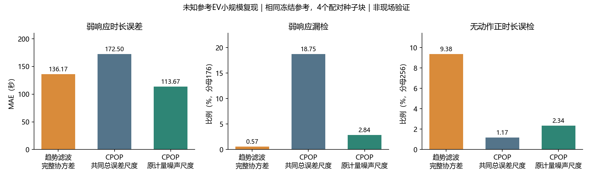

# 未知参考EV：第一部分小规模复现结果

2026-10-31。已实际完成提升树、GP、趋势滤波复现及新数据同条件比较。本件是实验入口，非正式报告。**本轮不正式采用趋势滤波，也不自动用CPOP替换研发主线。**

## 1. 对照只按两大板块组织

按用户最新纠偏，正式比较以“全过程特征提取／因素响应分析”两板块组织。提升树与GP只是第一部分内部选型，不每个辅助模块另建正式baseline。本轮仅研究第一部分，CPOP是其通用对照；第二部分代码/配置/冻结结果保持。

任务已知，未调节参考功率未知。通知前资料预测参考，事后实际记录用于过程提取。固定单EV交流计量、完整1分钟、30分钟/1.5kW、提前15分钟通知、前后观察各15分钟；不把通知后功率或回补回填参考。

## 2. 实际复现与适配

| 内容 | 实做 | 归属 |
|---|---|---|
| 参考预测 | LightGBM叶数7/15与GP固定核尺度.7/1.5，共同11特征、同样8个原始训练horizon、通知前60分钟均值offset，全部60格直接预测 | 成熟方法内部复现，非新预测算法 |
| 冻结模型 | 原生tree文本/GP数组JSON，训练用户/任务/标签时点、特征、SHA可追溯，保存加载精确复放 | 工程与时点可靠性 |
| 趋势滤波 | 原生格均值H=I的L1趋势滤波，现有SciPy有界最小二乘解凸对偶，记录原/对偶目标、间隙、KKT与失败 | 成熟方法复现，无新通用求解器/格内超分辨率 |
| 误差进入拟合 | 独立非事件残差估LedoitWolf完整协方差，实际进入GLS损失；另保留标准标量TF用于内部归因 | 成熟广义lasso/GLS的EV适配，不是原创算法，且不自动去均值偏差 |
| 共同特征/证据 | 同阈值计算时长、幅度、电量、恢复/反弹；独立非事件用户最大扫描分数作任务证据，不置零/筛样本 | 共用测量协议，接通不代表增量已证实 |

GP本轮只复现均值预测，没有验证后验路径或特征置信区间。正常充满停机、实际离站/缺测、15分钟细致物理阶段和现场均未验证。

## 3. 数据、选择和冻结

[协议](protocol.json)先固定。复用未改的独立细格生成机制，用新种子/新用户生成新版本事实，原数据不改。该正常功率机制平滑且持续充电，不含真实会话结束。

| 用途 | 用户/记录 | 用途边界 |
|---|---|---|
| 参考训练 | 64用户×2=128非事件 | 每记录同8horizon，共1024训练行 |
| 参考验证 | 新32用户×2=64非事件 | 按实测功率MSE选择，不在验证重训 |
| 过程开发 | 新32用户×2=64非事件 | 估误差模型、选TF平滑强度 |
| 独立校准 | 新48用户×2=96非事件 | 每用户两事件最大scan的上尾rank |
| 响应验证 | 新16用户×2×强/弱/null=96变体 | 冻结后只评价、不再改参 |
| 新测试 | 4块×新32用户×2×强/弱/null=768变体 | 256基础任务/128用户；主2304输出，CP设置核对另768输出 |

阶段用户隔离、按整周平移保持日历，训练标签完成<参考验证<开发<校准<响应验证<测试。non_event明确未发任务，不从未响应者筛取。真值只由生成器和评价器读取。

参考内部RMSE：树leaf7/15为.075224/.076189kW，GP尺度.7/1.5为.094715/.088526kW；选leaf7，给所有过程共享。实测验证目标含计量噪声，不是潜在参考RMSE。这只有两个固定GP核及小训练预算，不能证明树普胜；两树差也很小。

TF开发固定网格.5/1/2/4/8/16/32/64，选最小使每用户两任务任一正时长误检≤.05的配置。32用户最多允许1人；标准TF选λ4、GLS选λ2。开发通过不保证新测试原始误检≤5%。协方差中心化不修预测偏差；完整残差已含计量噪声，不重复加噪声。

主协议共同总误差尺度σ=.0814723kW，来自开发残差RMS，含参考误差，不是meter真值。CP固定beta=2log60，TF有上述选参规则，原始时长率只能解释为这些配置的比较，不称同raw-FPR功效优越。独立任务证据另用同α校准。

看到响应验证后发现CP的σ敏感，因此在test生成前另封[补充协议](supplement_protocol.json)/[freeze](supplement_freeze.json)：原生CP、σ=.05、beta/结点/求解不变，同参考、同校准样本另做标定。明确validation已见；主协议、原freeze、原结果不改。两CP设置全报，不按test选弱者。这仍是同一个板块同一个算法的设置核对。

## 4. 特征提取结果与取舍

MAE按各场景全部256条记录计，含未响应者；弱漏按同一176条真实格阈上响应计。无动作误检仅用null256基础任务，不把强/弱中重复无动作轨迹另加独立样本。

| 指标 | GLS趋势滤波λ2 | CP共同总误差尺度 | CP原计量σ=.05 |
|---|---:|---:|---:|
| 强场景时长MAE | 30.70秒 | 17.58秒 | 14.30秒 |
| 弱场景时长MAE | 136.17秒 | 172.50秒 | 113.67秒 |
| null时长MAE | 36.80秒 | 7.03秒 | 11.48秒 |
| 弱响应漏成零时长 | 1/176（.57%） | 33/176（18.75%） | 5/176（2.84%） |
| 无动作正时长误检 | 24/256（9.38%） | 3/256（1.17%） | 6/256（2.34%） |
| 三场景等权MAE | 67.89秒 | 65.70秒 | 46.48秒 |
| 768事件批耗时之和 | 4.99秒 | 20.98秒 | 19.67秒 |

**GLS少漏弱响应，但误检更多；对原计量σ的CP，三场景时长MAE均更大，各自4块均为同一劣势方向。当前不支持正式采用GLS。** 不能只报相对共同总尺度CP的弱MAE改善36.33秒，省掉原设置CP113.67秒这一反证。仅4块、限定模拟，不代表普遍胜负。

批耗时含Python处理/原生R启动与输出保存，非独占核心单事件延迟、不含共用参考预测；不将工程耗时比当普遍复杂度结论。全部3072个主/补充测试输出ok，无回退/隐删。

原始η跨过程逐项相同，同参考下仍按原始电表积分，不把时长收益计为η收益或第二部分收益。完整幅度/曲线/最长时长/恢复等指标见[test_assessment.json](test_assessment.json)、[逐任务CSV](test_metrics.csv)及[补充测试](sensitivity_test_assessment.json)。

null任务“有证据”误报为12/256、12/256、14/256；弱176条证据不足66、77、69。少漏时长不等于有充分证据。按实际校准单位合并每用户两次任务，null测试用户块有证据误报分别为12/128（9.38%）、11/128（8.59%）、13/128（10.16%），均高于名义5%。这次小试没有实证达到该用户块误报目标，不能仅挑事件率接近5%来称校准可靠。校准48用户最大值，最小p1/49、α.05实际到2/49；需用户块可交换等条件，有限校准集与随机阈值也带来不确定性，不据此声称现场认证或秩公式数学失效。事件率/用户块率均保留在[pilot_summary.json](pilot_summary.json)。

内部标准TF λ4的强/弱/null MAE24.14/127.27/22.97秒，弱漏8/176、null误检14/256；GLS没有稳定改善点特征。两者同时改变Σ形状/尺度和λ，不能将差异全归于相关协方差。

## 5. 实际改进归属与下一步

本轮新增了可复现实现、合法内部选参/冻结、参考误差真正进入过程损失、共用特征及独立任务证据链。**实现了适配，不等于证明性能改进，也不等于提出新算法。** 标准TF和GLS都按成熟方法保留；数值最优不等于恢复了真实响应。

小试完成后停止在本test上调λ/Σ/σ/GP配置。不正式采用GLS，不把CP升为我们的新算法。若后续继续，先决定一项“保住短弱响应同时控制误检/参考持续偏差”的机制，而不是先扩网络或只降低门限；本轮还不足以确定具体新机制。自然停机/离站、缺观测、粗计量仍缺证据。第二部分保持，正式报告后置。

## 6. 使用、复核与记录

本轮研究代码仍work，未准入或修改根B1运行库/默认/API。`reference_models.py`提供fit/predict/save/load；`trend_filter.py`提供`fit_curve(y,covariance,penalty)`及数值证书；`run.py`分阶段执行。沿用既有venv，无新库/安装/GPU。已执行prepare→reference→process→calibrate/freeze→validation/evaluate→test/evaluate及固定CP核对。输出排他新建，拒绝覆盖；后续另开版本，不原地重跑冻结数据。

- [主freeze](freeze.json)、[参考内部选择](reference_selection.json)、[过程选择](process_selection.json)、[任务校准](event_calibration.json)。
- [TF数学说明](trend_filter_method.md)、[参考44微控](reference_controls/receipt.json)、[TF31微控](trend_filter_controls.json)。
- [独立全链审计](independent_audit.json)/[说明](independent_audit_notes.md)、[参考核验](reference_result_review.md)、[过程核验](technical_review/technical_result_review.md)。
- [完成收据](completion_receipt.json)记录运行范围、来源保护与限制。

新事实位于`data/B1_unknown_reference_pilot_v1_20261031`，评价真值与过程留本work。原运行代码/旧数据/冻结科学记录/报告/B2B3B4保持；项目AGENTS仅追加接续说明。无删除/打包/启动器/UI/外发/提交。
