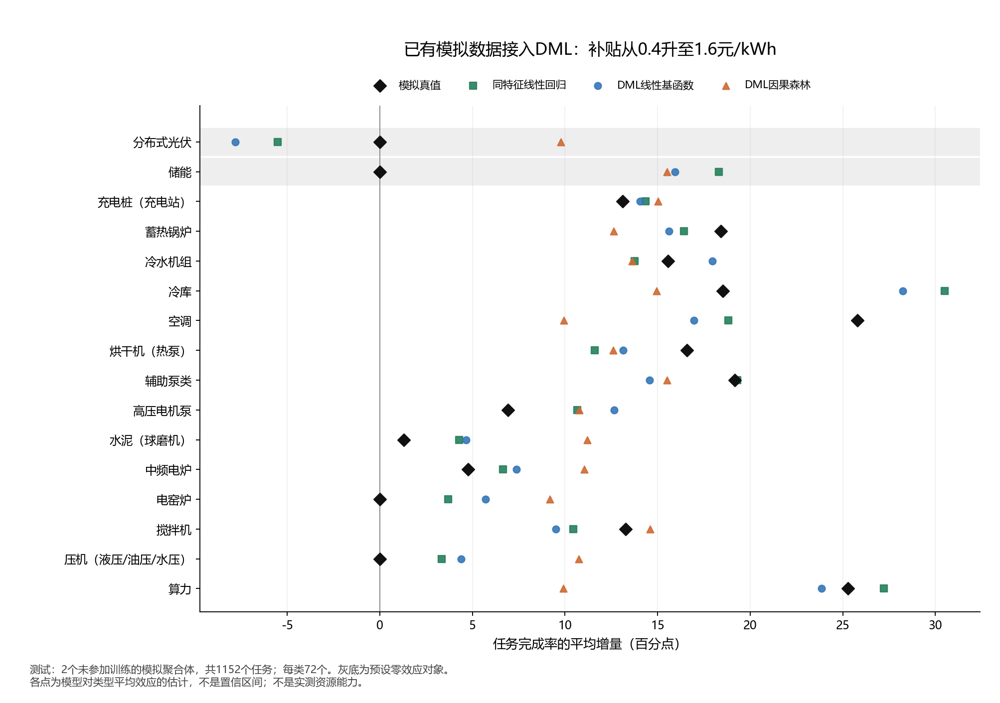

# 已有模拟数据接入同事DML的实际结果

日期：2026-10-17。对应用户要求：“用我们已有的模拟数据尝试，能不能带入这个程序”。现用入口：[程序及用法](../vpp_dml_project_trial_20261017/README.md)、[拟合前协议](../vpp_dml_project_trial_20261017/protocol.json)、[独立核验](../vpp_dml_project_trial_20261017/verification.json)。

## 结论

**能接入，已经实际跑通并复跑。** 接入的是本项目解耦模拟数据内部2.4，使用同事程序的交叉拟合、LightGBM、线性基函数和因果森林核心，未调用同事simulate生成数据。

**这次固定配置没有形成稳定的效果优势。** 高补贴档总体均值接近模拟真值，但资源类型差异和预设零效应恢复不足；同特征简单回归在高补贴档的类型平均误差更小。不能因总体均值接近就认为解耦已经成功，也不能据此否定DML方法本身。此次只证明可以接入并量化了当前配置的局限。

## 1. 接入什么，做了哪些适配

数据入口为 `data/驱动因素解耦模拟数据集_v2/`，目录名v2、内部版本2.4。它有两种分开的场景：主实验3456个独立任务，以及四天continuous连续运行。此次采用主实验，因为它有四档补贴和固定同状态的干预真值。四天连续数据不满足同事原模型七天预热与历史窗口；独立任务也不能按日期拼成连续状态，因此均不伪造小时历史。

| 项目 | 本次实际处理 |
| --- | --- |
| 事前输入 | 01_predecision_inputs.csv，类型及8项事前数值/授权字段 |
| 观察结果 | 02_observed_responses.csv，仅取completion_ratio作训练结果 |
| 激励 | 原0.4、0.8、1.2、1.6元/kWh；以0.4为参照，另外三档做虚拟变量 |
| 输出 | 提高补贴对本次任务完成率的即时增量，单位为百分点 |
| 模拟真值 | 03_counterfactual_truth_evaluation_only.csv，仅在预测保存后加载评价 |
| 原程序复用 | nuisance.crossfit、default_learner、make_final、SeriesRLearner、ForestRLearner；适配类继承VPPResponseDML |
| 协议适配 | 替换小时面板特征、周折和时间分组；使用原聚合体划分，训练内部3折；诊断不通过时阻断最终拟合 |
| 未补造 | 绿色/调频激励、问卷、参考价、未来价格、连续历史、拒绝或容量标签 |

8项数值/二值字段为额定功率、任务难度、任务时长、事前状态指数、既往接受次数、气温、生产系数、事前授权；另加训练侧固定的16类类型编码，共23个模型协变量。没有用潜在保留价格、真值接受概率、来源ID、接受/开放/执行结果作输入。

拒绝、未授权和零交付均保留，全部3456条进入原分区。输出是沿各类**请求方向**统一的完成比例，不是全部资源同一符号的网侧MW变化，也不等同于参与意愿或最大可调容量。

## 2. 怎么隔离训练和评价

| 分区 | 任务 | 实体 | 聚合体 |
| --- | ---: | ---: | --- |
| 训练 | 1728 | 48 | 01—03 |
| 验证 | 576 | 16 | 04 |
| 测试 | 1152 | 32 | 05—06 |

每个实体36任务，四价各9条。三个训练聚合体做3折，每折保留完整实体，测试及验证结果不进入预处理、第一阶段或最终模型拟合。验证仅报告，不调参或选型；两个预设DML模型和三个参照全部保留。

参照为零效应、训练观测各价均值差、同特征及处理交互的OLS。DML第一阶段LightGBM300树，因果森林200树/每叶40/抽样0.3，线性基函数沿用ridge1e-4，种子2026。无剪裁、非负/单调约束、预设零效应类型硬置0或测试后调整。

使用的是任务级处理对比，未调用原baseline(df_test)，没有套用原7天参考价或周聚类区间。仅3个训练/2个测试聚合体，不报告稳健显著性或置信区间。原主体随机全因子为无放回排列，0.25是边际分配概率；没有将其强称给定完整历史后的精确概率，m(X)仍由训练数据学习。

## 3. 实际结果

高补贴对比：**0.4→1.6元/kWh**。测试模拟真值的总体平均完成率增加 **11.1702个百分点**。

| 方法 | 估计总体增量（百分点） | 总体偏差（百分点） | 16类平均效应的平均绝对偏差（百分点，越小越好） |
| --- | ---: | ---: | ---: |
| 零效应参照 | 0.0000 | −11.1702 | 11.1702 |
| 训练总体常数差 | 12.4248 | +1.2546 | 7.9910 |
| 同特征线性回归 | 12.7413 | +1.5711 | **4.5823** |
| DML线性基函数 | 12.3038 | +1.1336 | 5.2123 |
| DML因果森林 | 12.3131 | +1.1429 | 7.4083 |

这说明总体均值接近不能证明类型差异恢复准确。因果森林的高补贴平均效应接近真值，但把不同类型压到相近的效应附近；空调真值25.79个百分点、估计9.95；算力真值25.27、估计9.90。完整数值见metrics_by_group.csv，不以几项成功案例替代全部类型。

另外两档也保留，类型平均效应绝对偏差如下：

| 补贴对比 | 总体常数差 | 同特征OLS | DML线性基函数 | DML因果森林 |
| --- | ---: | ---: | ---: | ---: |
| 0.4→0.8 | 2.1680 | 3.7284 | 3.5407 | **2.0342** |
| 0.4→1.2 | 5.1224 | **3.5824** | 3.6483 | 4.9945 |
| 0.4→1.6 | 7.9910 | **4.5823** | 5.2123 | 7.4083 |

因果森林在最低对比上相对这些参照较好，但优势不覆盖三档，不能认定它在本数据上稳定更好。未据此选模型部署或改超参数。

### 零效应对象

该模拟器预先设定光伏与储能不随补贴改变响应，是用于检查假效应的负控；这不代表现实光伏、储能永远没有价格响应。

| 高补贴档，单位：百分点 | 模拟真值 | 同特征OLS | DML线性基函数 | DML因果森林 |
| --- | ---: | ---: | ---: | ---: |
| 分布式光伏 | 0 | −5.5232 | −7.7901 | +9.7682 |
| 储能 | 0 | +18.3002 | +15.9418 | +15.5005 |

两类测试共144任务，高补贴档DML线性基函数有81.94%、因果森林100%的估计绝对值超过预定5个百分点阈值。它是描述性“假非零比例”，不是显著性检验。简单回归也存在明显假效应，因此不能把它推荐为已通过的因果模型。零效应参照在负控上天然为0，但无法估其他类型的正效应；各参照的局限同时保留。

黑色菱形为模拟真值，其余为固定模型的估计；灰底两类是真值为0的负控。图中可见不同模型在类型之间的偏差，所有16类均保留。PNG已目检，SVG同图导出未另渲染。

## 4. 结果的范围

- 原潜在结果固定了每个任务不可见的参与随机阈值和个体保留成本；DML估的是公开协变量下的条件平均效应，逐任务真值误差还含未观测异质性。因此主报总体/类型均值偏差，逐任务MAE/RMSE另列在summary，不要求逐任务精确恢复。
- 第一阶段筛查通过：激励模型R²约−0.072/−0.065/−0.055，残差相关条件数4.021。该筛查仅表明没有触发预设弱变化/共线门槛，不能证明整个识别假设成立或最终模型准确。
- 原模拟中价格影响参与与开放，最终完成率还受非线性物理限制、未观测个体差异和独立场景变化影响。当前共同特征与固定模型不能充分恢复所有类型；本轮未通过追加潜在成本、真实接受概率、真值类型标记或改测试样本来补成绩。
- 训练只有每类3实体，测试每类2实体，外推与统计稳定性仍有限。验证1条、测试36条超出训练特征逐列范围，未删除、裁剪或另设路由。
- 本次保留原2.4的机制与假设，不重新生成模拟数据，不把2019等历史实验或同事原86,360行模拟结果作为本次数据；不是实测能力/真实价格弹性/心理识别或正式90%验收。

## 5. 复现核验

RUN01与RUN02完整成功。RUN01约3.99秒，RUN02耗时见其receipt；CPU运行，无GPU/远程连接/数据上传。独立环境沿用上一轮，全部来源、协议及同事10个Python文件绑定SHA256，运行前后原件保持。

两次25920条留出预测容差内一致，最大差1.02e-15；615组指标最大复跑差9.95e-14，不写成逐字节完全相同。独立用原表CSV与标准库求和重算3690个指标数值，最大差7.11e-14；3456条观察结果与对应潜在真值一致；另用SVD重建线性DML的5184条留出估计，最大差1.23e-15。完整折表检查聚合体隔离通过。

以上是计算核验，不是新增独立物理实验或现实因果识别。RUN01/02以及五模型、三价全部结果本地保留。

## 6. 对项目的实际用途

可以保留这套DML核心作为任务一的候选实验工具，现有模拟数据已可接入，不需要先造齐同事的全部字段。接入的关键是使研究对象、输出、划分与真值对应。

当前不应把此配置直接写成优于透明基线、零作用检验通过或现用因素解耦成果。若后续继续改进，应先检查任务完成率与价格分配、事前物理状态及个体差异的对应，用训练/验证侧确定新方案；原测试已用于本次评价，不能反复调到它好看后再称独立检验。

本轮用户要求的模拟数据接入已完成。原三路线、六类实测成果及教师材料不替换，不开展组合能力、市场适配、自监督或多智能体；P1/103状态保持。
